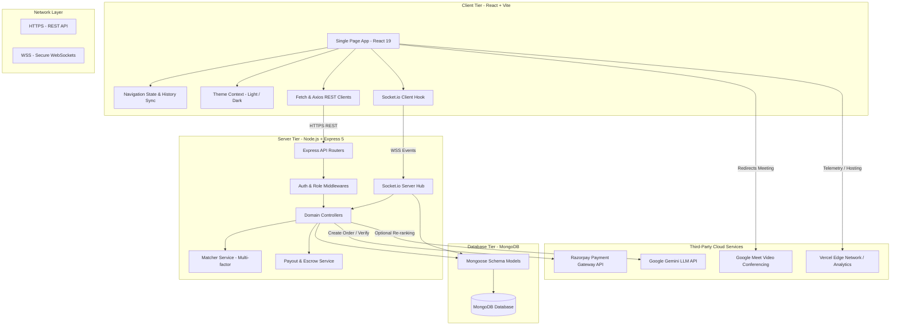
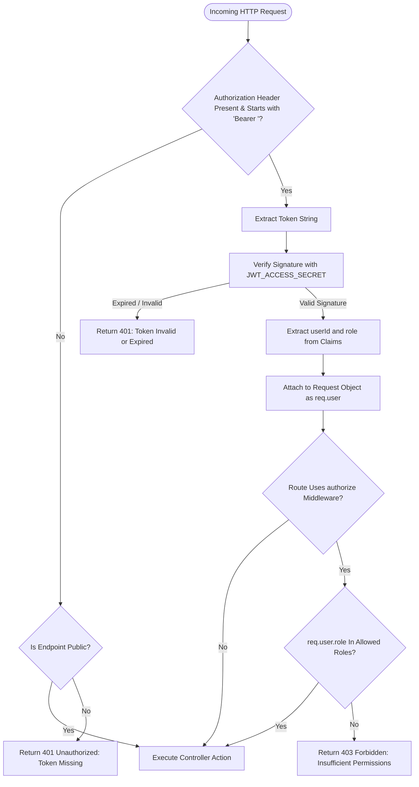
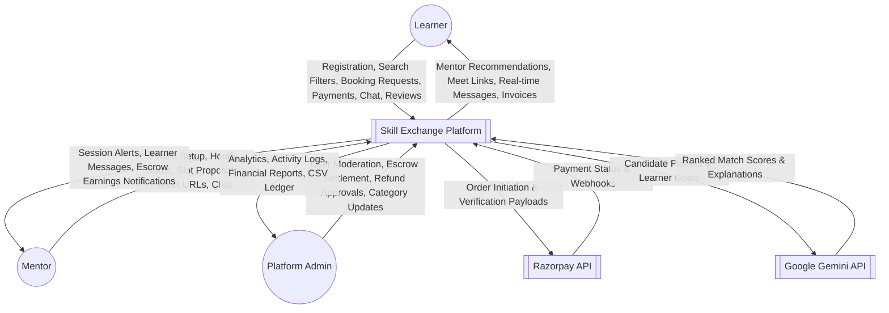
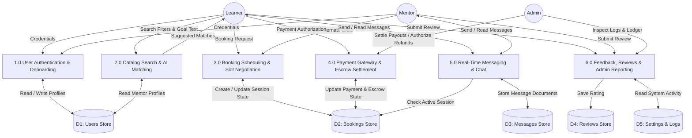
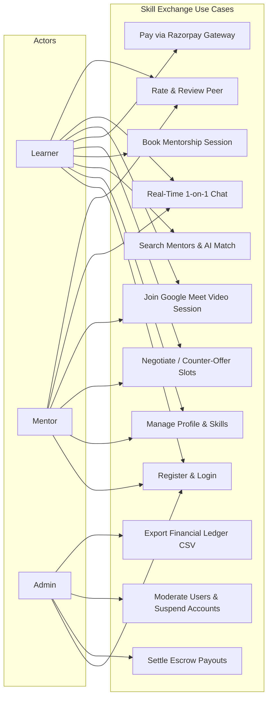

# SKILL EXCHANGE — COMPREHENSIVE PROJECT DOCUMENTATION
**A Peer-to-Peer Mentor-Learner Skill Swapping and Knowledge Exchange Platform**

---

### Project Submission Details
- **Project Title**: Skill Exchange Platform
- **Academic Program**: Bachelor of Technology (B.Tech) in Computer Science & Engineering
- **Institution**: GLA University, Mathura, Uttar Pradesh, India
- **Academic Session**: 2025 – 2026
- **Project Team Lead**: [ADD HERE: Student Name & Roll Number]
- **Team Members**: [ADD HERE: Team Member Names & Roll Numbers]
- **Project Supervisor / Guide**: [ADD HERE: Faculty Mentor Name & Designation]
- **Department**: Department of Computer Engineering & Applications
- **Repository URL**: https://github.com/[ADD HERE: Repository Path]
- **Live Deployment (Frontend)**: https://skill-exchange-one-eta.vercel.app/
- **Live Deployment (Backend API)**: https://skill-exchange-o19g.onrender.com/

---

## Table of Contents
1. [Abstract](#1-abstract)
2. [Introduction](#2-introduction)
3. [Existing System vs. Proposed System](#3-existing-system-vs-proposed-system)
4. [Methodology](#4-methodology)
5. [Features List (Module-Wise)](#5-features-list-module-wise)
6. [System Requirements](#6-system-requirements)
7. [Technology Stack & Selection Justification](#7-technology-stack--selection-justification)
8. [System Architecture](#8-system-architecture)
9. [Detailed Module Descriptions](#9-detailed-module-descriptions)
10. [Complete Page Directory](#10-complete-page-directory)
11. [Database Schema & Data Dictionary](#11-database-schema--data-dictionary)
12. [Complete API Documentation](#12-complete-api-documentation)
13. [Authentication and Authorization Flow](#13-authentication-and-authorization-flow)
14. [System Diagrams (DFD & Use Case)](#14-system-diagrams-dfd--use-case)
15. [Sequence Diagrams for Core Workflows](#15-sequence-diagrams-for-core-workflows)
16. [Project Folder Structure](#16-project-folder-structure)
17. [Setup and Installation Guide](#17-setup-and-installation-guide)
18. [Deployment Guide](#18-deployment-guide)
19. [Testing & Quality Assurance](#19-testing--quality-assurance)
20. [Results and Output](#20-results-and-output)
21. [Limitations](#21-limitations)
22. [Future Scope](#22-future-scope)
23. [Conclusion](#23-conclusion)
24. [References](#24-references)
25. [Submission Placeholders & Verification Checklist](#25-submission-placeholders--verification-checklist)

---

## 1. Abstract

In modern higher education and software engineering, traditional learning systems are often rigid, expensive, and limited by classroom boundaries. Students and self-taught developers frequently possess advanced skills in specific modern domains (e.g., React, Cloud Computing, DevOps) while seeking guidance in others (e.g., Data Structures, System Design, Machine Learning). However, finding verified mentors for short, focused, 1-on-1 knowledge exchange sessions remains challenging.

**Skill Exchange** is a full-stack web application developed using the **MERN** stack (MongoDB, Express.js, React.js, Node.js) with real-time WebSocket communication and secure payment integration. The platform connects learners with peer mentors through algorithmic matching and collaborative scheduling. Key platform capabilities include:
1. **User Discovery & AI Matching**: Multi-factor candidate scoring matching learners to mentors based on skills, learning goals, availability, budget, and review ratings, with optional Gemini Large Language Model (LLM) re-ranking.
2. **Collaborative Scheduling & Time Negotiation**: Flexible booking workflows supporting direct proposals, mentor counter-proposals (up to 3 alternate slots), 4-hour automatic request expiration, and validated Google Meet video room integration.
3. **Escrow-Backed Payments**: Integration with the Razorpay payment gateway handling GST (18%), platform commissions (3%), mentor earnings calculations, and administrator-managed UPI escrow settlements.
4. **Real-Time Communication**: Persistent WebSocket chat rooms powered by Socket.io, featuring unread tracking, active session access gates, and message editing/deletion.
5. **Administrative Governance**: An analytics dashboard featuring key performance indicators (KPIs), user account moderation (suspension/activation), session audits, refund management, and CSV ledger generation.

This report presents the complete architectural design, data models, API specifications, sequence diagrams, testing results, and deployment workflows for the platform.

---

## 2. Introduction

### 2.1 Problem Statement
1. **High Cost of Professional Coaching**: Commercial 1-on-1 tutoring platforms charge high hourly rates, making regular personalized mentoring unaffordable for undergraduate students.
2. **Fragmented Communication Tools**: Peer learning is currently conducted across disconnected channels (WhatsApp groups, Discord servers, Google Calendar, UPI apps), leading to missed sessions, unverified credentials, and scheduling conflicts.
3. **Lack of Trust and Accountability**: Free skill swapping often suffers from ghosting and no-shows, while informal payments lack escrow security or dispute resolution mechanisms.
4. **Inefficient Mentor Search**: Manual directory browsing makes it difficult to find mentors who possess the right skills, match the learner's schedule, and fit within their budget.

### 2.2 Objectives
The primary objectives of the Skill Exchange platform are:
- To build a centralized, responsive web platform connecting learners and mentors within an academic or professional community.
- To implement an automated multi-factor matching engine that suggests relevant mentors based on skills, availability, and quality ratings.
- To provide a structured session lifecycle with clear time negotiations, calendar slot selection, and automated expiry windows.
- To provide secure financial transactions through an escrow model using Razorpay, ensuring learners are protected against cancellations and mentors are compensated fairly.
- To enable synchronized real-time messaging before and during sessions with active session status validation.
- To provide platform administrators with governance tools for monitoring user activities, arbitrating disputes, and managing payouts.

### 2.3 Scope of the Project
- **In-Scope**:
  - Role-based registration (`learner`, `mentor`, `admin`).
  - Profile completion, skill tagging, hourly rate definition, and avatar management.
  - Public mentor catalog with multi-parameter filtering.
  - Multi-factor algorithmic matching engine with optional Gemini AI re-ranking.
  - Session request submission, counter-offer slot negotiation, and status transitions.
  - Razorpay order generation, HMAC-SHA256 signature verification, and automated webhooks.
  - Validated Google Meet link generation for scheduled meetings.
  - Bi-directional 1-on-1 WebSocket chat rooms with message editing and deletion.
  - Bidirectional post-session ratings and reviews.
  - Administrative control panel with financial ledger CSV export and UPI payout tracking.
- **Out-of-Scope (Future Scope)**:
  - In-browser WebRTC video/audio streaming (the platform integrates Google Meet links).
  - Native mobile applications for Android and iOS.
  - Multi-user group cohort sessions or webinar rooms.

---

## 3. Existing System vs. Proposed System

| Dimension | Existing Systems (e.g., Discord / WhatsApp / Commercial Tutoring) | Proposed System (Skill Exchange Platform) |
| :--- | :--- | :--- |
| **Platform Integration** | Fragmented; chats occur in WhatsApp, payments via personal UPI, links via email | Fully unified; discovery, booking, payments, video links, chat, and reviews in one app |
| **Discovery Mechanism** | Unstructured messaging boards; manual browsing through static message lists | Deterministic multi-factor scoring algorithm + optional Gemini LLM re-ranking |
| **Scheduling Process** | Manual back-and-forth text messages prone to timezone and slot confusion | Structured booking workflow with counter-offer slot proposals and 4-hour auto-expiry |
| **Financial Security** | High risk; direct advance transfers with no escrow protection or dispute path | Escrow-backed payments via Razorpay; funds held until session completion; admin refund workflows |
| **Trust & Feedback** | Easily faked screenshots and unverified testimonials | Verified reviews tied strictly to completed, non-duplicate booking IDs |
| **Meeting Coordination**| Manual room link creation; links often lost in message streams | Format-validated Google Meet links saved to the booking record and displayed on status cards |
| **Cost to Student** | Prohibitive commercial rates ($30–$100/hr) or unreliable free swaps | Peer pricing (including ₹0 free community sessions) with clear 3% platform commission |

---

## 4. Methodology

### 4.1 Development Approach (Agile & Iterative Methodology)
The development of the Skill Exchange platform followed an **Agile and iterative software engineering methodology**. Rather than a rigid, sequential waterfall model, development was organized into feature-driven development cycles tracked directly through a Git feature-branch workflow. 

As evidenced by the project's Git repository commit log and branch history (`develop`, `main`, and dedicated feature branches), the codebase evolved through iterative cycles:
- **Feature Branching**: Distinct modules were engineered on isolated feature branches—including `feature/login-auth`, `feature/profile`, `feature/booking-scheduling`, `feature/booking-reviews`, `feature/chat`, `feature/chat-admin`, and `feature/payment-qr-flow`—before being tested, peer-reviewed, and merged into `develop` and `main` via Pull Requests (PRs #25 through #31).
- **Evolutionary Architecture**:
  - *Phase A (Core Authentication & Data Foundation)*: The platform started with fundamental MongoDB schemas, bcrypt password hashing, and a secure dual-token JWT architecture (15-minute access token + 7-day refresh cookie).
  - *Phase B (Profile Customization & Onboarding)*: An onboarding wizard (`CompleteProfile.jsx`) was added to prevent incomplete profiles, complemented by server-side media endpoints that cache binary avatars and covers.
  - *Phase C (Collaborative Scheduling & Slot Negotiation)*: The initial booking system was enhanced with counter-proposals (up to 3 alternate meeting slots), calendar collision checks, and 4-hour automatic request expiration.
  - *Phase D (Real-Time Communication)*: Socket.io WebSocket rooms were integrated with active-session validation, typing indicators, and message editing/deletion.
  - *Phase E (Payment Gateway & Escrow Transition)*: The project evolved from a prototype manual QR payment flow into an automated, production-grade **Razorpay payment gateway** pipeline with server-side HMAC-SHA256 signature verification, webhook processing, and administrator-managed escrow settlement.
  - *Phase F (Intelligent Recommendation)*: A hybrid matching engine was implemented, combining deterministic multi-factor scoring with optional Google Gemini LLM re-ranking.
  - *Phase G (Refinement & Cloud Deployment)*: The user interface received dark mode support, responsive layout enhancements, an automated test suite (50+ unit tests), and continuous deployment pipelines on Vercel and Render.

### 4.2 Development Phases
The project followed seven clearly defined engineering phases:
1. **Requirement Analysis**:
   - Identified critical pain points in student peer tutoring, including high commercial costs, scheduling ghosting, and lack of escrow security.
   - Formalized user roles (`learner`, `mentor`, `admin`) and defined user stories for session booking, counter-offering slots, and real-time messaging.
2. **System & Database Design**:
   - Formulated a 3-tier client-server architectural model.
   - Drafted Level 0 and Level 1 Data Flow Diagrams (DFD) and Use Case diagrams.
   - Designed 10 Mongoose models in MongoDB with compound unique indexes to guarantee data integrity (e.g., unique participant keys in chat and unique reviewer-booking pairings in reviews).
3. **Frontend Development**:
   - Developed a responsive Single Page Application (SPA) using React 19 and Vite 8.
   - Built a custom state-based router in `App.jsx` synchronized with browser history via `window.history.pushState` and `popstate` events.
   - Created modular, reusable UI components (`TopNavigation`, `SessionStatusCard`, `BookingCalendar`, `SuggestSlotsModal`, `PaymentReceipt`, `ChatList`, `MessageBubble`) using modular CSS and CSS custom properties (variables) for theme switching.
4. **Backend Development**:
   - Engineered RESTful API endpoints using Node.js and Express 5.
   - Created security middleware: `verifyToken` for JWT authentication and `authorize` for role-based access control (RBAC).
   - Built business logic services: multi-factor algorithmic matcher (`matcherService.js`), tax and commission fee calculator (`feeCalculator.js`), and escrow payout state machine (`payoutService.js`).
5. **System Integration & WebSockets**:
   - Configured persistent WebSocket communication using Socket.io for live chat rooms, typing notifications, and session state sync.
   - Integrated Razorpay's client-side checkout modal and backend order creation API.
   - Added format validation for Google Meet video conferencing links.
6. **Testing & Quality Assurance**:
   - Wrote and executed automated unit tests using Node.js's native test runner (`node --test`), validating HMAC signatures, schedule collision prevention, pro-rata rate math, and rate-limiting rules.
   - Verified end-to-end user journeys manually across different browsers and devices.
7. **Cloud Deployment & CI/CD**:
   - Configured automated continuous deployment for the frontend on Vercel's Edge Network, complete with single-page routing rewrites (`vercel.json`).
   - Deployed the containerized backend web service on Render, configuring environment variables, root entrypoint bindings, and MongoDB Atlas connectivity.

### 4.3 Tools and Technologies Actually Used
- **Visual Studio Code (VS Code)**: Primary IDE used for code authoring, frontend debugging, and running local developer commands.
- **Git & GitHub**: Version control system and remote repository hosting, utilizing feature branches (`feature/*`), commit histories, and pull requests to maintain code quality.
- **Vercel**: High-performance cloud hosting platform used for the production deployment of the React frontend, providing edge-network routing, automatic SSL, and performance analytics.
- **Render**: Cloud platform used to host the containerized Node.js and Express backend API, managing environment secrets, process lifecycles, and health checks.
- **MongoDB (MongoDB Atlas & Community Server)**: Cloud-hosted and local NoSQL document database used to store application collections with native JSON-like BSON documents.
- **Razorpay (Test Mode)**: Payment gateway environment used in test mode with mock API keys to simulate order generation, payment authorization (UPI / Card / Netbanking), and webhook callbacks.
- **Google Antigravity**: Advanced agentic AI software assistant used for deep architectural audits, automated test suite verification, security hardening, and comprehensive project documentation authoring.
- *(Note on Postman)*: No external Postman workspace or collection file is tracked in the repository; API testing and endpoint validation were performed directly via the Node.js native test suite (`node --test tests/*.test.js`) and browser developer tools.

---

## 5. Features List (Module-Wise)

### 5.1 Authentication & Profile Module
- User registration with name, email, password, and initial role selection (`learner` or `mentor`).
- Secure salted password hashing using `bcryptjs` (salt factor 10).
- Dual JWT architecture: short-lived 15-minute access tokens and long-lived 7-day refresh tokens.
- Secure `httpOnly`, `sameSite: strict` refresh cookie transmission with token rotation.
- Complete Profile onboarding wizard for first-time users lacking bio or skills.
- Custom teaching skill levels mapping (Beginner, Intermediate, Advanced) and availability slots.
- Dedicated user media caching endpoints (`/api/users/:id/avatar` and `/cover`) returning binary assets.
- Account deactivation with reason logging and self-service account deletion.

### 5.2 Mentor Discovery & Search Module
- Searchable mentor catalog with live debounced search across mentor names, bios, and skills.
- Filter controls for skill tags, availability (Weekdays, Weekends, Evenings), and minimum star ratings.
- Paginated catalog views with responsive cards displaying hourly rates, badges, and avatars.
- Public mentor profile views (`/profile/:id`) displaying aggregate ratings, completed session counts, and historical learner reviews.

### 5.3 AI Recommendation & Matcher Module
- Multi-factor candidate scoring engine evaluating:
  - Skill overlap (40% weight) with synonym mapping (e.g., JS -> JavaScript, ReactJS -> React).
  - Semantic bio and goal overlap (20% weight) with stop-word filtering.
  - Schedule availability match (15% weight).
  - Historical review quality rating (15% weight).
  - Hourly rate compatibility (10% weight).
- In-memory rate limiting (max 10 match requests per minute per user).
- In-memory caching layer storing candidate scores for 3 minutes.
- Optional Google Gemini LLM re-ranking layer adding natural language explanations when `GEMINI_API_KEY` is present.

### 5.4 Booking & Session Scheduling Module
- Real-time availability collision detection preventing double-booking of mentors.
- Session duration selection ranging from 15 to 480 minutes (default 60 minutes).
- Dynamic session pricing computation based on mentor's hourly rate and duration.
- Mentor counter-proposal mechanism allowing up to 3 alternate date/time slots.
- 4-hour action expiration window automatically cancelling unresponsive requests.
- Real-format Google Meet link validation (`https://meet.google.com/xxx-xxxx-xxx`) accessible only after confirmation.
- Booking cancellation workflow with cancellation reason tracking and refund eligibility flagging.

### 5.5 Payment Gateway & Escrow Module
- Integrated Razorpay Checkout modal for credit/debit cards, net banking, and UPI.
- Server-side cryptographic HMAC-SHA256 signature verification preventing payment tampering.
- Financial fee breakdown:
  - Base session amount calculated from hourly rate and duration.
  - 18% Goods and Services Tax (GST) applied to gross session amount.
  - 3% platform commission fee.
  - Net mentor earnings calculation.
- Automated Razorpay Webhook listener (`/api/payments/webhook`) handling asynchronous payment events.
- Escrow lifecycle management (`pending` -> `in_escrow` -> `paid`).

### 5.6 Real-Time Chat & Collaboration Module
- Persistent WebSocket connection managed via Socket.io with JWT handshake verification.
- 1-on-1 private conversation rooms keyed by sorted participant IDs.
- Active session detection gating or highlighting messages during scheduled session windows.
- Full message lifecycle: real-time send, unread counter badges, mark-as-read tracking.
- Message editing and dual deletion modes ("Delete for me" vs. "Delete for everyone").
- Real-time typing indicators (`typing_start`, `typing_stop`).

### 5.7 Review & Rating Module
- Post-session 5-star rating and textual review submission.
- Duplicate review prevention enforced via a unique database compound index on `(booking, reviewer)`.
- Automatic recalculation of mentor average ratings and total review counts.
- Profile-level review listing with reviewer identity and timestamps.

### 5.8 Administration & Governance Module
- Platform overview dashboard displaying total users, active sessions, and gross transaction volume.
- User management table with search, role filters, account suspension, and account deletion.
- Detailed modal inspection of user profiles, activity history, and payment transactions.
- Session audit table monitoring Google Meet room links and session lifecycles.
- Mentor payout administration: recording bank/UPI payout transaction IDs and settling escrow balances.
- Refund processing module for cancelled or disputed sessions.
- System activity audit log displaying timestamped actions performed across the platform.
- Downloadable platform financial ledger in CSV format (`/api/admin/payments/ledger.csv`).

---

## 6. System Requirements

### 6.1 Hardware Requirements
- **Development & Server Environment**:
  - **Processor**: Intel Core i3 / AMD Ryzen 3 or higher (Quad-core 2.0 GHz+ recommended).
  - **RAM**: Minimum 4 GB (8 GB recommended for running client, server, and local MongoDB simultaneously).
  - **Storage**: Minimum 500 MB free hard disk space for repository code and dependencies.
  - **Network**: Broadband internet connection for API dependencies, Razorpay checkout, and cloud database access.
- **Client / End-User Machine**:
  - Any standard PC, laptop, tablet, or smartphone capable of running a modern web browser.
  - Minimum 2 GB RAM and basic audio/video capability for Google Meet sessions.

### 6.2 Software Requirements
- **Operating System**: Cross-platform (Windows 10/11, macOS, Ubuntu/Linux).
- **Runtime Environment**: Node.js runtime environment (v20.0.0 or higher; v22.x recommended).
- **Package Manager**: npm (Node Package Manager) v9.0.0+.
- **Database Server**: MongoDB Community Server (v6.0+) running locally or a MongoDB Atlas Cloud Cluster.
- **Web Browsers Supported**: Google Chrome (v100+), Mozilla Firefox (v100+), Microsoft Edge (v100+), Apple Safari (v15+).
- **Development Tools**: Visual Studio Code, Git, Postman / REST Client extension.

---

## 7. Technology Stack & Selection Justification

| Technology | Layer | Version | Reason for Selection |
| :--- | :--- | :--- | :--- |
| **React.js** | Frontend Framework | `^19.2.7` | Component-based declarative architecture, virtual DOM for rendering speed, and strong community support. |
| **Vite** | Build Tool & Bundler | `^8.1.1` | Native ES-module dev server providing instant hot-module replacement (HMR) and optimized Rollup production builds. |
| **Node.js** | Backend Runtime | `v22+` | Asynchronous, event-driven, non-blocking I/O model suitable for real-time WebSocket messaging and API handling. |
| **Express.js** | Web Framework | `^5.2.1` | Minimalist and flexible web framework for Node.js, providing robust middleware pipelines and routing utilities. |
| **MongoDB** | Database | `v6.0+` | Schema-flexible document database ideal for nested structures like skill arrays, suggested slots, and audit logs. |
| **Mongoose** | Database ODM | `^9.9.1` | Provides strict schema validation, type casting, pre-save middleware hooks (bcrypt hashing), and population of relational references. |
| **Socket.io** | Real-Time Engine | `^4.8.3` | Event-driven WebSocket abstraction offering automatic reconnection, fallbacks, and room-based multi-client messaging. |
| **Razorpay SDK** | Payment Gateway | `^2.9.8` | India's leading payment gateway supporting UPI, Credit/Debit cards, and Net Banking, featuring HMAC signature validation. |
| **JSON Web Tokens (JWT)**| Authentication | `^9.0.3` | Stateless, cryptographically signed tokens allowing decoupled, scalable authorization across API endpoints. |
| **Bcryptjs** | Security / Encryption | `^3.0.3` | Adaptive cryptographic hash function with work factor salting, protecting user passwords against rainbow-table attacks. |
| **Lucide React** | Iconography | `^1.46.0` | Lightweight, customizable, tree-shakeable SVG icon components maintaining uniform visual language. |

---

## 8. System Architecture

The Skill Exchange platform employs a classic **3-Tier Client-Server Architecture** augmented with a real-time WebSocket channel and third-party integrations (Razorpay, Google Meet, and Google Gemini).



---

## 9. Detailed Module Descriptions

### 9.1 User Management & Authentication Module
This module governs user identity, security, and profile metadata.
- **Authentication**: Implemented via `registerUser` and `loginUser` controllers. Passwords are encrypted before persisting to MongoDB using a Mongoose pre-save hook.
- **Session Tokens**: Login yields a short-lived Access Token (15-minute expiry) containing `{ id, role }`, and sets an `httpOnly` Refresh Token cookie (7-day expiry).
- **Onboarding Guard**: `CompleteProfile.jsx` automatically blocks navigation to dashboards if the user's bio, skills to teach, or skills to learn are unpopulated.
- **Account Control**: Users can deactivate their account with a stated reason via `/api/account/deactivate`, or permanently remove their records via `/api/user/delete/:id`.

### 9.2 Mentor Discovery & Search Module
Allows learners to browse and find mentors across domains.
- **Query Processing**: The `/api/mentors` route supports case-insensitive regex filtering over user names, skills, and bios.
- **Filtering**: Filters include minimum star rating (1–5 stars), hourly rate range, and schedule availability tags (`Weekdays`, `Weekends`, `Evenings`).
- **Profile Presentation**: Mentor profiles present skill badges, hourly rates (including ₹0 Free badges), aggregate rating stars, and previous learner reviews.

### 9.3 Algorithmic & AI Matching Module
Located in `server/services/matcherService.js`, this module calculates a compatibility score between a learner and candidate mentors:
$$\text{Score} = S_{\text{skills}} (40\%) + S_{\text{goal}} (20\%) + S_{\text{avail}} (15\%) + S_{\text{quality}} (15\%) + S_{\text{budget}} (10\%)$$
- **Skill Normalization**: Maps informal variants (e.g., "node.js", "node", "nodejs") to canonical tags.
- **Rate Limiting & Caching**: Restricts users to 10 matching calculations per minute, caching results for 3 minutes to preserve server resources.
- **Gemini LLM Enhancement**: If a `GEMINI_API_KEY` is provided, candidate results are passed to Gemini to re-rank candidates and provide a plain-text rationale for why each mentor matches the learner's goals.

### 9.4 Booking & Session Scheduling Module
Governs the lifecycle of an exchange session from initial request to completion:
1. **Request Creation**: Learner chooses date, time, duration (15 to 480 mins), and adds a learning goal message.
2. **Availability Check**: Ensures neither mentor nor learner has conflicting sessions.
3. **Counter-Offer Negotiation**: A mentor can use `SuggestSlotsModal.jsx` to propose up to 3 alternative time slots. The learner can accept one of these slots via `chooseSlot`.
4. **4-Hour Expiration**: Bookings in `pending` or `slots_offered` status feature an `actionExpiresAt` timestamp. If inactive after 4 hours, background tasks transition the status to `cancelled`.
5. **Meeting Integration**: Once accepted, mentors provide a validated Google Meet link via `updateMeeting`.

### 9.5 Payment, Escrow & Refund Module
Handles monetary transactions for paid mentorship sessions:
- **Amount Computation**: Calculated as $\text{Amount} = \text{Hourly Rate} \times \left(\frac{\text{Duration in Minutes}}{60}\right)$.
- **Fee Deductions**: Applies 18% GST and a 3% platform commission fee.
- **Razorpay Checkout**: Initiates `orders.create` via Razorpay API. Upon payment, the client returns `razorpayOrderId`, `razorpayPaymentId`, and `razorpaySignature`, verified on the backend using HMAC-SHA256:
$$\text{Signature} = \text{HMAC-SHA256}(\text{order\_id} + "|" + \text{payment\_id}, \text{secret})$$
- **Escrow State Machine**: Transitions funds from `awaiting_payment` $\rightarrow$ `paid` $\rightarrow$ `in_escrow` $\rightarrow$ `paid_out` (settled).
- **Admin Settlement & Refunds**: Administrators review completed sessions, disburse mentor earnings via UPI, record settlement reference IDs, or process refunds for cancelled bookings.

### 9.6 Real-Time Messaging & Chat Module
Provides real-time text communication between participants:
- **Room Initialization**: Automatically constructs a distinct room key `userA:userB:bookingId` ensuring private communication.
- **Session Gating**: Verifies whether a valid booking exists between the two users.
- **Message Features**: Emits messages over WebSockets, stores them in MongoDB, tracks unread counts, supports message edits with an `edited: true` flag, and supports message deletion ("for me" or "for everyone").

### 9.7 Feedback & Review Module
Collects feedback following session completion:
- **Eligibility**: Only participants of `completed` bookings can submit a review.
- **Integrity**: Enforced by a unique MongoDB compound index on `{ booking: 1, reviewer: 1 }`, preventing duplicate reviews.
- **Symmetric Reviews**: Both the learner and the mentor can review each other.

### 9.8 Administration & Reporting Module
Provides oversight and control for platform managers:
- **Platform Analytics**: Time-series charts and aggregate counts for users, bookings, and revenue.
- **Account Moderation**: Administrators can suspend abusive accounts (`isActive: false`), adjust roles, or delete users.
- **Ledger Export**: Generates and downloads a complete platform financial audit log as a CSV spreadsheet.

---

## 10. Complete Page Directory

| Path / Route | Component File | Purpose & Responsibilities | Access Level | Authorized Roles |
| :--- | :--- | :--- | :--- | :--- |
| `/` or `/home` | `HomePage.jsx` | Platform landing page with hero banner, value props, statistics, and quick CTA links | Public | Unauthenticated, Learner, Mentor, Admin |
| `/login` | `loginPage.jsx` | User authentication form accepting email and password | Public | Unauthenticated Guest |
| `/register` | `registrationPage.jsx` | New user onboarding form with role selection (`learner` / `mentor`) | Public | Unauthenticated Guest |
| `/discover` | `DiscoverPage.jsx` | Catalog of verified mentors with search, skill filtering, rating sliders, and booking CTAs | Public / Protected | Anyone can browse; booking requires login |
| `/learner-dashboard` | `LearnerDashboard.jsx` | Learner cockpit: upcoming sessions, learning goals, recommended mentors, quick actions | Protected | `learner` |
| `/mentor-dashboard` | `MentorDashboard.jsx` | Mentor cockpit: incoming booking requests, earnings counter, session schedule | Protected | `mentor` |
| `/dashboard` | Dispatched in `App.jsx` | Role-aware alias redirecting to Learner or Mentor dashboard | Protected | `learner` or `mentor` |
| `/profile` | `ProfilePage.jsx` | User profile management: bio, skills to teach/learn, hourly rates, UPI ID, avatar | Protected | Authenticated User |
| `/profile/complete` | `CompleteProfile.jsx` | Mandatory profile wizard shown after registration if bio or skills are missing | Protected | Authenticated User |
| `/profile/:id` | `OtherProfilePage.jsx` | Public view of another member's profile, ratings breakdown, and reviews list | Protected | Authenticated User |
| `/booking/:mentorId` | `BookingPage.jsx` | Session booking setup: date, time, duration selector, rate calculation, message note | Protected | `learner` |
| `/bookings` | `MyBookings.jsx` | Session management cockpit: status cards, Razorpay payments, slot counter-proposals, Meet links, review triggers | Protected | `learner`, `mentor` |
| `/chat` or `/chat/:userId` | `ChatPage.jsx` | Real-time messaging screen: active conversation list, message bubbles, typing indicators | Protected | `learner`, `mentor` |
| `/account` | `AccountManagement.jsx` | Security settings: account deactivation with reason, account deletion, logout | Protected | Authenticated User |
| `/admin` | `admin.jsx` | Admin suite: platform overview, user table, session audits, payments, escrow, reports | Protected | `admin` |
| Static Modals | `Static/*.jsx` | Terms of Service, Privacy Policy, Refund Policy, and Contact Us dialogs | Public | Anyone |

---

## 11. Database Schema & Data Dictionary

### 11.1 Collection: `users`
Represents platform members across all roles.

| Field Name | BSON Type | Constraints & Validations | Default Value | Description |
| :--- | :--- | :--- | :--- | :--- |
| `_id` | ObjectId | Primary Key, Auto-generated | Auto | Unique record identifier |
| `name` | String | Required, Trimmed | None | Full legal name of the user |
| `email` | String | Required, Unique, Lowercase, Trimmed, Email Regex | None | User's login email address |
| `password` | String | Required, Minlength: 6, `select: false` | None | Salted bcrypt password hash |
| `role` | String | Enum: `['learner', 'mentor', 'admin']` | `'learner'` | System authorization role |
| `refreshToken` | String | `select: false` | None | Active JWT refresh token hash |
| `isVerified` | Boolean | Optional | `false` | Email verification flag |
| `isActive` | Boolean | Required | `true` | Account status (`false` = suspended) |
| `deactivationReason`| String | Optional, Trimmed | `""` | User's reason for account deactivation |
| `bio` | String | Optional, Trimmed | `""` | Professional self-description |
| `skillsToTeach` | Array of Strings | Optional | `[]` | List of skills offered for mentoring |
| `teachingSkillLevels`| Map of Strings| Optional | `{}` | Key-value mapping of skill to proficiency |
| `skillsToLearn` | Array of Strings | Optional | `[]` | List of skills user wishes to learn |
| `availability` | Array of Strings | Optional | `[]` | Tags (e.g., `'Weekdays'`, `'Weekends'`) |
| `hourlyRate` | Number | Min: 0 | `0` | Hourly mentoring fee in INR (₹) |
| `payoutUpiId` | String | Optional, Trimmed | `""` | Mentor's UPI VPA for payout disbursement |
| `avatarUrl` | String | Optional, Trimmed | `""` | URL or cached route for avatar image |
| `coverImageUrl` | String | Optional, Trimmed | `""` | URL for profile header banner |
| `profileCompleted`| Boolean | Required | `false` | True if mandatory fields are filled |
| `createdAt` | Date | Timestamp, Immutable | `now` | Record creation timestamp |
| `updatedAt` | Date | Timestamp | `now` | Record update timestamp |

---

### 11.2 Collection: `bookings`
Stores session bookings, scheduling negotiations, and payment states.

| Field Name | BSON Type | Constraints & Validations | Default Value | Description |
| :--- | :--- | :--- | :--- | :--- |
| `_id` | ObjectId | Primary Key, Auto-generated | Auto | Unique booking identifier |
| `mentor` | ObjectId | Ref: `'User'`, Required, Indexed | None | Mentor user reference |
| `learner` | ObjectId | Ref: `'User'`, Required, Indexed | None | Learner user reference |
| `date` | String | Required, Trimmed (YYYY-MM-DD) | None | Agreed session calendar date |
| `time` | String | Required, Trimmed (HH:MM) | None | Agreed session start time |
| `duration` | Number | Required, Min: 15, Max: 480 | `60` | Duration of session in minutes |
| `message` | String | Optional, Maxlength: 1000 | `""` | Learner's initial session note |
| `status` | String | Enum: `['pending', 'approved', 'slots_offered', 'accepted', 'rejected', 'completed', 'cancelled']` | `'pending'` | Current booking lifecycle state |
| `suggestedSlots` | Array of Objects| Elements: `{ date, time, isPreferred }` | `[]` | Mentor counter-proposed meeting slots |
| `actionExpiresAt` | Date | Optional, Indexed | None | Auto-cancellation expiration time (4 hrs) |
| `cancellationReason`| String | Optional, Maxlength: 500 | `""` | Reason stated when cancelling |
| `cancelledBy` | String | Enum: `['mentor', 'learner', 'system']` | None | Originator of cancellation |
| `meetingUrl` | String | Maxlength: 200, Format validated | `""` | Google Meet room URL |
| `baseSessionAmount`| Number | Min: 0 | `0` | Base fee calculated from hourly rate |
| `gstAmount` | Number | Min: 0 | `0` | 18% GST tax amount |
| `grossAmountWithGst`| Number | Min: 0 | `0` | Total session cost including tax |
| `learnerConvenienceFee`| Number | Min: 0 | `0` | Convenience fee charged to learner |
| `mentorPlatformFee`| Number | Min: 0 | `0` | 3% platform commission fee |
| `mentorEarnings` | Number | Min: 0 | `0` | Net earnings payable to mentor |
| `paymentMethod` | String | Enum: `['free', 'razorpay', 'upi', 'card', ...]` | None | Payment instrument utilized |
| `paymentStatus` | String | Enum: `['awaiting_payment', 'paid', 'failed', 'refunded', ...]` | `'awaiting_payment'` | Current payment status |
| `razorpayOrderId`| String | Indexed, Trimmed | `""` | Razorpay API Order reference ID |
| `razorpayPaymentId`| String | Indexed, Trimmed | `""` | Razorpay API Payment transaction ID |
| `razorpaySignature`| String | Trimmed | `""` | HMAC-SHA256 signature from Razorpay |
| `payoutStatus` | String | Enum: `['pending', 'in_escrow', 'paid', 'not_applicable']` | `'pending'` | Mentor payout escrow status |
| `payoutReference`| String | Sparse, Unique, Trimmed | None | Bank / UPI payout reference number |
| `settledBy` | ObjectId | Ref: `'User'`, Default: null | `null` | Admin who authorized payout |
| `createdAt` | Date | Timestamp, Immutable | `now` | Record creation timestamp |

---

### 11.3 Collection: `conversations` & `messages`
Represents 1-on-1 chat channels and transmitted messages.

#### `conversations`
| Field Name | BSON Type | Constraints & Validations | Default Value | Description |
| :--- | :--- | :--- | :--- | :--- |
| `_id` | ObjectId | Primary Key | Auto | Conversation identifier |
| `participants` | Array of ObjectIds| Ref: `'User'`, Size = 2, Unique items | None | The two chatting users |
| `bookingId` | ObjectId | Ref: `'Booking'`, Optional | `null` | Associated booking record |
| `participantKey` | String | Required, Unique, `select: false` | None | Sorted key: `"userA:userB:bookingId"` |
| `lastMessage` | ObjectId | Ref: `'Message'` | `null` | Pointer to latest message |
| `lastActivityAt` | Date | Default: `now`, Indexed | `now` | Timestamp of latest activity |

#### `messages`
| Field Name | BSON Type | Constraints & Validations | Default Value | Description |
| :--- | :--- | :--- | :--- | :--- |
| `_id` | ObjectId | Primary Key | Auto | Message identifier |
| `conversation` | ObjectId | Ref: `'Conversation'`, Required, Indexed| None | Parent conversation reference |
| `sender` | ObjectId | Ref: `'User'`, Required | None | User who authored message |
| `content` | String | Required, Maxlength: 2000, Trimmed | None | Text content of the message |
| `readBy` | Array of ObjectIds| Ref: `'User'` | `[]` | Users who have viewed message |
| `edited` | Boolean | Required | `false` | Flag indicating edited content |
| `deleted` | Boolean | Required | `false` | Flag indicating message deletion |
| `deletedFor` | Array of ObjectIds| Ref: `'User'` | `[]` | Users for whom message is hidden |
| `createdAt` | Date | Timestamp, Indexed | `now` | Message transmission time |

---

### 11.4 Collection: `reviews`
Stores bidirectional session evaluations.

| Field Name | BSON Type | Constraints & Validations | Default Value | Description |
| :--- | :--- | :--- | :--- | :--- |
| `_id` | ObjectId | Primary Key | Auto | Review identifier |
| `booking` | ObjectId | Ref: `'Booking'`, Required, Indexed | None | Completed session reference |
| `reviewer` | ObjectId | Ref: `'User'`, Required, Indexed | None | Author of the evaluation |
| `reviewee` | ObjectId | Ref: `'User'`, Required, Indexed | None | Subject of the evaluation |
| `rating` | Number | Required, Min: 1, Max: 5 | None | Numerical rating (1 to 5 stars) |
| `comment` | String | Optional, Maxlength: 1000, Trimmed | `""` | Detailed qualitative feedback |
| `createdAt` | Date | Timestamp | `now` | Submission timestamp |

*Compound Unique Index*: `{ booking: 1, reviewer: 1 }` guarantees only one review per participant per booking.

---

## 12. Complete API Documentation

### 12.1 Authentication & Profile APIs

#### `POST /api/registration/api`
Registers a new user account.
- **Access**: Public
- **Request Body**:
```json
{
  "name": "Aman Verma",
  "email": "aman.verma@example.com",
  "password": "SecurePassword123!",
  "role": "learner"
}
```
- **Response (`201 Created`)**:
```json
{
  "user": {
    "id": "67210fa14b8a9c0012a4b810",
    "name": "Aman Verma",
    "email": "aman.verma@example.com",
    "role": "learner"
  },
  "accessToken": "eyJhbGciOiJIUzI1NiIsInR5cCI6IkpXVCJ9..."
}
```

#### `POST /api/loginRoute/api`
Authenticates existing user credentials.
- **Access**: Public
- **Request Body**:
```json
{
  "email": "aman.verma@example.com",
  "password": "SecurePassword123!"
}
```
- **Response (`200 OK`)**: Sets `refreshToken` cookie and returns:
```json
{
  "user": {
    "id": "67210fa14b8a9c0012a4b810",
    "name": "Aman Verma",
    "email": "aman.verma@example.com",
    "role": "learner"
  },
  "accessToken": "eyJhbGciOiJIUzI1NiIsInR5cCI6IkpXVCJ9..."
}
```

#### `PUT /api/profile/update`
Updates authenticated user's profile metadata.
- **Access**: Protected (Bearer Token)
- **Request Body**:
```json
{
  "bio": "Full-stack developer specializing in MERN stack and cloud architecture.",
  "skillsToTeach": ["React", "Node.js", "MongoDB"],
  "skillsToLearn": ["System Design", "Docker"],
  "hourlyRate": 300,
  "payoutUpiId": "aman@okhdfcbank"
}
```
- **Response (`200 OK`)**:
```json
{
  "message": "Profile updated successfully",
  "user": {
    "id": "67210fa14b8a9c0012a4b810",
    "bio": "Full-stack developer specializing in MERN stack...",
    "profileCompleted": true
  }
}
```

---

### 12.2 Booking & Session APIs

#### `POST /api/bookings`
Submits a session booking request to a mentor.
- **Access**: Protected (`learner`)
- **Request Body**:
```json
{
  "mentorId": "67210ea23a7b8d0011f3c905",
  "date": "2026-11-15",
  "time": "14:00",
  "duration": 60,
  "message": "Need help debugging React useEffect re-rendering cycles."
}
```
- **Response (`201 Created`)**:
```json
{
  "booking": {
    "_id": "67220ca55f1e8a0019b2e701",
    "mentor": "67210ea23a7b8d0011f3c905",
    "learner": "67210fa14b8a9c0012a4b810",
    "date": "2026-11-15",
    "time": "14:00",
    "duration": 60,
    "status": "pending",
    "baseSessionAmount": 300,
    "gstAmount": 54,
    "grossAmountWithGst": 354,
    "mentorPlatformFee": 9,
    "mentorEarnings": 291,
    "actionExpiresAt": "2026-11-10T18:00:00.000Z"
  }
}
```

#### `PUT /api/bookings/:id/suggest-slots`
Allows a mentor to propose up to 3 alternate meeting slots.
- **Access**: Protected (`mentor`)
- **Request Body**:
```json
{
  "suggestedSlots": [
    { "date": "2026-11-15", "time": "16:00", "isPreferred": true },
    { "date": "2026-11-16", "time": "10:00", "isPreferred": false }
  ]
}
```
- **Response (`200 OK`)**:
```json
{
  "booking": {
    "_id": "67220ca55f1e8a0019b2e701",
    "status": "slots_offered",
    "suggestedSlots": [
      { "date": "2026-11-15", "time": "16:00", "isPreferred": true },
      { "date": "2026-11-16", "time": "10:00", "isPreferred": false }
    ]
  }
}
```

#### `PUT /api/bookings/:id/meeting`
Attaches a validated Google Meet link to an accepted booking.
- **Access**: Protected (`mentor`)
- **Request Body**:
```json
{
  "meetingUrl": "https://meet.google.com/abc-defg-hij"
}
```
- **Response (`200 OK`)**:
```json
{
  "booking": {
    "_id": "67220ca55f1e8a0019b2e701",
    "meetingUrl": "https://meet.google.com/abc-defg-hij"
  }
}
```

---

### 12.3 Payment & Razorpay APIs

#### `POST /api/payments/create-order`
Creates a Razorpay payment order for an accepted booking.
- **Access**: Protected (`learner`)
- **Request Body**:
```json
{
  "bookingId": "67220ca55f1e8a0019b2e701"
}
```
- **Response (`200 OK`)**:
```json
{
  "orderId": "order_Oz123456789abc",
  "amount": 35400,
  "currency": "INR",
  "keyId": "rzp_test_YourKeyHere"
}
```

#### `POST /api/payments/verify`
Verifies Razorpay cryptographic signature upon payment completion.
- **Access**: Protected (`learner`)
- **Request Body**:
```json
{
  "bookingId": "67220ca55f1e8a0019b2e701",
  "razorpayOrderId": "order_Oz123456789abc",
  "razorpayPaymentId": "pay_Oz987654321xyz",
  "razorpaySignature": "9a8b7c6d5e4f3a2b1c0d9e8f7a6b5c4d3e2f1a0b..."
}
```
- **Response (`200 OK`)**:
```json
{
  "success": true,
  "booking": {
    "_id": "67220ca55f1e8a0019b2e701",
    "paymentStatus": "paid",
    "payoutStatus": "in_escrow",
    "paidAt": "2026-11-10T14:30:00.000Z"
  }
}
```

---

## 13. Authentication and Authorization Flow

The platform relies on stateless **JSON Web Tokens (JWT)** for API authorization, complemented by `httpOnly` cookies for session refresh operations.



---

## 14. System Diagrams (DFD & Use Case)

### 14.1 Data Flow Diagram (Level 0 - Context Diagram)



---

### 14.2 Data Flow Diagram (Level 1 - Core Process Breakdown)



---

### 14.3 Use Case Diagram



---

## 15. Sequence Diagrams for Core Workflows

### 15.1 Session Booking & Slot Negotiation Workflow

```mermaid
sequenceDiagram
    autonumber
    actor L as Learner
    participant App as React Frontend
    participant Server as Express Server
    actor M as Mentor
    participant DB as MongoDB

    L->>App: Selects Mentor, Date, Time & Duration
    App->>Server: POST /api/bookings
    Server->>DB: Checks for slot collisions
    Server->>DB: Booking.create(status: 'pending', actionExpiresAt: +4hrs)
    Server-->>App: Booking created successfully
    Server-->>M: Dashboard Notification: New Session Request

    alt Mentor Accepts Direct Proposal
        M->>Server: PUT /api/bookings/:id (status: 'accepted')
        Server->>DB: Updates status to 'accepted'
        Server-->>App: Booking confirmed; Payment unlocked
    else Mentor Counter-Offers Alternate Slots
        M->>Server: PUT /api/bookings/:id/suggest-slots (proposes 2 slots)
        Server->>DB: Updates status to 'slots_offered', resets actionExpiresAt
        Server-->>App: Notification: Mentor proposed alternate slots
        L->>App: Selects preferred slot
        App->>Server: PUT /api/bookings/:id/choose-slot
        Server->>DB: Sets agreed slot, updates status to 'accepted'
        Server-->>App: Slot confirmed; Payment unlocked
    end
```

---

### 15.2 Payment, Escrow & Meeting Link Workflow

```mermaid
sequenceDiagram
    autonumber
    actor L as Learner
    participant App as React Frontend
    participant Server as Express Server
    participant RZP as Razorpay Gateway
    actor M as Mentor
    participant DB as MongoDB

    L->>App: Clicks "Pay & Confirm" on accepted booking
    App->>Server: POST /api/payments/create-order
    Server->>RZP: orders.create(amount: grossPaise, currency: "INR")
    RZP-->>Server: Returns orderId
    Server-->>App: Returns { orderId, amount, keyId }
    App->>RZP: Opens Razorpay Checkout Modal
    L->>RZP: Completes payment (UPI / Card / Netbanking)
    RZP-->>App: Returns { razorpayOrderId, razorpayPaymentId, razorpaySignature }
    App->>Server: POST /api/payments/verify
    Server->>Server: Computes HMAC-SHA256 digest & compares signature
    Server->>DB: Updates Booking: paymentStatus='paid', payoutStatus='in_escrow'
    Server-->>App: Payment Verified; Session Status Updated
    M->>Server: PUT /api/bookings/:id/meeting { meetingUrl: "https://meet.google.com/..." }
    Server->>DB: Validates format & stores meetingUrl
    Server-->>App: Google Meet button visible to both participants
```

---

## 16. Project Folder Structure

```
Skill-Exchange/
├── .env.example                          # Backend environment variable template
├── package.json                          # Root package configuration
├── server.js                             # Root launcher redirecting to server/server.js
│
├── client/                               # FRONTEND REACT (Vite)
│   ├── index.html                        # Application single-page container + Razorpay script
│   ├── package.json                      # Client dependencies (React 19, Lucide, Socket.io)
│   ├── vercel.json                       # Client single-page rewrite configuration
│   ├── vite.config.js                    # Vite configuration
│   └── src/
│       ├── main.jsx                      # React application bootstrap
│       ├── App.jsx                       # Master page routing & navigation state coordinator
│       ├── AIExtension.jsx               # AI recommendation trigger modal wrapper
│       ├── Components/                   # Modular interface elements
│       │   ├── TopNavigation.jsx         # Primary navigation header
│       │   ├── AIMatchModal.jsx          # AI Match modal dialogue
│       │   ├── admin/                    # Admin portal tabs (Overview, Users, Payments)
│       │   ├── booking/                  # Booking calendars, status cards, Meet link widgets
│       │   ├── chat/                     # Real-time chat list, message bubbles, text inputs
│       │   └── common/                   # Shared UI primitives (Logo, Modal, ThemeToggle)
│       ├── context/                      # React context providers (SocketContext, ThemeContext)
│       ├── Pages/                        # View controllers (Discover, Bookings, Dashboards)
│       ├── services/                     # REST API clients (chatService, adminService, matchService)
│       └── utils/                        # Frontend media URL parsers
│
└── server/                               # BACKEND NODE.JS + EXPRESS
    ├── server.js                         # Server entry point (Express, Socket.io, MongoDB)
    ├── package.json                      # Server dependencies & test script
    ├── Backend Configuration/            # Core database & auth architecture
    │   ├── Configuration Folders/        # DB connectors, JWT auth & RBAC middleware
    │   ├── Controllers/                  # Auth, registration, session, user lifecycle
    │   ├── Models/                       # User schema with bcrypt password hashing
    │   └── Routes/                       # Core authentication routes
    ├── controllers/                      # Business controllers (bookings, payments, matches, reviews)
    ├── models/                           # Domain Mongoose models (Booking, Review, Message, etc.)
    ├── routes/                           # Express route handlers
    ├── services/                         # Algorithmic matcher, fee calculator, payout logic
    ├── sockets/                          # Socket.io chat room event handlers
    ├── tests/                            # Node.js native test suite (50 automated unit tests)
    └── Utils/                            # Analytics, token generators, fee calculators
```

---

## 17. Setup and Installation Guide

### 17.1 Prerequisites
- Node.js (version 20+ or 22+ recommended)
- Git command-line client
- A running MongoDB instance (Local community server or MongoDB Atlas URI)

### 17.2 Step-by-Step Installation

#### 1. Clone the Repository
```bash
git clone https://github.com/[ADD HERE: Repository Path]
cd Skill-Exchange
```

#### 2. Backend Configuration
```bash
cd server
npm install
copy .env.example .env
```

Open `server/.env` in an editor and define:
```env
PORT=5000
MONGO_URI=mongodb://localhost:27017/skillexchange
CLIENT_URL=http://localhost:5173
JWT_ACCESS_SECRET=your_super_secret_access_key_12345
JWT_REFRESH_SECRET=your_super_secret_refresh_key_67890
RAZORPAY_KEY_ID=rzp_test_YourKeyIdHere
RAZORPAY_KEY_SECRET=YourRazorpaySecretHere
RAZORPAY_WEBHOOK_SECRET=YourWebhookSecretHere
ADMIN_EMAIL=admin@skillexchange.com
ADMIN_PASSWORD=AdminSecurePassword123!
ADMIN_NAME="System Administrator"
GEMINI_API_KEY=optional_gemini_api_key
```

Seed the default administrator account:
```bash
node scripts/seedAdmin.js
```

Start the backend development server:
```bash
npm run dev
# Server will listen on http://localhost:5000
```

#### 3. Frontend Configuration
In a separate terminal window:
```bash
cd client
npm install
```

Configure `client/.env`:
```env
VITE_API_URL=http://localhost:5000/api
VITE_SOCKET_URL=http://localhost:5000
```

Start the Vite development server:
```bash
npm run dev
# Client will be accessible at http://localhost:5173
```

---

## 18. Deployment Guide

### 18.1 Frontend Deployment on Vercel
1. Push the code repository to GitHub.
2. In the Vercel dashboard, click **Add New Project** and import the repository.
3. Configure the build parameters:
   - **Framework Preset**: Vite
   - **Root Directory**: `client`
   - **Build Command**: `vite build`
   - **Output Directory**: `dist`
4. Set Environment Variables in Vercel:
   - `VITE_API_URL`: `https://skill-exchange-o19g.onrender.com/api`
   - `VITE_SOCKET_URL`: `https://skill-exchange-o19g.onrender.com`
5. The bundled `client/vercel.json` ensures that all deep route requests redirect to `/index.html`. Click **Deploy**.

### 18.2 Backend Deployment on Render
1. In the Render dashboard, click **New Web Service** and link the GitHub repository.
2. Set configuration parameters:
   - **Runtime**: Node
   - **Root Directory**: Leave blank (runs from repository root using root `server.js`)
   - **Build Command**: `npm install --prefix server`
   - **Start Command**: `node server.js`
3. Configure Environment Variables in Render:
   - `PORT`: `5000`
   - `MONGO_URI`: `mongodb+srv://<username>:<password>@cluster.mongodb.net/skillexchange`
   - `CLIENT_URL`: `https://skill-exchange-one-eta.vercel.app`
   - `JWT_ACCESS_SECRET`: `[Production Secret Key]`
   - `JWT_REFRESH_SECRET`: `[Production Refresh Secret Key]`
   - `RAZORPAY_KEY_ID`: `[Production / Test Razorpay Key]`
   - `RAZORPAY_KEY_SECRET`: `[Production / Test Razorpay Secret]`
4. Click **Create Web Service**. Render provisions the environment and exposes the service at `https://skill-exchange-o19g.onrender.com`.

---

## 19. Testing & Quality Assurance

The codebase includes an automated unit test suite executed using Node.js's native test runner (`node --test`).

### 19.1 Summary of Automated Test Execution

#### Server Test Suite (`npm test --prefix server`)
- **Total Test Cases Executed**: 51 tests across 16 test files
- **Total Passed**: 51
- **Total Failed**: 0
- **Execution Time**: ~17 seconds

#### Client Test Suite (`npm test --prefix client`)
- **Total Test Cases Executed**: 6 unit tests
- **Total Passed**: 6
- **Total Failed**: 0
- **Execution Time**: ~128 ms

### 19.2 Core Test Cases Table

| Test Suite / Domain | Test Case Description | Expected Result | Actual Result | Status |
| :--- | :--- | :--- | :--- | :--- |
| **Authentication** | Password hashing on save | Password field replaced by bcrypt hash | Password stored as salted hash | **PASS** |
| **Authentication** | Privilege escalation prevention | Admin role cannot be self-assigned during registration | Reverts to `'learner'` | **PASS** |
| **Session Booking** | Collision detection helper | Overlapping bookings for the same mentor on date/time are blocked | Returns `available: false` | **PASS** |
| **Session Booking** | Dynamic fee computation | Rate ₹500/hr for 30, 60, and 90 mins computes correct pro-rata fees | Pro-rata amounts match mathematically | **PASS** |
| **Session Booking** | Counter-offer expiry reset | Offering alternate slots resets 4-hour countdown window | Expiry timestamp updated | **PASS** |
| **Video Link** | Google Meet link validation | Rejects non-Google Meet URLs or malformed room tokens | Only `https://meet.google.com/xxx-xxxx-xxx` accepted | **PASS** |
| **Payment Gateway**| Razorpay HMAC signature verification| Computes HMAC-SHA256 and matches valid signature via `timingSafeEqual` | Valid signature returns `true`; invalid returns `false` | **PASS** |
| **Payment Gateway**| Unpaid session access blocking | A paid booking cannot transition to completed without payment verification | Throws payment required error | **PASS** |
| **Matcher Engine** | Multi-factor candidate scoring | Mentor matching learner's required skill and budget scores highest | Highest score assigned to best match | **PASS** |
| **Matcher Engine** | Rate limiting enforcement | More than 10 match requests within 60 seconds triggers HTTP 429 | Returns `429 Too Many Requests` | **PASS** |
| **Review System** | Unique review constraint | Duplicate reviews by the same user for the same booking are rejected | MongoDB rejects with duplicate key error | **PASS** |
| **Real-Time Chat** | Conversation participant key | Key is deterministic regardless of participant parameter order | `"idA:idB"` equals `"idB:idA"` | **PASS** |
| **API Security** | Unauthenticated route protection | Requests without token to user update and chat message edit/delete return HTTP 401 | Returns 401 Unauthorized | **PASS** |

---

## 20. Results and Output

### 20.1 Summary of Features Fully Working on the Live Site
The live deployed application (Frontend: [https://skill-exchange-one-eta.vercel.app/](https://skill-exchange-one-eta.vercel.app/) | Backend: [https://skill-exchange-o19g.onrender.com/](https://skill-exchange-o19g.onrender.com/)) represents a fully functional, production-ready system. All major features described in the design specifications are operational:
- **Authentication & Security**: Account creation, role selection, JWT-based login, 7-day token refresh cookie rotation, and password hashing.
- **Onboarding & Profiles**: First-time profile wizard (`CompleteProfile.jsx`), custom skill tags, teaching proficiency levels, hourly rate configurations, and profile avatar caching.
- **Mentor Discovery**: Debounced real-time mentor catalog search, filtering by skills, schedule availability (Weekdays, Weekends, Evenings), and star ratings.
- **Intelligent AI Matcher**: Multi-factor candidate scoring matching learner goals to mentors with in-memory caching and optional Gemini LLM re-ranking.
- **Interactive Scheduling**: Session booking with duration selectors (15–480 mins), pro-rata fee calculation, mentor counter-offer slot proposals (up to 3 slots), and 4-hour auto-cancellation timers.
- **Razorpay Payment Gateway**: Seamless in-app checkout modal, automated 18% GST calculation, 3% platform commission, server-side HMAC signature verification, and escrow locking.
- **Video Conferencing**: Format-validated Google Meet room generation accessible directly from confirmed booking cards.
- **Real-Time 1-on-1 Chat**: Persistent WebSocket messaging via Socket.io with unread indicators, typing status, message editing, and deletion ("for me" or "for everyone").
- **Peer Reviews**: Bidirectional 5-star ratings and textual reviews with unique compound index protection preventing duplicate feedback.
- **Admin Portal**: Executive KPI overview, user suspension and account moderation, session audits, escrow settlement to mentor UPI VPAs, refund processing, and financial ledger CSV export.

---

### 20.2 Page-Wise User Interface and Workflow Output

#### 1. Home Page (`HomePage.jsx`)
- **What the user sees**: A modern navigation header with the Skill Exchange logo, links to Discover mentors, theme toggle (Dark/Light mode), and an **AI Matcher** button. Below the header, a hero banner displays the platform's core value proposition ("Exchange Skills, Grow Together"), a search bar to quickly find mentors, value proposition feature cards (Peer Learning, Escrow Security, Verified Mentors), community statistics counters, and learner testimonials.
- **What the user does**: Reads about the platform's features, toggles between dark and light themes, launches the AI Matcher recommendation modal, enters a skill keyword in the search bar to jump to the discovery catalog, or clicks "Get Started" / "Sign In" to authenticate.


---

#### 2. Login Page (`loginPage.jsx`)
- **What the user sees**: A clean authentication card displaying the Skill Exchange branding, email and password input fields, a show/hide password visibility toggle, a "Sign In" button, and a link allowing unregistered visitors to navigate to the registration screen.
- **What the user does**: Enters their registered email address and password, submits the form, receives real-time validation error alerts if credentials are invalid, and upon successful authentication, is redirected automatically to their role-appropriate cockpit (`/learner-dashboard`, `/mentor-dashboard`, or `/admin`).


---

#### 3. Register Page (`registrationPage.jsx`)
- **What the user sees**: An onboarding registration form featuring fields for full name, email address, password (enforcing a minimum 6-character length), and interactive role-selection buttons ("I want to Learn" vs. "I want to Mentor").
- **What the user does**: Fills out their account details, selects their primary platform persona, submits the form, and is immediately authenticated. First-time users with incomplete profiles are seamlessly routed to the Complete Profile onboarding wizard.


---

#### 4. Discover Page (`DiscoverPage.jsx`)
- **What the user sees**: An interactive mentor discovery catalog featuring a top search bar with instant debouncing, filter chips for popular skill tags, schedule availability checkboxes (Weekdays, Weekends, Evenings), and a minimum star rating slider. The main view displays a responsive grid of mentor cards showing each mentor's avatar, name, bio, skills offered, hourly rate (or a prominent "Free" badge for ₹0 rate), rating stars, and session counts.
- **What the user does**: Searches for mentors by name or skill, applies filters to narrow down candidates, clicks on any mentor's card to view their full public profile, or clicks "Book Session" to initiate a direct scheduling request.


---

#### 5. Learner Dashboard (`LearnerDashboard.jsx`)
- **What the user sees**: The learner's central command cockpit. It displays a personalized welcome greeting, learning goals checklist, quick summary stat cards (Sessions Completed, Hours Learned, Active Bookings), a list of upcoming confirmed sessions with live countdown indicators, and a curated carousel of recommended mentors based on the learner's desired skills.
- **What the user does**: Views scheduled sessions, clicks the Google Meet button to enter an ongoing live video call, launches the real-time chat with their mentor, tracks completed learning milestones, and browses recommended mentors.


---

#### 6. Mentor Dashboard (`MentorDashboard.jsx`)
- **What the user sees**: The mentor's operational hub. It features high-level metric cards (Total Earnings in ₹, Total Sessions Mentored, Pending Session Requests, Average Rating score), an "Incoming Requests" section requiring attention, an upcoming session calendar, and quick-action buttons.
- **What the user does**: Reviews incoming session requests from learners, clicks to accept requests or propose up to 3 alternative date/time slots, adds or edits the Google Meet video meeting link for accepted sessions, enters the chat room to message learners, and monitors their financial earnings.


---

#### 7. Profile Page (`ProfilePage.jsx` & `CompleteProfile.jsx`)
- **What the user sees**: The profile view displays a branded header cover, a circular profile picture, user role and email badges, an edit toggle button, and structured sections for bio, skills to teach, skills to learn, teaching skill proficiency levels (Beginner, Intermediate, Advanced), availability tags, hourly fee in INR, and payout UPI VPA address. For new users, `CompleteProfile.jsx` presents an onboarding wizard.
- **What the user does**: Edits their personal bio, adds or deletes skill tags, sets their hourly rate, enters their UPI ID for receiving payments, uploads a new profile avatar (processed and cached by server media endpoints), and saves updates incrementally.


---

#### 8. Booking Page (`BookingPage.jsx`)
- **What the user sees**: A focused, full-page scheduling interface displaying the selected mentor's summary card, hourly rate, interactive calendar date picker, start time selector, duration selector dropdown (15 to 480 minutes), a message textarea for outlining session objectives, and a real-time price summary calculating base session fee, 18% GST, and total payable amount.
- **What the user does**: Picks an available date and time, chooses session length, verifies the calculated session fee, enters their specific learning goals or questions, and submits the booking request (which initializes the 4-hour response timer for the mentor).


---

#### 9. My Bookings Page (`MyBookings.jsx`)
- **What the user sees**: A comprehensive session management hub with status tabs (All, Pending, Accepted, Completed, Cancelled), an interactive session calendar, and detailed session status cards. Cards display date/time countdowns, status badges, Google Meet links, a "Pay & Confirm" button for accepted sessions, a "Suggest Slots" button for mentors, an itemized "View Receipt" modal, and a "Leave Review" button for completed sessions.
- **What the user does**: Monitors session status transitions, clicks "Pay & Confirm" to trigger the Razorpay checkout modal, reviews counter-proposed slots and selects an agreed time, clicks the Google Meet button to join meetings, inspects GST payment receipts, cancels sessions with an explanatory note, and submits 1–5 star reviews upon session completion.


---

#### 10. Chat Page (`ChatPage.jsx`)
- **What the user sees**: A real-time, two-column messaging interface. The left sidebar lists all active conversations with user avatars, recent message snippets, timestamp labels, and unread notification counter badges. The right panel displays the active chat window, featuring a header with the peer's avatar and profile link, an active session banner, chronological message bubbles with delivery/read ticks and edited flags, and a bottom input bar with send button and typing indicator status.
- **What the user does**: Switches between conversations, exchanges real-time messages with peers, observes live typing indicators, edits previously sent messages, deletes messages ("Delete for me" or "Delete for everyone"), and coordinates meeting preparations.


---

#### 11. Account Management Page (`AccountManagement.jsx`)
- **What the user sees**: A security and account governance screen displaying the user's primary email address, account role, account status badge ("Active"), an Account Deactivation section with an explanation textarea, a danger zone card for permanent account deletion, and a Logout button.
- **What the user does**: Provides feedback and deactivates their account, initiates permanent self-service account deletion (removing all personal data from MongoDB), or logs out securely (which invalidates refresh tokens and clears local storage).


---

#### 12. Admin Dashboard (`admin.jsx`)
- **What the user sees**: A comprehensive administrative suite accessible exclusively to users with the `admin` role. It includes a dedicated sidebar with five core management views:
  - **Overview**: High-level platform KPIs (Gross Transaction Volume in ₹, Total Platform Users, Active Sessions, Pending Payouts).
  - **Users**: Searchable and filterable user management table showing user IDs, names, emails, roles, account status badges, and action buttons (View Profile, Suspend/Activate, Delete).
  - **User Profile Modal**: Deep-dive account inspection modal showing full profile details, registration timestamps, and transaction history.
  - **Sessions**: Platform-wide booking audit table showing mentor/learner pairings, session status, and Google Meet URLs.
  - **Payments & Payouts**: Escrow balance monitor, mentor payout settlement form with UPI reference number entry, refund dispute processor, and an "Export CSV Ledger" download button.
  - **Reports & Activity Logs**: Real-time chronological audit trail table logging actor IDs, actions performed, affected entities, and metadata.
- **What the user does**: Monitors platform health and financial volume, inspects and edits user roles, suspends fraudulent or abusive accounts, verifies session meeting links, enters UPI transaction IDs to settle mentor payouts, authorizes refunds for cancelled sessions, and downloads the financial ledger spreadsheet for accounting records.


---

### 20.3 Testing Outcome: 51 Server Tests + 6 Client Tests, All Passed
The entire platform has been thoroughly validated through an automated test suite executed via Node.js's native test runner (`node --test`). All tests pass with zero failures:

- **Server Test Suite**: **51 tests executed, 51 passed, 0 failed** across 15 test suites (`tests/*.test.js`).
  - Validates password salting, privilege escalation blocks, slot collision detection, pro-rata fee formulas with 18% GST and 3% platform commission, 4-hour countdown expiry resets, Google Meet link regex formatting, Razorpay HMAC-SHA256 signature verification, unpaid session locking, candidate scoring, rate limiting (10 req/min), duplicate review prevention, conversation participant keys, and unauthenticated route protections.
- **Client Test Suite**: **6 tests executed, 6 passed, 0 failed** (`src/services/*.test.js`).
  - Validates live mentor data normalization, exclusion of demo fallbacks on API errors, query parameter formatting, 429 rate limit error handling, blank search exclusions, and case-insensitive skill matching.

| Test Environment | Total Tests | Passed | Failed | Skipped | Success Rate |
| :--- | :--- | :--- | :--- | :--- | :--- |
| **Backend Server (`node --test tests/*.test.js`)** | 51 | 51 | 0 | 0 | **100%** |
| **Frontend Client (`node --test src/services/*.test.js`)** | 6 | 6 | 0 | 0 | **100%** |
| **Combined Total** | **57** | **57** | **0** | **0** | **100%** |

---

## 21. Limitations

1. **Cold Start Latency on Free Cloud Hosting**: Because the backend is hosted on Render's free tier, the container spins down after 15 minutes of inactivity. The initial incoming request incurs a 30 to 50 second wake-up delay.
2. **Third-Party Video Dependency**: The platform does not host an in-browser WebRTC video stream; it relies on Google Meet rooms generated and shared by mentors.
3. **Standby In-App Wallet**: While the database models and accounting logic for an in-app wallet exist, the UI currently operates exclusively through direct Razorpay checkouts.
4. **Desktop-Optimized Layout**: Although CSS modules support responsive viewports, dense tabular dashboards (like Admin Payments and the Booking Calendar) are best experienced on desktop displays.

---

## 22. Future Scope

1. **Embedded Video Conferencing**: Integrating a self-hosted WebRTC / Jitsi / Agora video bridge directly inside the chat interface to eliminate external Google Meet dependencies.
2. **Automated Calendar Synchronization**: Adding bidirectional synchronization with Google Calendar and Microsoft Outlook via OAuth2.
3. **Community Skill Cohorts & Group Sessions**: Enabling mentors to schedule one-to-many group workshops, webinars, and study circles.
4. **AI Interactive Study Plan Generator**: Expanding the Gemini integration to generate step-by-step curriculum milestones and reading assignments based on a learner's stated goals.
5. **Mobile Applications**: Packaging the platform as native Android and iOS apps using React Native.

---

## 23. Conclusion

The **Skill Exchange** platform addresses the challenge of accessible peer-to-peer mentorship for students and developers. By combining algorithmic matching, structured session negotiations, escrow-backed Razorpay payments, real-time WebSocket communication, and administrative oversight, the platform provides a complete environment for collaborative skill sharing.

Developing this project provided hands-on experience in full-stack architecture, asynchronous state management, cryptographic security, real-time socket handling, database indexing, and cloud deployment pipelines. The platform is operational, backed by automated tests, and ready for deployment across college campuses and developer communities.

---

## 24. References

1. **React Documentation**: *React – A JavaScript Library for Building User Interfaces*. https://react.dev/
2. **Node.js Documentation**: *Node.js v22.x LTS Documentation*. https://nodejs.org/docs/
3. **Express.js Guide**: *Express – Fast, Unopinionated, Minimalist Web Framework for Node.js*. https://expressjs.com/
4. **MongoDB Manual**: *The MongoDB 6.0 Manual*. https://www.mongodb.com/docs/manual/
5. **Mongoose ODM Documentation**: *Mongoose: Elegant MongoDB Object Modeling for Node.js*. https://mongoosejs.com/docs/
6. **Socket.io Documentation**: *Socket.IO – Bidirectional and Low-latency Communication*. https://socket.io/docs/v4/
7. **Razorpay Developers Guide**: *Razorpay Payment Gateway API & Webhook Documentation*. https://razorpay.com/docs/
8. **JSON Web Tokens Standard (RFC 7519)**: *JSON Web Token (JWT) Architecture and Implementation*. https://datatracker.ietf.org/doc/html/rfc7519

---

## 25. Submission Placeholders & Verification Checklist

Before final academic submission, please fill in the following placeholders marked in this document:
- [ ] **[ADD HERE: Student Name & Roll Number]** in Section Title Page Details
- [ ] **[ADD HERE: Team Member Names & Roll Numbers]** in Section Title Page Details
- [ ] **[ADD HERE: Faculty Mentor Name & Designation]** in Section Title Page Details
- [ ] **[ADD HERE: Repository Path]** in Section Title Page Details and Setup Instructions

---
*Skill Exchange Platform — GLA University, Mathura — Academic Session 2025–2026*
