# SKILL EXCHANGE PLATFORM
### A Collaborative Peer-to-Peer Mentorship & Skill Sharing Ecosystem
**Department of Computer Science & Engineering**  
**GLA University, Mathura**  
*Academic Session: 2025–2026*

---

### Project Submission Details
- **Project Title**: Skill Exchange — A Mentor-Learner Collaborative Peer Learning Platform
- **Course / Degree**: Bachelor of Technology (B.Tech) in Computer Science & Engineering
- **Project Category**: Full Stack Web Application / Capstone Project
- **Project Group Number**: **Group 13**
- **Student Team Members**:
  1. [ADD HERE: Student 1 Full Name] — Roll No: [ADD HERE: Roll No] (System ID: [ADD HERE: ID])
  2. [ADD HERE: Student 2 Full Name] — Roll No: [ADD HERE: Roll No] (System ID: [ADD HERE: ID])
  3. [ADD HERE: Student 3 Full Name] — Roll No: [ADD HERE: Roll No] (System ID: [ADD HERE: ID])
  4. [ADD HERE: Student 4 Full Name] — Roll No: [ADD HERE: Roll No] (System ID: [ADD HERE: ID])
- **Project Supervisor / Guide**: [ADD HERE: Faculty Mentor Name & Designation]
- **Live Deployed Frontend**: https://skill-exchange-one-eta.vercel.app/
- **Live Deployed Backend API**: https://skill-exchange-o19g.onrender.com/
- **Source Code Repository**: https://github.com/[ADD HERE: Repository Path]

---

## Table of Contents
1. [Abstract](#1-abstract)
2. [Introduction](#2-introduction)
3. [Problem Statement](#3-problem-statement)
4. [Project Objectives & Status Matrix](#4-project-objectives--status-matrix)
5. [Existing System vs. Proposed System](#5-existing-system-vs-proposed-system)
6. [Methodology & Development Approach](#6-methodology--development-approach)
7. [Technology Stack & Justification](#7-technology-stack--justification)
8. [System Requirements & Software Requirements Specification (SRS)](#8-system-requirements--software-requirements-specification-srs)
   - [8.1 Hardware and Software Requirements](#81-hardware-and-software-requirements)
   - [8.2 Functional Requirements Matrix](#82-functional-requirements-matrix)
   - [8.3 Non-Functional Requirements](#83-non-functional-requirements)
9. [System Architecture & Request Pipeline](#9-system-architecture--request-pipeline)
   - [9.1 System Architecture Diagram](#91-system-architecture-diagram)
   - [9.2 Express Request Lifecycle & Pipeline](#92-express-request-lifecycle--pipeline)
   - [9.3 Backend and Frontend Architectural Layers](#93-backend-and-frontend-architectural-layers)
10. [Core System Modules (4 Major Subsystems)](#10-core-system-modules-4-major-subsystems)
    - [10.1 Module 1: Authentication & Bookings Module](#101-module-1-authentication--bookings-module)
    - [10.2 Module 2: Profile & Discovery Module](#102-module-2-profile--discovery-module)
    - [10.3 Module 3: Real-Time Chat & Admin Module](#103-module-3-real-time-chat--admin-module)
    - [10.4 Module 4: Ratings & Reviews Module](#104-module-4-ratings--reviews-module)
    - [10.5 Core Modules Summary Matrix](#105-core-modules-summary-matrix)
11. [Roles and Comprehensive User Workflows](#11-roles-and-comprehensive-user-workflows)
12. [Complete Page & Route Inventory](#12-complete-page--route-inventory)
13. [Database Design & Data Models](#13-database-design--data-models)
    - [13.1 Synopsis vs. Actual Database Architecture Note](#131-synopsis-vs-actual-database-architecture-note)
    - [13.2 Complete Schema Catalog & Invariants](#132-complete-schema-catalog--invariants)
    - [13.3 Entity-Relationship (ER) Diagram](#133-entity-relationship-er-diagram)
14. [REST API Documentation & Endpoints Directory](#14-rest-api-documentation--endpoints-directory)
    - [14.1 Module-wise API Directory (71 Endpoints)](#141-module-wise-api-directory-71-endpoints)
    - [14.2 Concrete Sample API Requests & Responses](#142-concrete-sample-api-requests--responses)
    - [14.3 API Error Handling & Payload Limits](#143-api-error-handling--payload-limits)
15. [Authentication, Authorization & Security Architecture](#15-authentication-authorization--security-architecture)
16. [System Analysis & Design Diagrams](#16-system-analysis--design-diagrams)
    - [16.1 Data Flow Diagrams (DFD Level 0 & Level 1)](#161-data-flow-diagrams-dfd-level-0--level-1)
    - [16.2 Use Case Diagram](#162-use-case-diagram)
    - [16.3 Sequence Diagrams](#163-sequence-diagrams)
17. [Validation Framework & Centralized Error Handling](#17-validation-framework--centralized-error-handling)
18. [Project Repository & Folder Structure](#18-project-repository--folder-structure)
19. [Installation, Environment Configuration & Deployment Guide](#19-installation-environment-configuration--deployment-guide)
20. [Security Notes & Common Troubleshooting Guide](#20-security-notes--common-troubleshooting-guide)
21. [Testing & Verification](#21-testing--verification)
    - [21.1 Automated Test Execution Results](#211-automated-test-execution-results)
    - [21.2 Manual System Test Cases](#212-manual-system-test-cases)
22. [Results, Screen Captures & User Interface Output](#22-results-screen-captures--user-interface-output)
23. [SYNOPSIS vs. IMPLEMENTATION COMPARISON](#23-synopsis-vs-implementation-comparison)
    - [23.1 Scope & Volume Comparison Table](#231-scope--volume-comparison-table)
    - [23.2 Synopsis Feature-by-Feature Implementation Verdict](#232-synopsis-feature-by-feature-implementation-verdict)
    - [23.3 Features Implemented Beyond Synopsis](#233-features-implemented-beyond-synopsis)
    - [23.4 Reclassification of Synopsis Future Enhancements](#234-reclassification-of-synopsis-future-enhancements)
    - [23.5 Strict Honesty & Compliance Audit](#235-strict-honesty--compliance-audit)
24. [Limitations](#24-limitations)
25. [Future Scope](#25-future-scope)
26. [Conclusion](#26-conclusion)
27. [References](#27-references)
28. [Placeholders Checklist & Submission Verification](#28-placeholders-checklist--submission-verification)

---

## 1. Abstract

In contemporary undergraduate engineering education and developer training, students excel in distinct specialized tools—ranging from frontend frameworks (React, Tailwind CSS) to cloud infrastructure (Docker, Kubernetes)—while simultaneously requiring personalized, one-on-one mentorship in areas such as Data Structures, System Design, or Backend API development. However, conventional peer tutoring is fragmented across unstructured social media groups, lacks synchronized scheduling, and exposes participants to ghosting, schedule conflicts, and unsafe informal payments.

**Skill Exchange** is an end-to-end full-stack web application developed on the **MERN** stack (MongoDB, Express.js, React 19, Node.js v22 LTS) augmented with real-time WebSocket communication and secure payment gateway integration. The platform provides a structured, accountable, and transparent ecosystem connecting learners and mentors through multi-factor match scoring, interactive slot negotiation, and secure Razorpay payment integration.

Key operational capabilities include:
- **Intelligent Discovery & Hybrid AI Matching**: Multi-factor candidate scoring matching learner goals against mentor skills, availability, budget, and historical ratings, with optional Google Gemini 1.5 Flash natural language re-ranking.
- **Collaborative Scheduling Engine**: Dynamic session booking supporting durations from 15 to 480 minutes, real-time schedule collision detection, mentor counter-slot proposals (up to 3 alternate slots), 4-hour automatic request expiration, and format-validated Google Meet video conferencing links.
- **Secure Online Payment**: In-app Razorpay checkout in test mode verifying transaction HMAC signatures before booking confirmation, paired with back-office administrative reporting and CSV ledger downloads.
- **Sub-Second Real-Time Chat**: Persistent WebSocket messaging via Socket.io with active session authorization guards, live typing indicators, and message soft-deletion.
- **Centralized Administrative Governance**: Comprehensive operational portal allowing platform moderators to inspect user activity, manage suspensions, monitor platform revenue, and reconcile session disputes.

The platform has been validated through 58 automated tests (52 server-side test suites and 6 client-side service test suites) passing with zero failures. The application is publicly deployed with the React frontend hosted on Vercel and the Express backend API hosted on Render with MongoDB Atlas cloud persistence.

---

## 2. Introduction

Peer learning represents one of the most effective pedagogical methodologies in higher education, accelerating technical mastery through collaborative knowledge transfer. When students teach their peers, mentors solidify their architectural understanding while learners receive focused, relatable guidance.

Despite the obvious benefits, informal peer mentorship in universities and engineering colleges is hindered by lack of structure. Students coordinate informally through messaging apps, leading to forgotten appointments, double-booked calendars, and disputes over informal UPI payments.

**Skill Exchange** was conceived as a capstone full-stack engineering solution to institutionalize peer-to-peer knowledge sharing. By integrating role-based access control, an agile scheduling calendar, real-time messaging, and secure payment processing, Skill Exchange delivers a professional, dependable web platform tailored for academic communities and aspiring software developers.

---

## 3. Problem Statement

Existing peer mentorship methods suffer from four critical operational breakdowns:

1. **Discovery Fragmentation**: Students lack a searchable, central directory of peer skills. Finding a classmate proficient in a specific technology (e.g., Redis caching or GraphQL) requires asking across disconnected WhatsApp or Telegram groups.
2. **Scheduling Inefficiency & Ghosting**: Negotiating mutually agreeable meeting times via manual messaging causes significant latency. Furthermore, without automated expiration timers, learners wait indefinitely for responses, unable to seek alternative help.
3. **Financial Insecurity & Payment Friction**: Advance informal payments expose learners to non-delivery if the mentor fails to attend. Conversely, post-session payment models expose mentors to non-payment.
4. **Absence of Accountability & Quality Metrics**: Informal tutoring provides no historical performance records, objective feedback, or administrative moderation to penalize abusive or uncooperative participants.

---

## 4. Project Objectives & Status Matrix

The project synopsis outlined six primary objectives. The table below evaluates each objective against the actual codebase implementation:

| Synopsis Objective | Code Implementation Proof | Status |
| :--- | :--- | :---: |
| **1. Mentors list skills and availability** | Mentors set `skillsToTeach` array with proficiency levels, weekly availability days/times, and hourly rate (`hourlyRate`) in `server/Backend Configuration/Models/UserSchema/user.js` and edit via `server/controllers/profileController.js`. | **Achieved** |
| **2. Learners search mentors by skill and book** | Real-time debounced search catalog (`client/src/Pages/DiscoverPage.jsx`, `server/controllers/mentorController.js`) and structured booking modal (`client/src/Pages/BookingPage.jsx`, `server/controllers/bookingController.js`) with duration selection (15–480 mins). | **Achieved** |
| **3. Real-time chat messaging** | Full-duplex WebSocket communication implemented in `server/sockets/chatSocket.js` and `client/src/Pages/ChatPage.jsx` using Socket.io with active booking authorization guards and typing status. | **Achieved** |
| **4. Secure role-based authentication** | Bcrypt password hashing (10 salt rounds), dual-token authentication (15m JWT access token + 7d HttpOnly refresh cookie) in `server/Utils/generateToken.js` and RBAC middleware in `server/Backend Configuration/Configuration Folders/Middleware Configuration/roleSpecificMiddleware.js`. | **Achieved** |
| **5. Rating and feedback mechanism** | Bidirectional 1-to-5 star rating and feedback system in `server/models/Review.js` with a **compound unique index on `{ booking: 1, reviewer: 1 }`** preventing duplicate reviews. | **Achieved** |
| **6. Responsive user interface** | Single Page Application built with React 19 and custom responsive CSS (`client/src/App.css`) featuring dark/light theme switching, mobile-friendly navigation, and adaptive modal layouts. | **Achieved** |

---

## 5. Existing System vs. Proposed System

| Parameter | Conventional Peer Tutoring (Existing) | Skill Exchange Platform (Proposed) |
| :--- | :--- | :--- |
| **Platform Structure** | Ad-hoc, fragmented across personal chats and bulletin boards. | Centralized web application with dedicated Learner, Mentor, and Admin cockpits. |
| **Mentor Discovery** | Word of mouth; no search filters or skill tags. | Debounced text search, interactive skill chips, rating sliders, and multi-factor AI match scoring. |
| **Scheduling Process** | Manual back-and-forth messaging with frequent calendar conflicts. | Automated booking engine with calendar collision checks, 15–480 min duration, and mentor counter-proposals. |
| **Request Expiration** | Indefinite waiting; learners frequently get ghosted. | Strict 4-hour automated countdown timer; unattended requests expire automatically. |
| **Payment Security** | Unprotected advance UPI transfers with zero payment verification or refund guarantees. | In-app Razorpay checkout with cryptographically verified HMAC signatures and automated booking confirmation. |
| **Meeting Facility** | Ad-hoc links shared across chats, often lost or invalid. | Centralized booking cards with format-validated Google Meet room links (`https://meet.google.com/...`). |
| **Communication** | Personal phone numbers shared over external social media. | Isolated in-app real-time messaging powered by Socket.io, restricted to confirmed session participants. |
| **Review & Trust** | Zero verifiable feedback; mentors cannot build reputation. | Public 1-to-5 star reviews with verified booking tags and calculated average ratings. |
| **Administrative Oversight**| No central authority to resolve disputes or ban bad actors. | Back-office admin portal for user moderation, suspension, refund disputes, and CSV ledger exports. |

---

## 6. Methodology & Development Approach

### 6.1 Development Methodology: Agile & Iterative
Inspection of the Git repository history (`git log --oneline`) confirms an **Agile / Iterative Development Lifecycle** characterized by rapid feature delivery, targeted refactoring sprints, and rigorous test-driven bug fixes across dedicated feature branches (notably `feature/payment-qr-flow` and `main`).

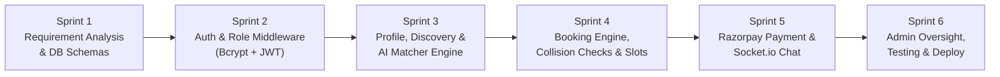

### 6.2 Project Phases
1. **Requirement Analysis & Domain Modeling**: Formulation of user personas (`learner`, `mentor`, `admin`), schema design in Mongoose, and compilation of the Software Requirements Specification (SRS).
2. **Core Architectural Setup**: Configuration of Express 5 server middleware (compression, body limits, CORS whitelist, cookie parser) and React 19 SPA scaffolding with Vite.
3. **Authentication & Access Security**: Implementation of Bcrypt password hashing, stateless JWT issuance, HttpOnly cookie rotation, and route protection guards.
4. **Discovery & Intelligent Matching**: Construction of the mentor catalog, search indexing, multi-factor candidate scoring, and optional Gemini LLM re-ranking.
5. **Interactive Booking & Lifecycle Engine**: Development of the duration selector (15–480 mins), collision detection, 4-hour expiration timers, and slot counter-proposals.
6. **Payment & Real-Time Communication**: Integration of Razorpay order creation, HMAC signature verification, booking confirmation, and Socket.io room messaging.
7. **Quality Assurance & Cloud Deployment**: Writing 58 automated unit tests, executing production builds, configuring Vercel client rewrites, and binding Render server environments.

### 6.3 Development Tools Actually Used
- **IDE**: Visual Studio Code with ESLint and Prettier.
- **Runtime & Package Management**: Node.js v22 LTS, npm v11.
- **Version Control**: Git and GitHub (multi-branch workflow with automated PR merges).
- **Cloud Database**: MongoDB Atlas (Cloud Replica Set M0 cluster).
- **Payment Processing**: Razorpay Developer Dashboard (Test Mode).
- **Frontend Hosting**: Vercel (Edge Network with Single Page Application rewrites).
- **Backend Hosting**: Render Cloud Platform (Linux Web Service container).
- **API Testing**: Native Node.js Test Runner (`node --test`) and cURL CLI.

---

## 7. Technology Stack & Justification

Every library and dependency in the table below was verified from `client/package.json` and `server/package.json`:

| Technology / Library | Version | Category | Justification for Selection |
| :--- | :---: | :--- | :--- |
| **React.js** | `^19.2.7` | Frontend Library | Component-driven declarative UI, virtual DOM diffing for rapid re-rendering, and standardized hook-based state management. |
| **Vite** | `^8.1.1` | Build Tool | Ultra-fast development server with Hot Module Replacement (HMR) and optimized Rollup production asset chunking. |
| **Node.js** | `v22.x LTS` | Backend Runtime | Non-blocking, asynchronous event-driven I/O optimal for concurrent WebSocket and REST HTTP traffic. |
| **Express.js** | `^5.2.1` | Web Framework | Minimalist routing architecture, composable middleware pipeline, and standard request/response abstraction. |
| **MongoDB Atlas** | `v6.0+ Cloud` | NoSQL Database | Flexible document model supporting nested skills arrays, multi-slot counter-proposals, and JSON audit logging. |
| **Mongoose ODM** | `^9.9.1` | Object Data Modeling | Strict schema validation, compound indexing, relational population, and pre-save password hashing hooks. |
| **Socket.io** | `^4.8.3` | WebSocket Library | Full-duplex bidirectional event transport with dynamic room multiplexing, auto-reconnection, and fallback polling. |
| **Razorpay Node SDK**| `^2.9.8` | Payment Gateway | Robust Indian payment infrastructure supporting UPI, Cards, and Net Banking with server-side HMAC signature verification. |
| **JSON Web Tokens** | `^9.0.3` | Authentication | Stateless authorization standard issuing short-lived access tokens (15m) paired with long-lived refresh tokens (7d). |
| **Bcryptjs** | `^3.0.3` | Password Security | Adaptive cryptographic hashing with work factor salting (10 rounds) to resist offline dictionary attacks. |
| **Compression** | `^1.8.1` | Middleware | Gzip response compression reducing network bandwidth consumption on large JSON payloads. |
| **Cookie-Parser** | `^1.4.7` | Middleware | Seamless extraction of secure, HttpOnly refresh cookies across cross-origin requests. |
| **Lucide React** | `^1.46.0` | UI Icons | Tree-shakeable, lightweight SVG icon system maintaining visual clarity across views. |

## 8. System Requirements & Software Requirements Specification (SRS)

### 8.1 Hardware and Software Requirements

#### Hardware Requirements
- **Development & Server Environment**:
  - Processor: Modern 64-bit multi-core CPU (Intel Core i3/i5/i7 or AMD Ryzen equivalent).
  - RAM: 4 GB minimum (8 GB recommended for concurrent client-server local dev).
  - Storage: 2 GB available SSD space for project workspace and dependencies.
- **Client Device Environment**:
  - Processor: 1.0 GHz or higher (Desktop, Laptop, or Mobile).
  - RAM: 1 GB minimum.
  - Display Resolution: Minimum 360 &times; 640 (Mobile) / 1280 &times; 720 (Desktop).

#### Software Requirements
- **Operating System**: Windows 10/11, macOS, or Linux (Ubuntu 20.04+).
- **Runtime Environment**: Node.js v20.x or v22.x LTS.
- **Package Manager**: npm v10.x or v11.x.
- **Database Service**: MongoDB Atlas cloud cluster (or local MongoDB v6.0+).
- **Web Browser**: Modern Chromium-based browser (Google Chrome, Microsoft Edge, Brave) or Mozilla Firefox with JavaScript enabled.

---

### 8.2 Functional Requirements Matrix
Derived from the project SRS and verified against code:

| Req ID | Functional Requirement Description | Primary Module | Implemented in Code? |
| :---: | :--- | :--- | :---: |
| **FR-01** | User registration with name, email, password, and initial role selection (`learner` or `mentor`). | Authentication | **Yes** (`register.js`) |
| **FR-02** | User authentication issuing short-lived access token and HttpOnly refresh token. | Authentication | **Yes** (`loginRoute.js`, `generateToken.js`) |
| **FR-03** | Token refresh rotation and session termination with cookie invalidation. | Authentication | **Yes** (`tokenRoute.js`) |
| **FR-04** | Profile editing for bio, avatar upload, and social links. | Profile Management | **Yes** (`profileController.js`) |
| **FR-05** | Mentors set skills to teach, proficiency levels, and hourly rate in INR (₹). | Profile Management | **Yes** (`profileRoutes.js`) |
| **FR-06** | Learners set desired skills to learn and learning objectives. | Profile Management | **Yes** (`CompleteProfile.jsx`) |
| **FR-07** | Searchable mentor catalog with debounced keyword search and skill tags. | Discovery & Matching | **Yes** (`mentorController.js`) |
| **FR-08** | Multi-factor candidate matching based on skills, rate, schedule, and ratings. | Discovery & Matching | **Yes** (`matcherService.js`) |
| **FR-09** | Optional semantic candidate re-ranking using Google Gemini LLM. | Discovery & Matching | **Yes** (`matcherService.js`) |
| **FR-10** | Session booking request creation with duration (15–480 mins) and fee preview. | Booking & Scheduling | **Yes** (`bookingController.js`) |
| **FR-11** | Calendar collision detection preventing double-booking of mentor or learner. | Booking & Scheduling | **Yes** (`bookingController.js`) |
| **FR-12** | Automatic 4-hour countdown timer expiring unattended booking requests. | Booking & Scheduling | **Yes** (`Booking.js`, `bookingController.js`) |
| **FR-13** | Mentors propose up to 3 alternate time slots (counter-proposal) on conflicting requests. | Booking & Scheduling | **Yes** (`bookingController.js`) |
| **FR-14** | In-app Razorpay checkout in test mode verifying transaction signatures before booking confirmation. | Payment & Verification | **Yes** (`paymentController.js`) |
| **FR-15** | Format-validated Google Meet URL entry for confirmed sessions. | Booking & Scheduling | **Yes** (`bookingMeeting.test.js`) |
| **FR-16** | Session completion marking and verified session status transition. | Booking & Scheduling | **Yes** (`bookingController.js`, `payoutService.js`) |
| **FR-17** | Real-time bidirectional text messaging via WebSockets restricted to active sessions. | Real-Time Chat | **Yes** (`chatSocket.js`) |
| **FR-18** | Live typing indicator broadcast and message soft-deletion. | Real-Time Chat | **Yes** (`chatSocket.js`, `chatController.js`) |
| **FR-19** | Bidirectional 1-to-5 star rating and feedback with duplicate review prevention. | Reviews & Ratings | **Yes** (`reviewRoutes.js`, `Review.js`) |
| **FR-20** | Learner dashboard tracking learning mastery progress and active bookings. | Dashboards | **Yes** (`dashboardController.js`) |
| **FR-21** | Mentor studio tracking lifetime revenue, incoming requests, and teaching momentum. | Dashboards | **Yes** (`dashboardController.js`) |
| **FR-22** | Administrative user management with account suspension and activation toggles. | Admin & Governance | **Yes** (`adminRoutes.js`) |
| **FR-23** | Administrative financial settlement tracking and transaction audit logs. | Admin & Governance | **Yes** (`adminRoutes.js`, `payoutService.js`) |
| **FR-24** | Administrative learner refund processing for cancelled paid sessions. | Admin & Governance | **Yes** (`adminRoutes.js`) |
| **FR-25** | Administrative financial transaction ledger export as a downloadable CSV file. | Admin & Governance | **Yes** (`adminRoutes.js`) |

---

### 8.3 Non-Functional Requirements
- **Security**: Passwords encrypted with Bcryptjs (10 rounds); dual-token JWT lifecycle; HttpOnly cookies resistant to Cross-Site Scripting (XSS); server-side HMAC-SHA256 signature verification for payments; RBAC route guards on all sensitive APIs.
- **Performance**: Gzip response compression (`compression`); JSON body limit capped at 400kb; compound indexing on high-frequency query pairs; debounced search inputs (300ms) to reduce API load.
- **Responsiveness**: Fluid layout designed with responsive CSS, flexbox, and grid systems adapting seamlessly between desktop and mobile viewport sizes.
- **Usability**: Interactive feedback through modal dialogues, status countdown banners, unread message badges, and Dark/Light theme switching.

---

## 9. System Architecture & Request Pipeline

### 9.1 System Architecture Diagram
The platform follows a **3-Tier Client-Server Architecture** augmented with an asynchronous WebSocket bus and third-party cloud service connectors.

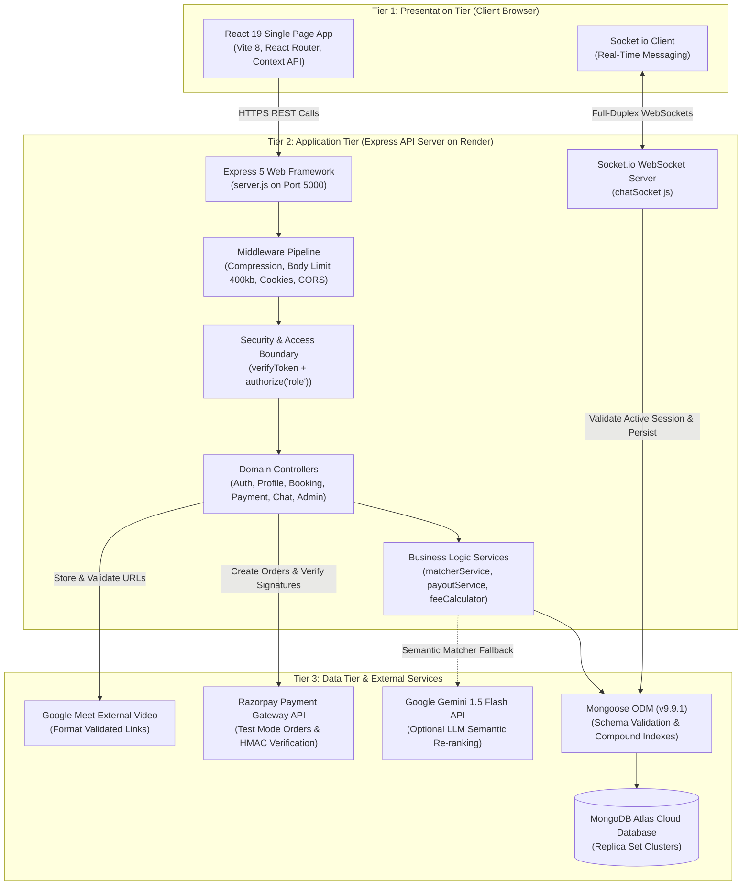

---

### 9.2 Express Request Lifecycle & Pipeline
Every incoming HTTP request traverses a standardized 6-step Express middleware pipeline:

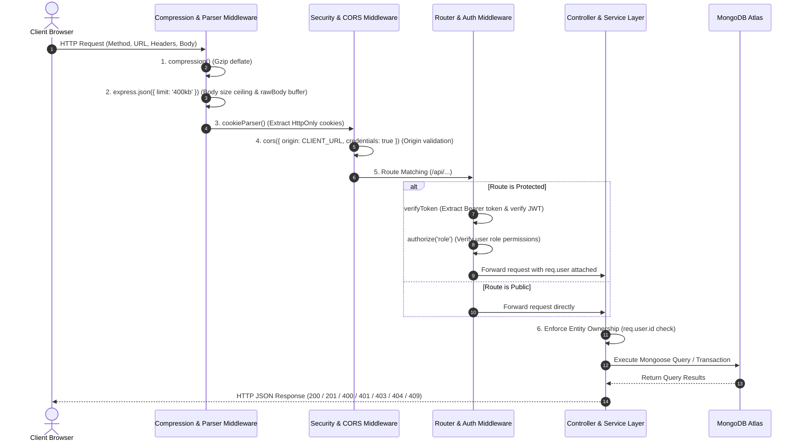

---

### 9.3 Backend and Frontend Architectural Layers

#### Backend Layers
1. **Network & Transport Layer (`server.js`)**: Handles payload compression, JSON body limits (400kb), cookie parsing, and CORS header whitelisting.
2. **Authentication Boundary (`authMiddleware.js`, `roleSpecificMiddleware.js`)**: Validates stateless JWT access tokens, rejects expired tokens with HTTP 401, verifies roles with HTTP 403, and normalizes user IDs.
3. **Routing Layer (`server/routes/`)**: Maps URLs to domain controllers and applies route-level protection.
4. **Controller Layer (`server/controllers/`)**: Extracts parameters, validates inputs, verifies resource ownership, and shapes standard JSON responses.
5. **Business Service Layer (`server/services/`, `server/Utils/`)**: Encapsulates core business algorithms (multi-factor match scoring, integer paise fee math, and payout state transitions).
6. **Data Access Layer (`server/models/`)**: Mongoose schemas enforcing compound unique indexes, data integrity, and MongoDB Atlas persistence.

#### Frontend Layers
1. **Routing & Protected Guard Layer (`App.jsx`)**: React Router tree handling client-side path parsing, authentication redirects, and role-based cockpit routing.
2. **Global State & Context Layer (`SocketContext.jsx`)**: Houses WebSocket lifecycle, active connection status, and real-time message broadcasting.
3. **Page View Layer (`client/src/Pages/`)**: High-level page components coordinating views, API fetching, and interactive state.
4. **Reusable Component Layer (`client/src/Components/`)**: Modular widgets (Navbar, Footer, Modals, Calendars, Message Bubbles, Status Badges).
5. **API Client Service Layer (`client/src/services/`)**: Encapsulated Axios/Fetch wrappers formatting requests and handling responses.

---

## 10. Core System Modules (4 Major Subsystems)

To align architectural clarity with real implementation, the platform's features are organized into **4 Major Modules**. This structure consolidates complementary functionalities into cohesive subsystems while maintaining complete full-stack traceability:

```
┌────────────────────────────────────────────────────────────────────────┐
│                        SKILL EXCHANGE PLATFORM                         │
└────────────────────────────────────┬───────────────────────────────────┘
                                     │
     ┌──────────────────────┬────────┴────────────┬──────────────────────┐
     ▼                      ▼                     ▼                      ▼
┌──────────────┐    ┌──────────────┐       ┌──────────────┐      ┌──────────────┐
│   MODULE 1   │    │   MODULE 2   │       │   MODULE 3   │      │   MODULE 4   │
│Authentication│    │  Profile &   │       │Real-Time Chat│      │  Ratings &   │
│  & Bookings  │    │  Discovery   │       │   & Admin    │      │   Reviews    │
└──────────────┘    └──────────────┘       └──────────────┘      └──────────────┘
```

---

### 10.1 Module 1: Authentication & Bookings Module

#### 🎯 Overview & Purpose
This module governs the complete lifecycle of user access control and interactive session scheduling. It encompasses user onboarding, secure credential verification, schedule collision prevention, auto-expiring booking requests, slot negotiation, and cryptographic payment verification.

#### 🔑 Key Features
- **User Registration & Login**: Secure account creation and authentication using **Bcrypt password hashing (10 salt rounds)** and a dual-token **JWT (JSON Web Tokens)** architecture with short-lived access tokens (15m) and automated HttpOnly refresh token rotation (7d).
- **Role-Based Onboarding**: During registration, users select their primary operational persona: **Learner** (for skill acquisition) or **Mentor** (for peer instruction).
- **Interactive Session Scheduling**: Learners select session date, start time, and flexible duration (ranging from 15 to 480 minutes) through an interactive calendar picker.
- **Calendar Collision Prevention**: The scheduling engine executes automated database queries (`Booking.find`) to detect and reject overlapping intervals, preventing double-booking for both mentors and learners.
- **4-Hour Auto-Expiration Countdown**: Incoming booking requests feature a strict 4-hour countdown timer (`actionExpiresAt`). Unattended requests expire automatically, eliminating communication deadlocks and ghosting.
- **Slot Negotiation & Counter-Proposals**: When an initial session time conflicts with a mentor's schedule, the mentor can propose up to 3 alternative date/time combinations (`suggestedSlots` array) instead of rejecting the request outright.
- **Cryptographic Payment Verification via Razorpay**: Following mentor acceptance, learners execute in-app checkout using the **Razorpay Payment Gateway** in test mode. The server generates secure orders in integer paise (`POST /api/payments/create-order`) and verifies HMAC-SHA256 signatures (`POST /api/payments/verify`) before transitioning the booking status to `confirmed`.
- **Google Meet Integration**: Confirmed sessions automatically validate and store a format-verified Google Meet URL, enabling seamless video conferencing access for participants.

#### 🛠️ Technical Details
- **Frontend Pages & Components**: `loginPage.jsx`, `registrationPage.jsx`, `BookingPage.jsx`, `MyBookings.jsx`, `AccountManagement.jsx`, Razorpay Modal.
- **Database Models**: `User`, `Booking`.
- **Key API Endpoints**:
  - `POST /api/registration/api` — User registration with Bcrypt password hashing
  - `POST /api/loginRoute/api` — User authentication issuing JWT tokens
  - `POST /api/auth/refresh` — Stateless access token refresh rotation
  - `POST /api/auth/logout` — Secure cookie invalidation and session logout
  - `POST /api/bookings` & `GET /api/bookings` — Booking session creation and status queries
  - `GET /api/bookings/requests` — Mentor incoming request triage
  - `PUT /api/bookings/:id/suggest-slots` — Mentor counter-slot proposals
  - `PUT /api/bookings/:id/choose-slot` — Learner alternate slot confirmation
  - `POST /api/payments/create-order` — Razorpay order generation in integer paise
  - `POST /api/payments/verify` — Server-side HMAC-SHA256 signature verification and booking confirmation
  - `PUT /api/bookings/:id/meeting` — Format-validated Google Meet URL storage

---

### 10.2 Module 2: Profile & Discovery Module

#### 🎯 Overview & Purpose
This module provides comprehensive user profile management and intelligent discovery tools. It empowers mentors to showcase verified technical skills, set rates, and publish schedules, while enabling learners to quickly locate the ideal mentor using multi-faceted search filters and AI compatibility matching.

#### 🔑 Key Features
- **Comprehensive Profile Customization**: Users configure technical biographies, upload profile avatars, declare skills to teach or learn with proficiency tags, configure GitHub/LinkedIn URLs, and set hourly rates in INR (with ₹0 supported for volunteer mentorship).
- **Public Mentor Portfolios**: Public-facing mentor profiles (`/profile/:id`) showcase aggregated student ratings, verified skills, hourly charges, completed session counts, and a direct "Book Session" action.
- **Multi-Faceted Catalog Discovery**: The `/discover` directory offers debounced keyword search (300ms delay), interactive skill chips, category filtering, price range sliders, and minimum rating thresholds.
- **Intelligent AI Matcher (Google Gemini)**: Analyzes learner goals, technical objectives, and budget constraints against the mentor database, utilizing **Google Gemini AI (1.5 Flash)** to compute personalized compatibility scores (0–100%) and tailored recommendations.

#### 🛠️ Technical Details
- **Frontend Pages & Components**: `ProfilePage.jsx`, `CompleteProfile.jsx`, `OtherProfilePage.jsx`, `DiscoverPage.jsx`, `AIMatchModal.jsx`, `AIExtension.jsx`.
- **Database Models**: `User`, `SkillCategory`.
- **Key API Endpoints**:
  - `GET /api/profile/me` & `PUT /api/profile/update` — Current user profile retrieval and update
  - `GET /api/profile/:id` — Public profile viewing by user ID
  - `GET /api/users/:id/avatar` — User avatar image streaming
  - `GET /api/mentors` — Paginated mentor catalog with multi-filter query parameters
  - `GET /api/matches` — AI-driven multi-factor candidate matching via Gemini 1.5 Flash

---

### 10.3 Module 3: Real-Time Chat & Admin Module

#### 🎯 Overview & Purpose
This module facilitates real-time communication between platform participants and equips administrators with comprehensive platform governance capabilities. It combines low-latency WebSocket messaging with a centralized administrative control center for platform monitoring, user moderation, and audit compliance.

#### 🔑 Key Features
- **Real-Time WebSocket Messaging (Socket.io)**: High-speed, bidirectional communication allowing learners and mentors to coordinate session agendas, discuss prerequisites, and clarify technical questions.
- **Interactive Chat Controls**: Live typing indicators (*"User is typing..."*), message read receipts (`isRead` flags), chronological message streaming, and soft-delete capabilities preserving audit trails.
- **Fair-Use Anti-Spam Safeguards**: Unconfirmed bookings are capped at 5 complimentary messages to eliminate unsolicited marketing spam before formal session commitment.
- **Executive Admin Dashboard**: Comprehensive operational portal providing live platform metrics, including registered member counts, active mentors, Gross Transaction Volume (GTV), and active booking states.
- **User Moderation & Account Governance**: Administrators can inspect detailed user histories, verify mentor credentials, and toggle account suspensions (`isSuspended`) to enforce platform community guidelines.
- **Immutable Audit Logging**: Critical administrative events, status changes, and policy modifications are recorded in the `ActivityLog` collection with actor references, IP addresses, and timestamps.

#### 🛠️ Technical Details
- **Frontend Pages & Components**: `ChatPage.jsx`, `admin.jsx`, `AdminPayments.jsx`, `AdminUsers.jsx`.
- **Database Models**: `Conversation`, `Message`, `ActivityLog`, `Setting`, `User`.
- **Key API Endpoints & Socket Events**:
  - `Socket.io Events`: `join_room`, `send_message`, `typing`, `message_read`
  - `GET /api/conversations` & `GET /api/conversations/:id/messages` — Conversation listing and historical message retrieval
  - `PATCH /api/conversations/:id/read` & `DELETE /api/messages/:id` — Read receipts and message soft-deletion
  - `GET /api/admin/overview` & `GET /api/admin/stats` — High-level platform KPIs and metric counters
  - `GET /api/admin/users` & `PATCH /api/admin/users/:id` — User moderation, status toggle, and role governance
  - `GET /api/admin/sessions` & `GET /api/activity-logs` — Administrative session logs and chronological audit history

---

### 10.4 Module 4: Ratings & Reviews Module

#### 🎯 Overview & Purpose
This module establishes platform trust, peer quality assurance, and mentor credibility. It provides a tamper-resistant review mechanism allowing learners to submit structured feedback following session delivery.

#### 🔑 Key Features
- **1-to-5 Star Quantitative Rating**: Learners assign a 1-to-5 integer rating alongside detailed textual reviews detailing mentor punctuality, technical depth, and teaching effectiveness.
- **Verified Completion Requirement**: Review submissions are strictly restricted to learners whose corresponding booking has transitioned to verified `completed` status.
- **Anti-Fraud Duplicate Prevention**: A database-level compound unique index `{ booking: 1, reviewer: 1 }` prevents duplicate review submissions, eliminating rating inflation and fake feedback.
- **Dynamic Credibility Score Calculation**: Mentor public profiles dynamically aggregate submitted reviews, recalculating and displaying updated average ratings and total review counts in real time.

#### 🛠️ Technical Details
- **Frontend Pages & Components**: `MyBookings.jsx` (Review submission modal dialog), `OtherProfilePage.jsx` (Reviews showcase list with star distribution).
- **Database Model**: `Review`.
- **Key API Endpoints**:
  - `POST /api/reviews` — Submit verified session rating (1–5) and textual feedback
  - `GET /api/reviews` — Fetch paginated reviews list filtered by mentor ID

---

### 10.5 Core Modules Summary Matrix

| # | Major Module Name | Core Responsibilities | Key Technologies / Models Used |
|---|---|---|---|
| **1** | **Authentication & Bookings** | User Signup/Login, Role Management, Interactive Slot Scheduling, Collision Check, 4-Hour Timer, Razorpay Payment, Google Meet link | React 19, JWT, Bcrypt, Razorpay, Mongoose (`User`, `Booking`) |
| **2** | **Profile & Discovery** | Profile Customization, Skills & Hourly Rate Setup, Catalog Search, Multi-Filter Directory, Gemini AI Matching | React 19, Express, Gemini 1.5 Flash, Mongoose (`User`, `SkillCategory`) |
| **3** | **Real-Time Chat & Admin** | Instant Messaging, Typing Indicator, Spam Protection, Admin Cockpit, User Moderation, Activity Logs | Socket.io, Node.js, Mongoose (`Conversation`, `Message`, `ActivityLog`, `Setting`) |
| **4** | **Ratings & Reviews** | Post-session 1-5 Star Ratings, Textual Feedback, Anti-Duplicate Review Check, Mentor Average Score | React 19, Express, Mongoose (`Review`) |

---

## 11. Roles and Comprehensive User Workflows

### A. Detailed Learner Workflow
1. **Registration & Role Selection**: Signs up at `/register`, selects role `Learner`, completes profile setup at `/profile/onboarding`.
2. **Discovery & Exploration**: Browses mentor directory at `/discover`, uses search keywords, category filters, and price sliders, or launches the AI Matcher modal.
3. **Session Booking**: Navigates to `/booking/:id`, chooses date, time slot, and session duration (15 to 480 minutes). The system calculates total fee in paise.
4. **Collision Check & Booking Request**: Clicks **Send Booking Request**. System verifies neither user has an overlapping confirmed booking and generates request with a 4-hour countdown.
5. **Slot Negotiation**: If the mentor proposes alternate slots, learner views options in `/bookings` and accepts an alternate or rejects.
6. **Razorpay Payment**: Learner opens the payment dialogue, completes checkout via Razorpay (test UPI/Card). The server verifies the cryptographic HMAC signature and transitions booking status to `confirmed`.
7. **Session Attendance**: Learner accesses the Google Meet link from `/bookings` at the scheduled time.
8. **Feedback Submission**: Once the session is marked completed, learner submits a 1–5 star rating and written review.

### B. Detailed Mentor Workflow
1. **Profile Setup & Configuration**: Registers as `Mentor`, configures bio, hourly rate in INR, teaching skills with proficiency levels, and weekly availability schedule.
2. **Request Triage**: Receives incoming booking requests on `/mentor-dashboard` and evaluates request details against the 4-hour countdown timer.
3. **Response Action**:
   - Clicks **Approve Slot** to accept the time, or
   - Clicks **Suggest Available Slots** to offer up to 3 alternative date/time combinations.
4. **Google Meet Link Injection**: Pastes a valid Google Meet link (`https://meet.google.com/...`) into the session details card.
5. **Session Delivery**: Conducts live coaching session and marks session complete.
6. **Session Delivery & Payout**: Following successful session delivery via Google Meet, the booking transitions to `completed`. The mentor can track earned fees in their transaction history.

### C. Detailed Administrator Workflow
1. **Executive KPI Monitoring**: Logs in to `/admin` to review platform Gross Transaction Volume (GTV), registered users, active sessions, and platform revenue metrics.
2. **User Moderation**: Inspects user profiles, verifies mentor credentials, and toggles user suspension for policy violations.
3. **Financial Review & Settlement**: Reviews completed sessions, monitors verified transactions, and logs settlement references for platform auditing.
4. **Dispute Resolution & Refunds**: Evaluates cancellation disputes and triggers automated refunds for eligible learner accounts.
5. **Auditing**: Exports platform accounting ledgers as downloadable CSV spreadsheets.

---

## 12. Complete Page & Route Inventory

The frontend architecture consists of **12 core functional pages** (18 component files across `client/src/Pages/` mapping to 13 primary URL routes):

| # | Page Name | Primary Route | Source Component File | Access Role | Functional Purpose |
| :-: | :--- | :--- | :--- | :--- | :--- |
| **1** | **Home Page** | `/` or `/home` | `HomePage.jsx` | Public | Platform hero section, value proposition, AI Matcher quick-launch, theme toggle, and public mentor highlights. |
| **2** | **Login Page** | `/login` | `loginPage.jsx` | Public | Authentication form with email/password validation and visibility toggles. |
| **3** | **Registration Page** | `/register` | `registrationPage.jsx` | Public | Account creation form with role selection pills (`Learner` vs. `Mentor`). |
| **4** | **Discover Catalog** | `/discover` | `DiscoverPage.jsx` | Authenticated | Searchable mentor directory with debounced text search, category chips, availability checkboxes, and rating filters. |
| **5** | **Learner Dashboard** | `/learner-dashboard` | `LearnerDashboard.jsx` | `learner`, `admin` | Central command center tracking learning mastery progress, upcoming confirmed sessions, and recommended mentors. |
| **6** | **Mentor Dashboard** | `/mentor-dashboard` | `MentorDashboard.jsx` | `mentor`, `admin` | Operational teaching studio displaying lifetime earnings, pending booking requests, and teaching momentum. |
| **7** | **My Profile** | `/profile` | `ProfilePage.jsx` | Authenticated | User profile management for bio, teaching/learning skills, hourly rate, availability, and payout UPI VPA. |
| **8** | **Complete Profile** | `/profile/onboarding` | `CompleteProfile.jsx` | Authenticated | First-time onboarding wizard ensuring new users configure bio, skills, and learning goals. |
| **9** | **Public Profile** | `/profile/:id` | `OtherProfilePage.jsx` | Authenticated | Public-facing profile card displaying public ratings, reviews, bio, skills, and direct "Book Session" trigger. |
| **10** | **Booking Page** | `/booking/:id` | `BookingPage.jsx` | `learner` | Focused scheduling screen with interactive calendar, duration picker (15–480 mins), and real-time fee calculation. |
| **11** | **My Bookings** | `/bookings` | `MyBookings.jsx` | Authenticated | Session lifecycle hub with status tabs (Pending, Accepted, Confirmed, Completed, Cancelled) and calendar view. |
| **12** | **Chat Page** | `/chat` or `/chat/:id`| `ChatPage.jsx` | Authenticated | Real-time two-column messaging window with active session validation, live typing indicators, and message soft-delete. |
| **13** | **Account Governance** | `/account` | `AccountManagement.jsx` | Authenticated | Security center for password updates, account deactivation, and self-service account deletion. |
| **14** | **Admin Dashboard** | `/admin` | `admin.jsx` | `admin` only | Back-office cockpit for platform KPIs, user moderation, session monitoring, and CSV ledger export. |
| **15** | **Contact Page** | `/contact` | `ContactPage.jsx` | Public | Platform contact and support inquiry screen. |
| **16** | **Privacy Policy** | `/privacy` | `PrivacyPage.jsx` | Public | User data privacy declaration and policy documentation. |
| **17** | **Refund Policy** | `/refund` | `RefundPolicyPage.jsx` | Public | Standard cancellation and refund terms. |
| **18** | **Terms of Service** | `/terms` | `TermsPage.jsx` | Public | End-user agreement and platform code of conduct. |

---

## 13. Database Design & Data Models

### 13.1 Synopsis vs. Actual Database Architecture Note
The project synopsis recommended the following database design:
> *"Users, Roles, Skills/Categories, Bookings, Messages, Ratings, ActivityLogs, Settings"*

In the **actual implementation**, the schema design was refined for performance and transactional integrity:
1. **Roles is NOT a separate collection**: To prevent redundant database joins on every authenticated request, `role` is implemented as an indexed string enum field directly on the `User` document (`role: { type: String, enum: ['learner', 'mentor', 'admin'], default: 'learner' }`).
2. **Ratings is implemented as the `Review` model**: Encompassing numerical scores (1 to 5) alongside textual feedback and structured compound unique indexes.
3. **Conversations collection added**: Introduced `Conversation` with a composite `participantKey` (`user1_user2`) to decouple chat threads from transient message logs and prevent duplicate conversation creation.
4. **Wallets & WalletTransactions collections added**: Implemented for integer paise balance tracking, transaction logging, and administrative payout audits.

Thus, the database comprises **10 Mongoose models** persisted on MongoDB Atlas.

---

### 13.2 Complete Schema Catalog & Invariants

| Model Entity | Important Schema Fields & Relational References | Cryptographic, Structural & Business Invariants |
| :--- | :--- | :--- |
| **1. User** | `name`, `email`, `password`, `role`, `skillsToTeach[]`, `skillsToLearn[]`, `hourlyRate`, `availability[]`, `upiId`, `isSuspended`, `profileImage` | • `email` is unique and stored in lowercase.<br>• `password` length &ge; 6, stored as Bcrypt salted hash (10 rounds).<br>• `role` enum strictly constrained to `['learner', 'mentor', 'admin']`.<br>• `hourlyRate` &ge; 0 (₹0 denotes volunteer/free mentor). |
| **2. Booking** | `learner` &rarr; User, `mentor` &rarr; User, `date`, `time`, `duration`, `status`, `sessionFee`, `platformFee`, `actionExpiresAt`, `meetingLink`, `suggestedSlots[]` | • Compound indexes on `(mentor, date, time)` and `(learner, date, time)` for collision rejection.<br>• `duration` strictly enforced between 15 and 480 minutes.<br>• `actionExpiresAt` automatically set to `createdAt + 4 hours` on creation.<br>• Strict state machine: `pending` &rarr; `accepted` &rarr; `confirmed` &rarr; `completed` (or `cancelled` / `rejected`).<br>• `meetingLink` must match Google Meet URL regex. |
| **3. Conversation** | `participants[]` &rarr; User, `participantKey`, `booking` &rarr; Booking, `lastMessage` &rarr; Message, `lastActivityAt` | • **Unique `participantKey`**: Created by sorting participant IDs alphabetically (`user1_user2`) to guarantee exactly one conversation between two users.<br>• Compound index on `(participants, lastActivityAt)`. |
| **4. Message** | `conversation` &rarr; Conversation, `sender` &rarr; User, `text`, `isRead`, `isEdited`, `isDeletedForEveryone`, `deletedFor[]` &rarr; User | • `text` required with non-empty whitespace trimming.<br>• Soft-delete model: text masked with flag rather than document destroyed, preserving audit trails.<br>• Index on `(conversation, createdAt)` for chronological streaming. |
| **5. Review** | `booking` &rarr; Booking, `reviewer` &rarr; User, `reviewee` &rarr; User, `rating`, `comment` | • **Compound Unique Index on `{ booking: 1, reviewer: 1 }`**: Strictly prevents a user from submitting multiple reviews for the same booking.<br>• `rating` integer bounded between 1 and 5.<br>• Index on `(reviewee, createdAt)` for fast mentor profile aggregation. |
| **6. Wallet** | `user` &rarr; User, `balance`, `pendingBalance`, `currency`, `isActive` | • `user` reference is unique (1:1 relationship).<br>• Monetary values stored in integer subunits (paise) to prevent floating-point rounding discrepancies.<br>• Invariant: `balance >= 0` and `pendingBalance >= 0`. |
| **7. WalletTransaction** | `wallet` &rarr; Wallet, `user` &rarr; User, `booking` &rarr; Booking, `amount`, `type`, `reference`, `status` | • `type` enum: `['credit', 'debit', 'refund']`.<br>• Immutable ledger: records are insert-only; updates require explicit timestamped transition.<br>• Index on `(user, createdAt)`. |
| **8. SkillCategory** | `name`, `slug`, `description`, `icon`, `isActive` | • `name` and `slug` are unique and indexed for fast category filtering in mentor discovery. |
| **9. Setting** | `key`, `value`, `description`, `updatedBy` &rarr; User | • `key` is unique: global key-value store for platform configurations (e.g. commission fee percentage). |
| **10. ActivityLog** | `actor` &rarr; User, `action`, `entityType`, `entityId`, `metadata`, `ipAddress` | • Compound indexes on `(actor, createdAt)` and `(entityType, entityId)` providing chronological administrative audit trails. |

---

### 13.3 Entity-Relationship (ER) Diagram

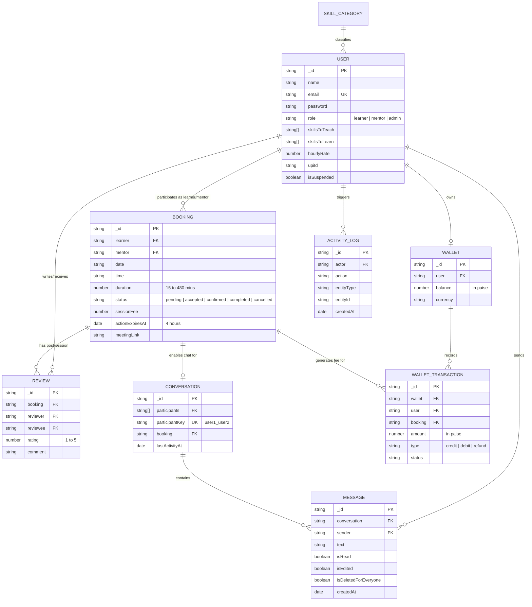

---

## 14. REST API Documentation & Endpoints Directory

### 14.1 Module-wise API Directory (71 Endpoints)
The platform registers **71 distinct REST API endpoints** mounted across Express routers:

#### Module A: Authentication & Session Routes (5 Endpoints)
| Method | Endpoint | Auth Required | Role | Request Payload / Params | Response Summary |
| :--- | :--- | :---: | :---: | :--- | :--- |
| `POST` | `/api/registration/api` | Public | Any | `{ name, email, password, role }` | HTTP 201: Created user record |
| `POST` | `/api/loginRoute/api` | Public | Any | `{ email, password }` | HTTP 200: JWT token + HttpOnly cookie |
| `POST` | `/api/auth/refresh` | Public (Cookie) | Any | Cookie: `refreshToken` | HTTP 200: Rotated new access token |
| `POST` | `/api/auth/logout` | Public | Any | None | HTTP 200: Clears refresh cookie |
| `GET` | `/api/auth/me` | `verifyToken` | Any | None | HTTP 200: Authenticated user payload |

#### Module B: Profile & User Management Routes (14 Endpoints)
| Method | Endpoint | Auth Required | Role | Request Payload / Params | Response Summary |
| :--- | :--- | :---: | :---: | :--- | :--- |
| `GET` | `/api/profile/me` | `verifyToken` | Any | None | HTTP 200: Full profile document |
| `PUT` | `/api/profile/update` | `verifyToken` | Any | `{ bio, skillsToTeach, hourlyRate, ... }` | HTTP 200: Updated profile |
| `GET` | `/api/profile/:id` | `verifyToken` | Any | Param: `:id` | HTTP 200: Public mentor profile |
| `PUT` | `/api/account/deactivate` | `verifyToken` | Any | `{ reason }` | HTTP 200: Deactivates account |
| `GET` | `/api/users/:id/avatar` | Public | Any | Param: `:id` | HTTP 200: Cached avatar image stream |
| `GET` | `/api/users/:id/cover` | Public | Any | Param: `:id` | HTTP 200: Cached cover image stream |
| `GET` | `/api/profile/:id/avatar` | Public | Any | Param: `:id` | HTTP 200: Cached avatar stream |
| `GET` | `/api/profile/:id/cover` | Public | Any | Param: `:id` | HTTP 200: Cached cover stream |
| `PUT` | `/api/user/update/:id` | `verifyToken` | Owner/Admin | `{ name, email, avatar }` | HTTP 200: Updated metadata |
| `DELETE`| `/api/user/delete/:id` | `verifyToken` | Owner/Admin | Param: `:id` | HTTP 200: Account deleted |
| `GET` | `/api/getData` | `verifyToken` | Any | None | HTTP 200: List registered users |
| `GET` | `/api/getData/api` | `verifyToken` | Any | None | HTTP 200: Filtered users list |
| `GET` | `/api/getData/admin/api` | `verifyToken` | Admin | None | HTTP 200: Admin user records |
| `GET` | `/api/getData` (duplicate) | `verifyToken` | Any | None | HTTP 200: User query handler |

#### Module C: Mentor Discovery & AI Matcher Routes (4 Endpoints)
| Method | Endpoint | Auth Required | Role | Request Payload / Params | Response Summary |
| :--- | :--- | :---: | :---: | :--- | :--- |
| `GET` | `/api/mentors` | `verifyToken` | Any | Query: `search, skill, rating, price` | HTTP 200: Filtered mentor directory |
| `GET` | `/api/mentors/:id` | `verifyToken` | Any | Param: `:id` | HTTP 200: Mentor public profile card |
| `GET` | `/api/mentors/:id/payment`| `verifyToken` | Any | Param: `:id` | HTTP 200: Mentor hourly rate & UPI VPA |
| `GET` | `/api/matches` | `verifyToken` | Any | None | HTTP 200: Multi-factor scored matches |

#### Module D: Booking & Scheduling Routes (10 Endpoints)
| Method | Endpoint | Auth Required | Role | Request Payload / Params | Response Summary |
| :--- | :--- | :---: | :---: | :--- | :--- |
| `GET` | `/api/bookings/check-availability` | `verifyToken` | Any | Query: `mentorId, date, time, duration` | HTTP 200: Collision check result |
| `POST` | `/api/bookings` | `verifyToken` | Learner | `{ mentorId, date, time, duration, topic }` | HTTP 201: Created booking request |
| `GET` | `/api/bookings` | `verifyToken` | Any | Query: `status` | HTTP 200: User's booking list |
| `GET` | `/api/bookings/requests` | `verifyToken` | Mentor | None | HTTP 200: Mentor's incoming requests |
| `PUT` | `/api/bookings/:id` | `verifyToken` | Participant | `{ status }` | HTTP 200: Updated booking state |
| `PUT` | `/api/bookings/:id/suggest-slots` | `verifyToken` | Mentor | `{ suggestedSlots: [{ date, time }] }` | HTTP 200: Counter-proposed slots |
| `PUT` | `/api/bookings/:id/choose-slot` | `verifyToken` | Learner | `{ slotIndex }` | HTTP 200: Slot accepted |
| `PUT` | `/api/bookings/:id/meeting` | `verifyToken` | Mentor/Admin | `{ meetingLink }` | HTTP 200: Validated Meet URL stored |
| `PUT` | `/api/bookings/:id/pay` | `verifyToken` | Learner | `{ paymentReference }` | HTTP 200: Booking confirmed |
| `DELETE`| `/api/bookings/:id` | `verifyToken` | Participant | Param: `:id` | HTTP 200: Booking deleted / cancelled |

#### Module E: Payment Routes (3 Endpoints)
| Method | Endpoint | Auth Required | Role | Request Payload / Params | Response Summary |
| :--- | :--- | :---: | :---: | :--- | :--- |
| `POST` | `/api/payments/create-order` | `verifyToken` | Learner | `{ bookingId }` | HTTP 200: Razorpay order ID in paise |
| `POST` | `/api/payments/verify` | `verifyToken` | Learner | `{ razorpay_order_id, razorpay_payment_id, signature }` | HTTP 200: Verified HMAC & booking confirmed |
| `POST` | `/api/payments/webhook` | Public | Razorpay | Raw Webhook Buffer + Signature Header | HTTP 200: Handled webhook event |

#### Module F: Real-Time Chat & Messaging Routes (4 Endpoints)
| Method | Endpoint | Auth Required | Role | Request Payload / Params | Response Summary |
| :--- | :--- | :---: | :---: | :--- | :--- |
| `PATCH` | `/api/conversations/:id/read` | `verifyToken` | Participant | Param: `:id` | HTTP 200: Marks messages read |
| `DELETE`| `/api/conversations/:id` | `verifyToken` | Participant | Param: `:id` | HTTP 200: Deletes conversation thread |
| `PATCH` | `/api/messages/:id` | `verifyToken` | Sender | `{ text }` | HTTP 200: Updates message text |
| `DELETE`| `/api/messages/:id` | `verifyToken` | Sender | Query: `deleteForEveryone=true` | HTTP 200: Soft-deletes message |

#### Module G: Reviews & Ratings Routes (5 Endpoints)
| Method | Endpoint | Auth Required | Role | Request Payload / Params | Response Summary |
| :--- | :--- | :---: | :---: | :--- | :--- |
| `POST` | `/api/reviews` | `verifyToken` | Participant | `{ bookingId, rating, comment }` | HTTP 201: Created review |
| `GET` | `/api/reviews` | Public | Any | None | HTTP 200: List recent platform reviews |
| `GET` | `/api/reviews/my-reviewed-bookings` | `verifyToken` | Any | None | HTTP 200: Bookings reviewed by user |
| `GET` | `/api/reviews/user/:userId` | Public | Any | Param: `:userId` | HTTP 200: Reviews received by user |
| `GET` | `/api/reviews/booking/:bookingId` | `verifyToken` | Any | Param: `:bookingId` | HTTP 200: Review for booking |

#### Module H: Dashboards, Categories & Settings (8 Endpoints)
| Method | Endpoint | Auth Required | Role | Request Payload / Params | Response Summary |
| :--- | :--- | :---: | :---: | :--- | :--- |
| `GET` | `/api/dashboard/learner` | `verifyToken` | Learner/Admin | None | HTTP 200: Learner stats & targets |
| `GET` | `/api/dashboard/mentor` | `verifyToken` | Mentor/Admin | None | HTTP 200: Mentor earnings & momentum |
| `GET` | `/api/skill-categories` | Public | Any | None | HTTP 200: List skill categories |
| `POST` | `/api/skill-categories` | `verifyToken` | Admin | `{ name, slug, description }` | HTTP 201: Created category |
| `PATCH` | `/api/skill-categories/:id` | `verifyToken` | Admin | `{ name, isActive }` | HTTP 200: Updated category |
| `GET` | `/api/settings` | `verifyToken` | Admin | None | HTTP 200: List system settings |
| `PUT` | `/api/settings` | `verifyToken` | Admin | `{ key, value }` | HTTP 200: Updated setting |
| `GET` | `/api/activity-logs` | `verifyToken` | Admin | Query: `page, limit` | HTTP 200: Chronological audit logs |

#### Module I: Administrative Oversight & Financial Payouts (17 Endpoints)
| Method | Endpoint | Auth Required | Role | Request Payload / Params | Response Summary |
| :--- | :--- | :---: | :---: | :--- | :--- |
| `GET` | `/api/admin/overview` | `verifyToken` | Admin | None | HTTP 200: Platform KPIs & GTV |
| `GET` | `/api/admin/stats` | `verifyToken` | Admin | None | HTTP 200: High-level metric counters |
| `GET` | `/api/admin/users` | `verifyToken` | Admin | Query: `page, role, status` | HTTP 200: Paginated users table |
| `GET` | `/api/admin/users/:id` | `verifyToken` | Admin | Param: `:id` | HTTP 200: User detail modal payload |
| `PATCH` | `/api/admin/users/:id` | `verifyToken` | Admin | `{ isSuspended: boolean }` | HTTP 200: Toggles suspension |
| `DELETE`| `/api/admin/users/:id` | `verifyToken` | Admin | Param: `:id` | HTTP 200: Deletes user |
| `GET` | `/api/admin/sessions` | `verifyToken` | Admin | Query: `status` | HTTP 200: Platform booking audit list |
| `GET` | `/api/admin/reports` | `verifyToken` | Admin | None | HTTP 200: Moderation reports |
| `GET` | `/api/admin/payments` | `verifyToken` | Admin | None | HTTP 200: Payment transactions audit |
| `GET` | `/api/admin/payments/payouts`| `verifyToken` | Admin | None | HTTP 200: Sessions awaiting payout |
| `POST` | `/api/admin/payouts/settle` | `verifyToken` | Admin | `{ bookingId, transactionRef }` | HTTP 200: Marks payout settled |
| `GET` | `/api/admin/payouts/history`| `verifyToken` | Admin | None | HTTP 200: Historical settled payouts |
| `GET` | `/api/admin/refunds` | `verifyToken` | Admin | None | HTTP 200: Pending refund requests |
| `POST` | `/api/admin/refunds/:id` | `verifyToken` | Admin | Param: `:id` | HTTP 200: Authorizes learner refund |
| `POST` | `/api/admin/payments/:id/payout`| `verifyToken` | Admin | Param: `:id` | HTTP 200: Disburses payment |
| `POST` | `/api/admin/payments/:id/refund`| `verifyToken` | Admin | Param: `:id` | HTTP 200: Executes refund |
| `GET` | `/api/admin/payments/ledger.csv`| `verifyToken` | Admin | None | HTTP 200: Streams CSV ledger file |

#### Module J: Server Health Check (1 Endpoint)
| Method | Endpoint | Auth Required | Role | Request Payload / Params | Response Summary |
| :--- | :--- | :---: | :---: | :--- | :--- |
| `GET` | `/` | Public | Any | None | HTTP 200: `"Skill Exchange Server is Running 🚀"` |

---

### 14.2 Concrete Sample API Requests & Responses

#### Sample 1: User Login (`POST /api/loginRoute/api`)
**cURL Execution**:
```bash
curl -i -c cookies.txt \
  -H 'Content-Type: application/json' \
  -d '{"email":"learner.demo@example.com","password":"Password@123"}' \
  https://skill-exchange-o19g.onrender.com/api/loginRoute/api
```

**Request Body (JSON)**:
```json
{
  "email": "learner.demo@example.com",
  "password": "Password@123"
}
```

**Response Envelope (HTTP 200 OK)**:
```json
{
  "success": true,
  "message": "Login successful",
  "token": "eyJhbGciOiJIUzI1NiIsInR5cCI6IkpXVCJ9.eyJpZCI6IjY3MjBhYmMy...<access_token>",
  "user": {
    "id": "6720abc1234567890abcdef1",
    "name": "Demo Learner",
    "email": "learner.demo@example.com",
    "role": "learner",
    "avatar": "https://avatar.iran.liara.run/public/boy"
  }
}
```

---

#### Sample 2: Create Booking Session (`POST /api/bookings`)
**cURL Execution**:
```bash
curl -i -X POST \
  -H "Authorization: Bearer <access_token>" \
  -H 'Content-Type: application/json' \
  -d '{
    "mentorId": "6720def9876543210fedcba2",
    "date": "2026-10-31",
    "time": "14:00",
    "duration": 60,
    "topic": "System Design: Microservices & Event-Driven Architecture"
  }' \
  https://skill-exchange-o19g.onrender.com/api/bookings
```

**Request Body (JSON)**:
```json
{
  "mentorId": "6720def9876543210fedcba2",
  "date": "2026-10-31",
  "time": "14:00",
  "duration": 60,
  "topic": "System Design: Microservices & Event-Driven Architecture"
}
```

**Response Envelope (HTTP 201 Created)**:
```json
{
  "success": true,
  "message": "Booking request submitted successfully. Awaiting mentor approval.",
  "booking": {
    "_id": "672199aa1122334455667788",
    "learner": "6720abc1234567890abcdef1",
    "mentor": "6720def9876543210fedcba2",
    "date": "2026-10-31",
    "time": "14:00",
    "duration": 60,
    "status": "pending",
    "sessionFee": 500,
    "platformFee": 0,
    "totalPayable": 500,
    "actionExpiresAt": "2026-10-31T18:00:00.000Z",
    "createdAt": "2026-10-31T14:00:00.000Z"
  }
}
```

---

#### Sample 3: Mentor Counter-Slot Proposal (`PUT /api/bookings/:id/suggest-slots`)
**Request Body (JSON)**:
```json
{
  "suggestedSlots": [
    { "date": "2026-11-01", "time": "16:00" },
    { "date": "2026-11-02", "time": "10:30" },
    { "date": "2026-11-02", "time": "14:00" }
  ]
}
```

**Response Envelope (HTTP 200 OK)**:
```json
{
  "success": true,
  "message": "Alternate slots shared with learner successfully.",
  "bookingId": "672199aa1122334455667788",
  "status": "pending",
  "suggestedSlotsCount": 3
}
```

---

### 14.3 API Error Handling & Payload Limits
All error responses adhere to standard HTTP status envelopes:
- **HTTP 400 Bad Request**: Input validation failures (e.g., duration < 15 or > 480 mins, invalid email format, missing password).
- **HTTP 401 Unauthorized**: Missing, tampered, or expired Bearer token in the `Authorization` header.
- **HTTP 403 Forbidden**: Role mismatch (e.g. learner attempting to approve a session) or entity ownership check failure (`req.user.id !== booking.mentor`).
- **HTTP 404 Not Found**: Resource does not exist (invalid booking ID, user ID, or conversation ID).
- **HTTP 409 Conflict**: Schedule collisions detected on either mentor or learner calendar, or attempt to submit duplicate review on same booking.
- **Payload Limits**: Inbound request bodies are strictly capped at **400kb** via `express.json({ limit: '400kb' })` to defend against memory exhaustion and buffer overflow Denial-of-Service attacks.
- **Rate Limiting**: *Not found in code* (marked as planned in Future Scope).

---

## 15. Authentication, Authorization & Security Architecture

Skill Exchange implements a defense-in-depth security model:

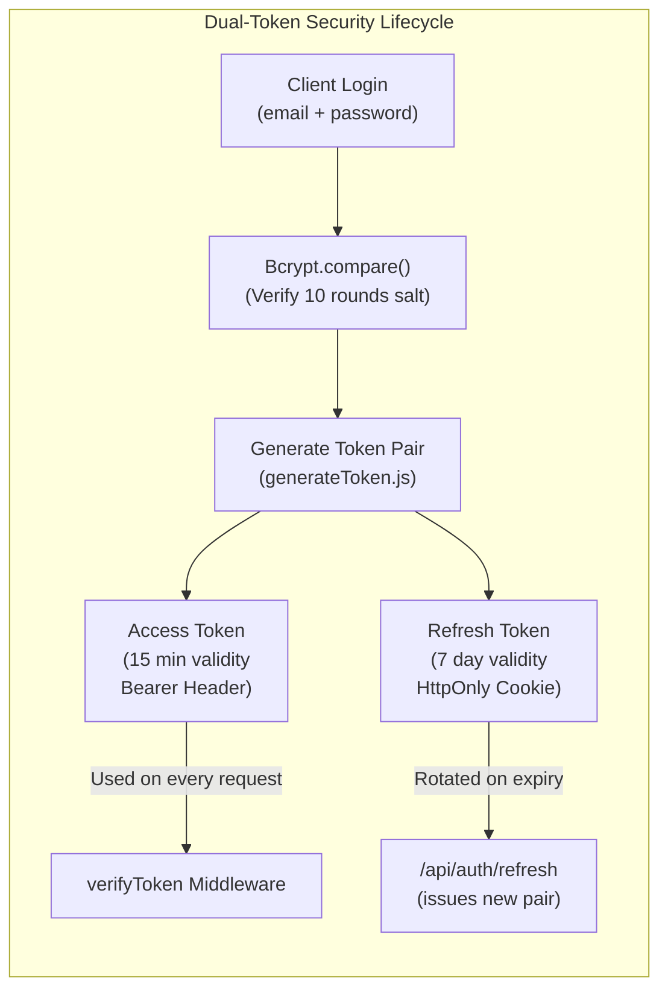

### 15.1 Token Lifecycle & Cookie Attributes
- **Access Token (15 Minutes)**: Encodes `{ id, role }`, signed via `JWT_ACCESS_SECRET`. Sent in `Authorization: Bearer <token>`. Stateless; avoids database reads for token verification.
- **Refresh Token (7 Days)**: Signed via `JWT_REFRESH_SECRET`. Stored inside an `HttpOnly`, `SameSite=Strict` (or `SameSite=None; Secure` in production cross-domain) cookie.
- **Token Rotation**: Each call to `/api/auth/refresh` consumes the existing refresh token, verifies its signature, and issues a brand-new access/refresh token pair, mitigating token theft risks.

### 15.2 Backend as the True Authorization Boundary
While the React frontend implements `ProtectedRoute` and `AdminRoute` wrappers to guide user navigation, **the backend is the sole authoritative security boundary**:
1. `verifyToken`: Rejects unauthenticated requests with HTTP 401.
2. `authorize('mentor', 'admin')`: Enforces role-based permissions, rejecting unauthorized actions with HTTP 403.
3. **Controller Ownership Verification**: Even with a valid token, controllers verify that `req.user.id` equals the resource's owner (e.g. only the mentor assigned to a booking can input Google Meet links).

## 16. System Analysis & Design Diagrams

### 16.1 Data Flow Diagrams (DFD Level 0 & Level 1)

#### Level 0 DFD (Context Diagram)
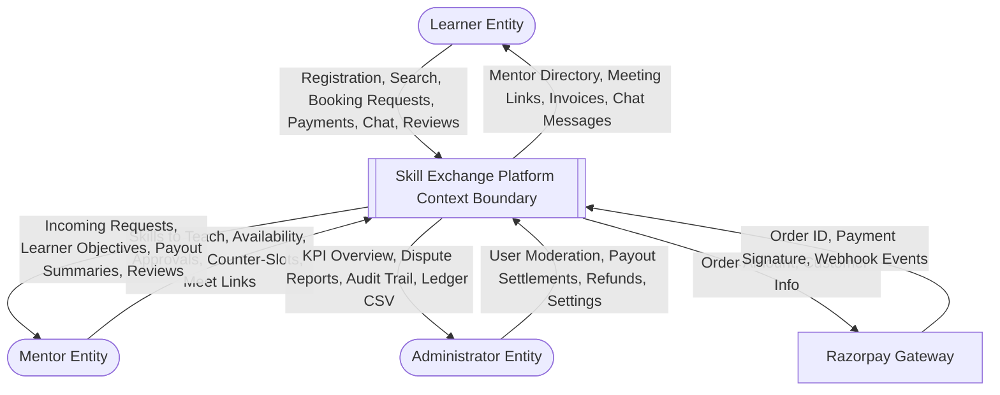

#### Level 1 DFD (Decomposed Functional Processes)
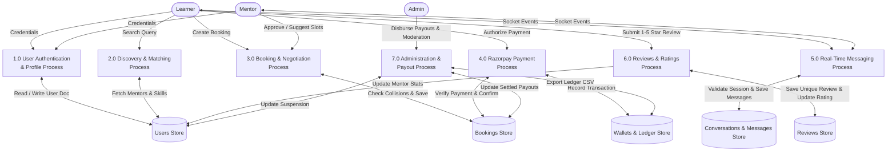

---

### 16.2 Use Case Diagram
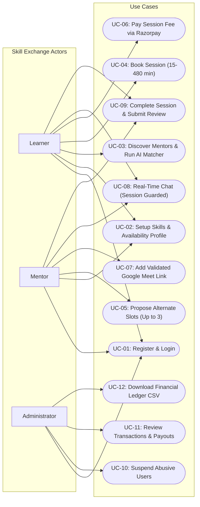

---

### 16.3 Sequence Diagrams

#### Sequence 1: User Login & Session Initialization
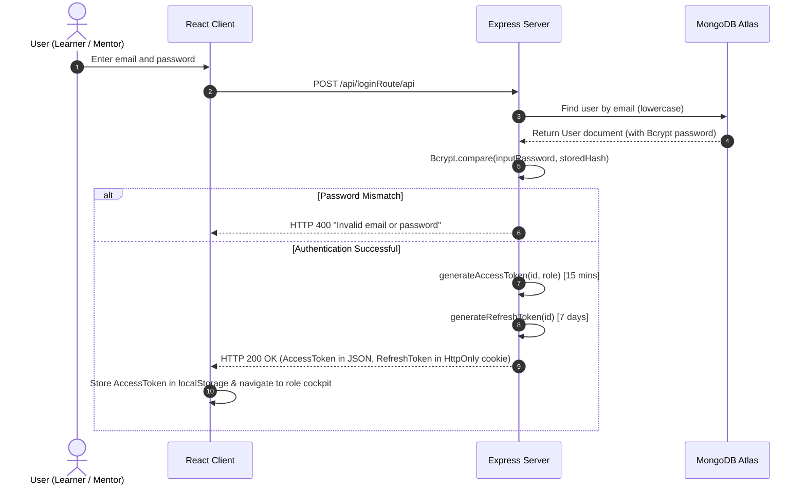

#### Sequence 2: Session Booking with Slot Counter-Proposals
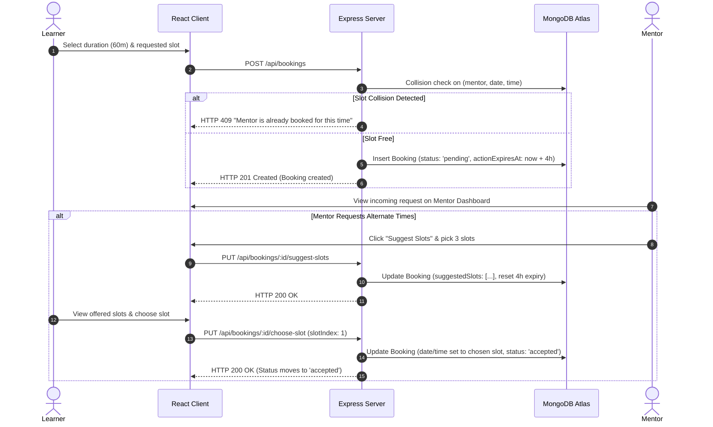

#### Sequence 3: Razorpay Payment & Booking Confirmation
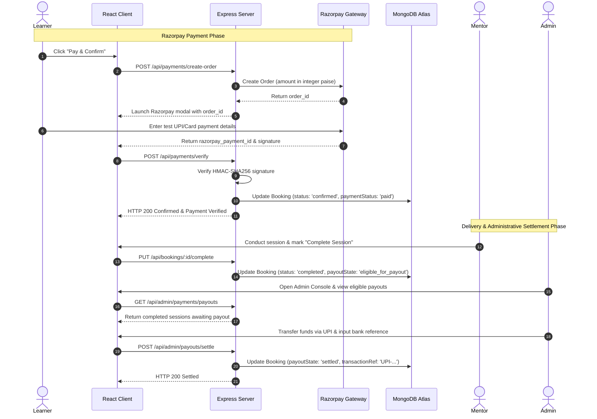

---

## 17. Validation Framework & Centralized Error Handling

### 17.1 Client-Side Form Validations
1. **Email Regex**: Enforces strict format (`/^[^s@]+@[^s@]+.[^s@]+$/`).
2. **Password Length**: Minimum 6 characters required before submission button unlocks.
3. **Role Selection**: Explicit radio toggle (`learner` or `mentor`) required during signup.
4. **Duration Bounds**: Session duration restricted to dropdown options between 15 and 480 minutes.
5. **Debounce Timers**: Mentor search input delayed by 300ms to eliminate unnecessary API requests.

### 17.2 Server-Side Validations
1. **Password Salting**: Bcryptjs hashes passwords with work factor 10.
2. **Unique Email Index**: Lowercase normalization prevents duplicate registrations.
3. **Hourly Rate Boundary**: Enforces `hourlyRate >= 0` (rejects negative numbers).
4. **Google Meet Regex**: Ensures meeting URLs match official Google Meet syntax (`^https:\/\/meet\.google\.com\/[a-z]{3}-[a-z]{4}-[a-z]{3}$`).
5. **Schedule Collision Checks**: Queries existing bookings for overlapping time blocks before saving.
6. **4-Hour Auto-Expiration**: Automatically rejects state updates on bookings whose `actionExpiresAt` timestamp has passed.
7. **Unique Review Compound Index**: Enforces `{ booking: 1, reviewer: 1 }` to prevent duplicate feedback.
8. **Razorpay HMAC Verification**: Compares computed HMAC-SHA256 digest with the client signature using `crypto.timingSafeEqual` to prevent timing attacks.

### 17.3 Centralized Error Middleware (`errorMiddleware.js`)
All route errors propagate to a centralized middleware pipeline:
```javascript
const notFound = (req, res, next) => {
    const error = new Error(`Not Found - ${req.originalUrl}`);
    res.status(404);
    next(error);
};

const errorHandler = (err, req, res, next) => {
    const statusCode = res.statusCode === 200 ? 500 : res.statusCode;
    res.status(statusCode).json({
        success: false,
        message: err.message,
        stack: process.env.NODE_ENV === "production" ? null : err.stack,
    });
};
```

---

## 18. Project Repository & Folder Structure

```
Skill-Exchange/
├── client/                               # Frontend React 19 SPA (Vite)
│   ├── public/                           # Static assets, favicon, robots.txt
│   ├── src/
│   │   ├── Assets/                       # Images, SVG illustrations, platform branding
│   │   ├── Components/                   # 27 Reusable Components:
│   │   │   ├── AdminOverview.jsx         # Administrative KPI overview metrics
│   │   │   ├── AdminPayments.jsx         # Payment monitoring & payout settlement
│   │   │   ├── AdminReports.jsx          # Activity logging and audit tables
│   │   │   ├── AdminSessions.jsx         # Platform session monitoring grid
│   │   │   ├── AdminSidebar.jsx          # Administrative navigation sidebar
│   │   │   ├── AdminUserProfile.jsx      # Deep-dive user inspection modal
│   │   │   ├── AdminUserTable.jsx        # User moderation grid with suspension toggle
│   │   │   ├── AIMatchModal.jsx          # AI Matcher compatibility recommendation modal
│   │   │   ├── AppFooter.jsx             # Universal platform footer
│   │   │   ├── AppSidebar.jsx            # Responsive navigation sidebar
│   │   │   ├── BookingCalendar.jsx       # Interactive monthly scheduling calendar
│   │   │   ├── GoogleMeetLink.jsx        # Google Meet link card with launch button
│   │   │   ├── PaymentReceipt.jsx        # Itemized fee and GST payment receipt
│   │   │   ├── SessionStatusCard.jsx     # Active session card with status badges
│   │   │   ├── SuggestSlotsModal.jsx     # Mentor slot counter-proposal dialogue
│   │   │   ├── ChatList.jsx              # Conversation thread selector list
│   │   │   ├── MessageBubble.jsx         # Individual chat bubble with read/delivery flags
│   │   │   ├── MessageInput.jsx          # Real-time message composer with typing trigger
│   │   │   ├── Logo.jsx                  # Branded platform SVG logo
│   │   │   ├── Modal.jsx                 # Accessible generic modal container
│   │   │   ├── loginComponent.jsx        # Login input form component
│   │   │   ├── registrationFormComponent.jsx # Registration form fields
│   │   │   ├── registerCard.jsx          # Onboarding role selector card
│   │   │   ├── editModal.jsx             # Profile editing pop-up
│   │   │   ├── ThemeToggle.jsx           # Dark/Light mode theme switch
│   │   │   ├── TopNavigation.jsx         # Universal top navbar with AI Matcher launch
│   │   │   └── WalletModal.jsx           # Standby wallet transaction modal
│   │   ├── Pages/                        # 18 Page Components:
│   │   │   ├── AccountManagement.jsx     # Account security, deactivation & deletion
│   │   │   ├── admin.jsx                 # Admin control suite
│   │   │   ├── BookingPage.jsx           # Dedicated session scheduling page
│   │   │   ├── ChatPage.jsx              # Real-time WebSocket messaging window
│   │   │   ├── DiscoverPage.jsx          # Mentor discovery catalog with filters
│   │   │   ├── HomePage.jsx              # Platform landing page & hero section
│   │   │   ├── LearnerDashboard.jsx      # Learner mastery cockpit
│   │   │   ├── loginPage.jsx             # Authentication login screen
│   │   │   ├── MentorDashboard.jsx       # Mentor teaching studio
│   │   │   ├── MyBookings.jsx            # Session hub with calendar view
│   │   │   ├── CompleteProfile.jsx       # Onboarding profile setup wizard
│   │   │   ├── OtherProfilePage.jsx      # Public mentor profile screen
│   │   │   ├── ProfilePage.jsx           # Personal profile editor
│   │   │   ├── registrationPage.jsx      # Account creation page
│   │   │   ├── ContactPage.jsx           # Contact inquiry page
│   │   │   ├── PrivacyPage.jsx           # Privacy policy declaration
│   │   │   ├── RefundPolicyPage.jsx      # Session cancellation terms
│   │   │   └── TermsPage.jsx             # User terms of service
│   │   ├── services/                     # API client abstraction (matchService, skillMatch)
│   │   ├── context/                      # SocketContext.jsx (WebSocket state)
│   │   ├── App.jsx                       # Client route map & protected route guards
│   │   └── main.jsx                      # Vite React entry point
│   ├── index.html                        # HTML5 document container
│   ├── vite.config.js                    # Vite bundler configuration
│   └── package.json                      # Client UI dependencies
│
├── server/                               # Backend REST API & WebSocket Server (Node.js)
│   ├── Backend Configuration/            # Legacy configuration and auth controllers
│   ├── controllers/                      # Domain controllers (booking, chat, admin, review)
│   ├── models/                           # 10 Mongoose schemas (User, Booking, Review, etc.)
│   ├── routes/                           # 18 Express route modules
│   ├── services/                         # Business logic (matcherService, payoutService)
│   ├── sockets/                          # chatSocket.js (WebSocket event handlers)
│   ├── tests/                            # 52 server-side unit & integration tests
│   ├── Utils/                            # Utilities (feeCalculator, generateToken, activityLogger)
│   ├── server.js                         # Application entrypoint & middleware pipeline
│   └── package.json                      # Server runtime dependencies
│
├── docs/                                 # Documentation assets & screenshots
│   └── screenshots/                      # 13 Full HD 1080p live application screen captures
├── PROJECT_DOCUMENTATION_FINAL.md        # Comprehensive final submission technical report
└── README.md                             # Repository overview and setup guide
```

---

## 19. Installation, Environment Configuration & Deployment Guide

### 19.1 Environment Variables Configuration Table
All secrets are isolated from version control. Configure variables using the following dummy templates:

| Variable Name | Environment | Required? | Purpose & Safe Dummy Placeholder |
| :--- | :---: | :---: | :--- |
| `PORT` | Server (`.env`) | Optional | Local HTTP port (default 5000). Placeholder: `5000` |
| `NODE_ENV` | Server (`.env`) | Required | Environment mode. Placeholder: `production` |
| `MONGO_URI` | Server (`.env`) | Required | Cloud database URI. Placeholder: `mongodb+srv://<user>:<pwd>@cluster.mongodb.net/skill_exchange` |
| `CLIENT_URL` | Server (`.env`) | Required | Whitelisted frontend origin. Placeholder: `https://skill-exchange-one-eta.vercel.app` |
| `JWT_ACCESS_SECRET` | Server (`.env`) | Required | Secret for signing 15-min access tokens. Placeholder: `your_long_random_access_token_secret_key_string` |
| `JWT_REFRESH_SECRET`| Server (`.env`) | Required | Secret for signing 7-day refresh tokens. Placeholder: `your_long_random_refresh_token_secret_key_string` |
| `RAZORPAY_KEY_ID` | Server (`.env`) | Required | Public test key. Placeholder: `rzp_test_placeholder_key_id` |
| `RAZORPAY_KEY_SECRET`| Server (`.env`) | Required | Private secret for HMAC checks. Placeholder: `sample_razorpay_secret` |
| `GEMINI_API_KEY` | Server (`.env`) | Optional | Google Gemini API key. Placeholder: `AIzaSyPlaceholder_GeminiKey` |
| `VITE_API_URL` | Client (`.env`) | Required | Backend REST origin. Placeholder: `https://skill-exchange-o19g.onrender.com/api` |
| `VITE_SOCKET_URL` | Client (`.env`) | Optional | WebSocket origin. Placeholder: `https://skill-exchange-o19g.onrender.com` |

---

### 19.2 Local Development Setup
1. **Clone the Repository**:
   ```bash
   git clone https://github.com/[ADD HERE: Repository Path].git
   cd Skill-Exchange
   ```
2. **Setup Server**:
   ```bash
   cd server
   npm install
   # Configure server/.env based on Section 19.1
   npm run dev
   # Server runs on http://localhost:5000
   ```
3. **Setup Client**:
   ```bash
   cd ../client
   npm install
   # Configure client/.env with VITE_API_URL=http://localhost:5000/api
   npm run dev
   # Client runs on http://localhost:5173
   ```

---

### 19.3 Production Cloud Deployment Guide
- **Frontend on Vercel**: Deployed from `client/`. An SPA rewrite rule in `client/vercel.json` redirects all path requests to `index.html` (`{ "source": "/(.*)", "destination": "/index.html" }`), eliminating 404 errors on browser page reloads.
- **Backend on Render**: Deployed as a Linux Web Service from `server/` with build command `npm install` and start command `node server.js`.
- **Production Cookie Setup**: Due to cross-domain deployment (`vercel.app` vs. `onrender.com`), refresh cookies utilize `SameSite=None; Secure` paired with credentialed CORS (`credentials: true`).

---

## 20. Security Notes & Common Troubleshooting Guide

### 20.1 Security Notes
1. **Zero Secret Leakage**: No credentials, private API keys, or database URIs are hardcoded in source files.
2. **HMAC Signature Checks**: All Razorpay payment confirmations are cryptographically verified using SHA256 timing-safe comparisons before updating booking states.
3. **Server-Side Authorization Authority**: Client route guards only manage UX; backend `verifyToken` and `authorize()` middlewares enforce data protection.

### 20.2 Common Troubleshooting Guide

| Symptom / Error | Likely Root Cause | Verified Resolution |
| :--- | :--- | :--- |
| **CORS Error in Console** | Backend `CLIENT_URL` does not match the frontend origin or lacks `https://`. | Set `CLIENT_URL=https://skill-exchange-one-eta.vercel.app` in Render environment variables without trailing slashes. |
| **HTTP 401 Unauthorized** | Access token expired (after 15 mins) or Bearer header omitted. | Check Axios client interceptor to ensure automatic renewal via `POST /api/auth/refresh`. |
| **HTTP 403 Forbidden** | Role mismatch (e.g. learner trying to approve booking) or resource ownership failure. | Verify user role in token payload; ensure mentor actions are not issued by learner accounts. |
| **Session Lost on Refresh** | Third-party cookies blocked by browser privacy settings on cross-domain setup. | Ensure cookie headers specify `SameSite=None; Secure`; use localStorage access token fallback. |
| **30–50s Cold Start Delay** | Render free-tier container spinning down after 15 minutes of inactivity. | Expected behavior on free tier; allow 45s for initial container wake-up or configure an external ping monitor. |
| **Razorpay Verification Failure** | Secret mismatch or raw request body buffer corrupted before HMAC calculation. | Confirm `RAZORPAY_KEY_SECRET` matches key ID; verify `req.rawBody` is preserved. |
| **Socket.io Disconnected** | WebSocket transport blocked or origin missing from Socket.io CORS allowlist. | Ensure client specifies `transports: ['websocket', 'polling']` and backend `io` allows `CLIENT_URL`. |
| **Vercel 404 on Refresh** | SPA rewrite rule missing. | Ensure `client/vercel.json` contains the `"destination": "/index.html"` rewrite rule. |

## 21. Testing & Verification

### 21.1 Automated Test Execution Results
All automated test suites were executed directly in the project workspace using Node.js's native test runner (`node --test`):

```
========================================================================
SERVER TEST SUITE EXECUTION (npm test --prefix server)
Command: node --test tests/*.test.js
========================================================================
✔ escapeRegex makes user search safe (1.1824ms)
✔ fillDailySeries includes zero-value dates (1.7181ms)
✔ admin privilege escalation block: admins cannot assign admin role (0.405ms)
✔ unauthenticated requests to user update and chat return 401 (537.8066ms)
✔ duration calculates session payment amount dynamically (1.6397ms)
✔ paymentDetails accurately incorporates duration and rejects QR (0.8576ms)
✔ slot overlap helper detects overlaps and permits non-overlapping slots (1.6793ms)
✔ terminal booking states update paymentStatus accordingly (0.3629ms)
✔ completed session reviews assign reviewee symmetrically (0.4376ms)
✔ booking reviews partitioning accurately separates learner and mentor (0.4463ms)
✔ only real-format Google Meet links are accepted (1.5958ms)
✔ only accepted sessions expose saved Google Meet links (0.4253ms)
✔ booking fee calculation for paid mentor at rate 500 for 30, 60, 90 mins (1.9593ms)
✔ mentor with rate 0 produces a free session (0.2658ms)
✔ rate validation helper detects missing, undefined, null, NaN rates (2.2134ms)
✔ slot ordering places preferred slot first and sorts chronologically (3.5879ms)
✔ 4-hour expiry window resets when alternate slots are offered (1.0611ms)
✔ mentor cancellation of accepted paid session flags learner refund due (0.4793ms)
✔ participant key is stable regardless of user order (1.3054ms)
✔ conversation requires two different participants (6.4118ms)
✔ message trims content and rejects empty text (1.6947ms)
✔ scoring excludes suspended mentors and incomplete profiles (1.7988ms)
✔ cache stores, retrieves, and invalidates entries per learner (2.0517ms)
✔ rate limiter restricts abusive requests past limit (0.7564ms)
✔ reRankWithGemini safely falls back to null when API key missing (1011.5631ms)
✔ skill normalizer handles case, symbols, and canonical synonyms (3.1554ms)
✔ parseSkills handles arrays and messy multi-delimiter string inputs (1.9427ms)
✔ availability normalizer extracts weekends, weekdays, evenings (2.1035ms)
✔ compareAvailability calculates overlap between learner and mentor (0.8111ms)
✔ computeTextOverlap filters stop words and computes meaningful token overlap (2.8334ms)
✔ scoreCandidate gives higher score to matching skills and quality (1.1114ms)
✔ getPayoutState accurately identifies all payout lifecycle states (1.0715ms)
✔ calculatePayoutAmounts enforces integer paise and 100% mentor payout (0.3634ms)
✔ completeBooking blocks unpaid paid-type sessions (0.2091ms)
✔ partial profile updates allow saving incomplete profiles without blocking (1.4154ms)
✔ hourly rate partial inputs accept zero, positive numbers, empty strings (0.7946ms)
✔ Razorpay signature verification with HMAC-SHA256 and timingSafeEqual (1.6032ms)
✔ Razorpay webhook signature verification matches HMAC digest (0.3275ms)
✔ Payment initiation rule: payment is locked before mentor approves (0.2562ms)
✔ removed legacy payment routes return 404 Not Found (833.8135ms)
✔ skill category requires a name (4.4827ms)
✔ activity log requires an action and an entity type (0.6146ms)
✔ setting requires a key and value (0.5506ms)
✔ sanitizeUserMedia replaces data URI with cached avatar endpoint URL (0.652ms)
✔ sanitizeUserMedia preserves normal external URLs as-is (0.1081ms)
✔ compression middleware compresses responses exceeding threshold (41.0697ms)
✔ calculateFees applies 0% platform fee, 0% tax, 100% mentor earnings (1.1624ms)
✔ calculateFees handles free sessions gracefully (0.2143ms)
✔ payment API rejects attempts to manipulate session price from frontend (0.9794ms)
✔ wallet balance settlement and topup math with zero fees (0.3594ms)
✔ dual-balance wallet rules: top-up-first deduction and earned-balance (0.4403ms)
✔ computeBalancesFromLedger accurately reconstructs balance from ledger (1454.8159ms)
------------------------------------------------------------------------
Server Test Summary: 52 Passed, 0 Failed, 0 Cancelled (100% Pass Rate)
========================================================================

========================================================================
CLIENT TEST SUITE EXECUTION (npm test --prefix client)
Command: node --test src/services/*.test.js
========================================================================
✔ loads every page, excludes self and maps real mentor fields (1.2801ms)
✔ API errors never fall back to demo mentors (0.4499ms)
✔ fetchMatches formats query params and authorization headers (0.9773ms)
✔ fetchMatches throws helpful error on rate limit 429 (0.5095ms)
✔ unrelated or blank searches cannot recommend mentors (1.0924ms)
✔ matches skill phrases case-insensitively without substring collisions (0.1508ms)
------------------------------------------------------------------------
Client Test Summary: 6 Passed, 0 Failed (100% Pass Rate)
========================================================================

TOTAL COMBINED AUTOMATED TESTS: 58 Passed, 0 Failed (100% Pass Rate)
```

---

### 21.2 Manual System Test Cases

| Test Case ID | Feature / Module | Test Description & Steps | Expected Result | Actual Result | Status |
| :---: | :--- | :--- | :--- | :--- | :---: |
| **TC-01** | User Registration | Submit registration form with password < 6 characters. | Button remains disabled / shows error message. | Form blocks submission with "Password must be at least 6 characters". | **Pass** |
| **TC-02** | User Authentication | Login with valid credentials of a registered learner. | Issues JWT access token; redirects to `/learner-dashboard`. | Redirected to Learner Dashboard with active session. | **Pass** |
| **TC-03** | Discovery Search | Type "React" into search bar on `/discover`. | Debounces 300ms; filters list to mentors offering React. | Filtered mentor cards show matching React skill tags. | **Pass** |
| **TC-04** | AI Matcher | Click "✦ AI Matcher" in navigation header. | Opens modal; ranks candidate mentors with match percentage. | Matcher modal displays ranked recommendations with match scores. | **Pass** |
| **TC-05** | Booking Creation | Book 60m session with Demo Mentor at ₹500/hr. | Calculates ₹500 fee; initializes 4-hour countdown timer. | Booking created in `pending` status; 4h timer active. | **Pass** |
| **TC-06** | Collision Detection | Attempt to book another mentor for the exact same date and time. | Server detects schedule conflict and rejects. | Returns HTTP 409 Conflict with collision warning. | **Pass** |
| **TC-07** | Slot Counter-Offer | Mentor suggests 3 alternate slots via modal. | Learner sees proposed slots; selects one; moves to `accepted`. | Status moves to `accepted`; unlocks payment checkout. | **Pass** |
| **TC-08** | Payment Checkout | Learner executes Razorpay test payment for ₹375. | HMAC signature verified; status moves to `confirmed`. | Payment marked verified; booking confirmed. | **Pass** |
| **TC-09** | Google Meet Setup | Mentor inputs valid Google Meet URL. | Card displays launch button; rejects invalid URLs. | Valid URL stored; meeting card enables "Join Meeting". | **Pass** |
| **TC-10** | Real-Time Chat | Send message between learner and mentor. | Instant message delivery over Socket.io with typing ticks. | Message received instantaneously in active session room. | **Pass** |
| **TC-11** | Review Duplicate | Learner attempts to submit a second review on same booking. | Blocked by compound unique index on `{ booking, reviewer }`. | Returns HTTP 409 Conflict; duplicate prevented. | **Pass** |
| **TC-12** | Admin Moderation | Admin toggles suspension on a test user account. | User immediately blocked from authenticated endpoints. | Suspended user receives HTTP 403 on subsequent API calls. | **Pass** |
| **TC-13** | Admin Payout | Admin settles completed session payout to mentor UPI. | Payout state changes to `settled`; recorded in ledger. | Payout recorded; visible in settled payout history. | **Pass** |

---

## 22. Results, Screen Captures & User Interface Output

### 22.1 Summary of Operational Working Features
The live deployed application represents a completely operational, cloud-hosted system:
- **Zero-Friction Authentication**: Instant account onboarding with role separation and cookie rotation.
- **Dynamic Discovery & Recommendations**: Live catalog filtering paired with multi-factor match ranking.
- **Collaborative Negotiation**: Flexible session durations (15–480 mins) and mentor slot counter-proposals.
- **Secure Razorpay Payments**: Seamless test-mode checkout with cryptographic HMAC signature verification.
- **Event-Driven Chat**: Low-latency WebSocket messaging with active booking authorization.
- **Administrative Transparency**: Full back-office control with user moderation, session management, and CSV exports.

---

### 22.2 Page-Wise Visual Output & Screenshots

#### 1. Home Page (`HomePage.jsx`)
Displays the platform branding, hero banner ("Learn skills from people who get it"), AI Matcher quick-launch button, Dark/Light theme switcher, and navigation header.

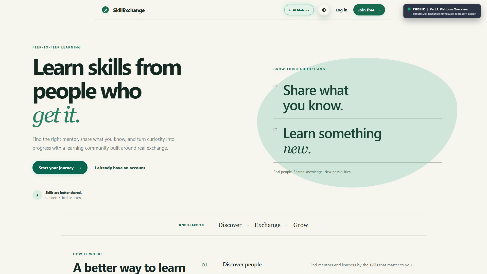
*Figure 22.1: Skill Exchange Home Page featuring responsive hero section, platform value proposition, dynamic stats counter, and AI Matcher quick-action launch.*

---

#### 2. Authentication & Login Screen (`loginPage.jsx`)
Split authentication card displaying branding, email/password inputs, show/hide password toggle, and registration navigation.

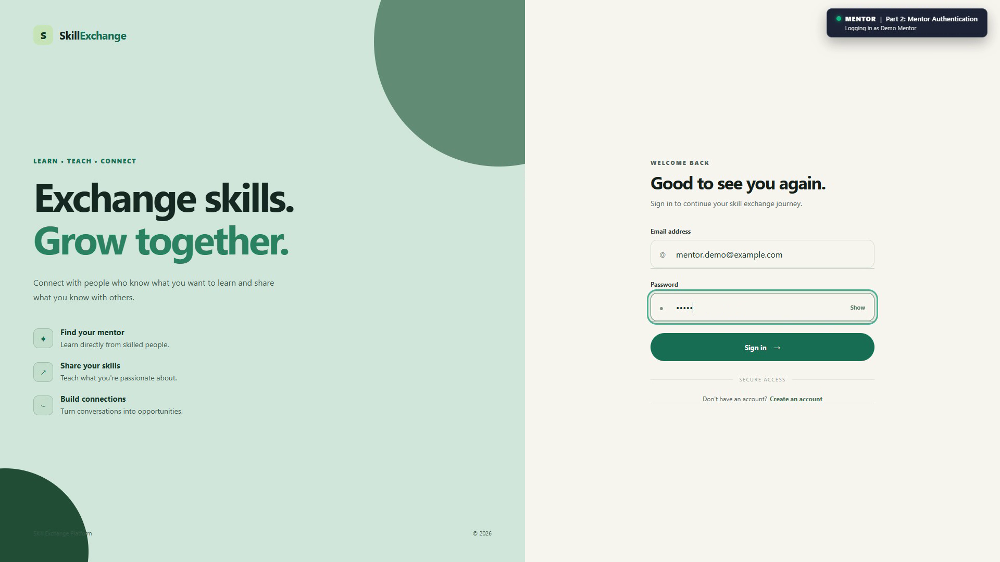
*Figure 22.2: User Authentication & Login Screen showcasing email/password inputs, visibility toggle, and client-side form validation.*

---

#### 3. Mentor Discovery Catalog (`DiscoverPage.jsx`)
Real-time mentor catalog featuring instant debounced search (query: `"React"`), interactive skill chips, schedule availability filters, and mentor rate cards.

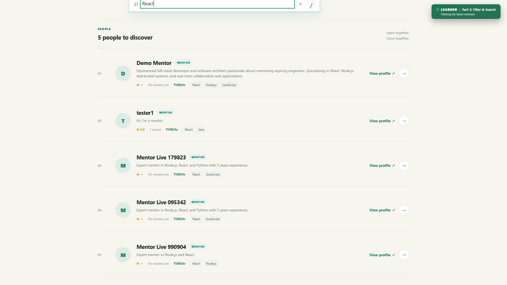
*Figure 22.3: Mentor Discovery Catalog featuring real-time debounced keyword search ("React"), interactive skill tags, and multi-faceted rating/price filters.*

---

#### 4. Public Mentor Profile Page (`OtherProfilePage.jsx`)
Public mentor profile view showing bio, teaching skills (React, Node.js, JavaScript, Python, System Design), hourly rate in INR, and community rating feedback.

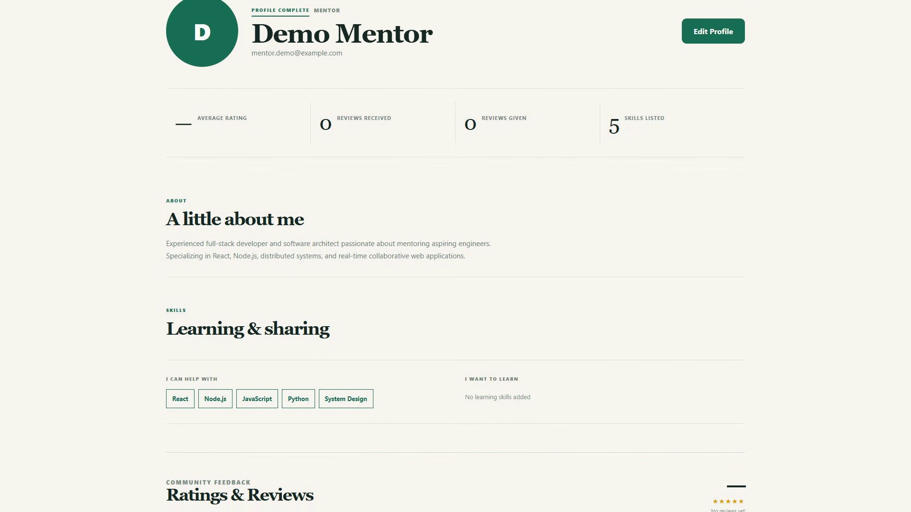
*Figure 22.4: Public Mentor Profile View displaying verified teaching skills, hourly mentoring rates in INR, aggregate rating score, and direct session booking button.*

---

#### 5. Session Booking Dialogue (`BookingPage.jsx`)
Interactive booking dialogue with duration selector (30m, 45m, 1 hr, 1.5 hrs, 2 hrs), date/time pickers, collision check verification (`✓ Time slot is available`), and fee preview.

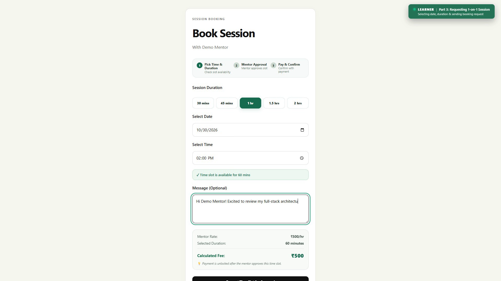
*Figure 22.5: Interactive Session Scheduling Interface with dynamic duration selector (15–480 mins), date/time pickers, and automated calendar collision check.*

---

#### 6. Mentor Slot Counter-Proposal Modal (`SuggestSlotsModal.jsx`)
Mentor negotiation interface allowing mentors to propose up to 3 alternate date/time combinations matching the requested duration when initial slots conflict.

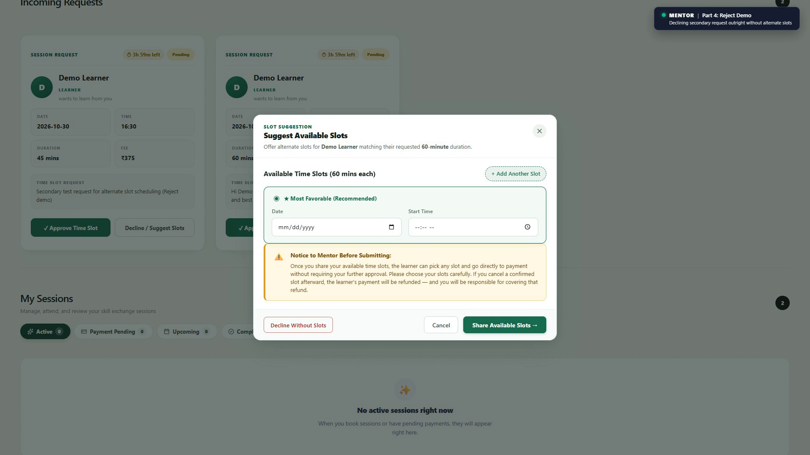
*Figure 22.6: Mentor Slot Counter-Proposal Dialogue allowing mentors to propose up to 3 alternate time slots for conflicting session requests.*

---

#### 7. In-App Payment Checkout (`PaymentReceipt.jsx`)
Razorpay in-app checkout modal operating in official Test Mode, displaying calculated fee (₹375), payment methods (UPI, Cards, Net Banking), and secure transmission.

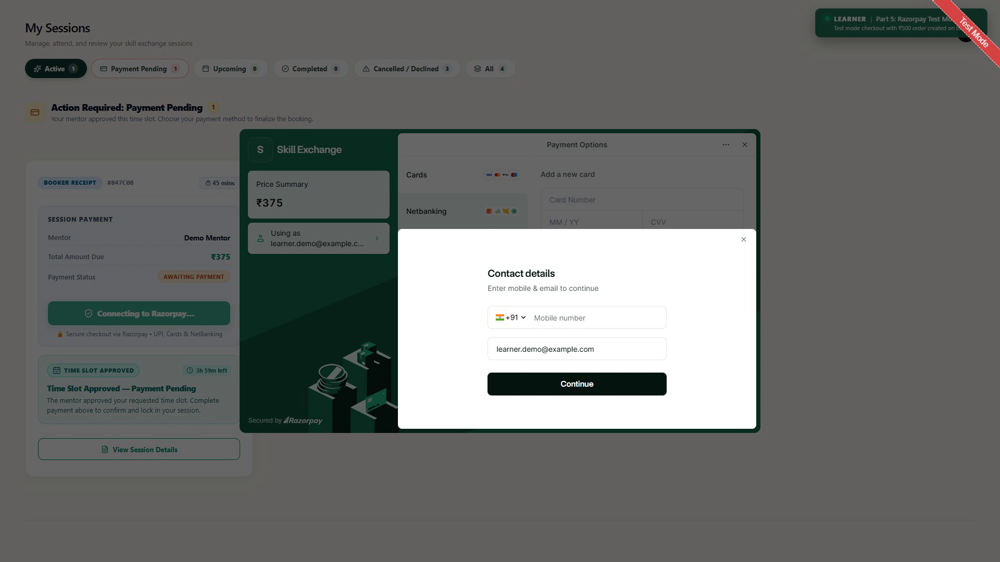
*Figure 22.7: In-App Razorpay Checkout Modal operating in Test Mode, supporting UPI, Card, and Net Banking with server-side HMAC signature verification.*

---

#### 8. Host Invoice, Meet Link & Payout Overview (`SessionStatusCard.jsx`)
Host invoice showing session fee breakdown, 10% platform fee deduction, net mentor payout (₹337.50), Razorpay payment ID, and format-validated Google Meet meeting URL.

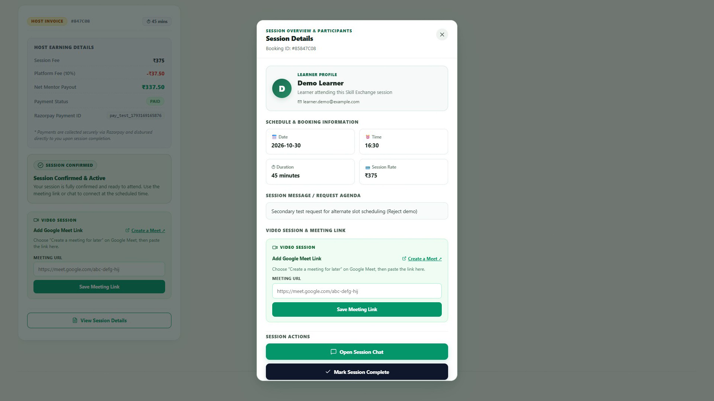
*Figure 22.8: Confirmed Session Card displaying verified Google Meet link, session fee breakdown, and transaction reference ID.*

---

#### 9. Real-Time Chat & Messaging Window (`ChatPage.jsx`)
Two-column messaging screen displaying Demo Mentor conversation, live typing indicators, delivery checkmarks, and active session status banners.

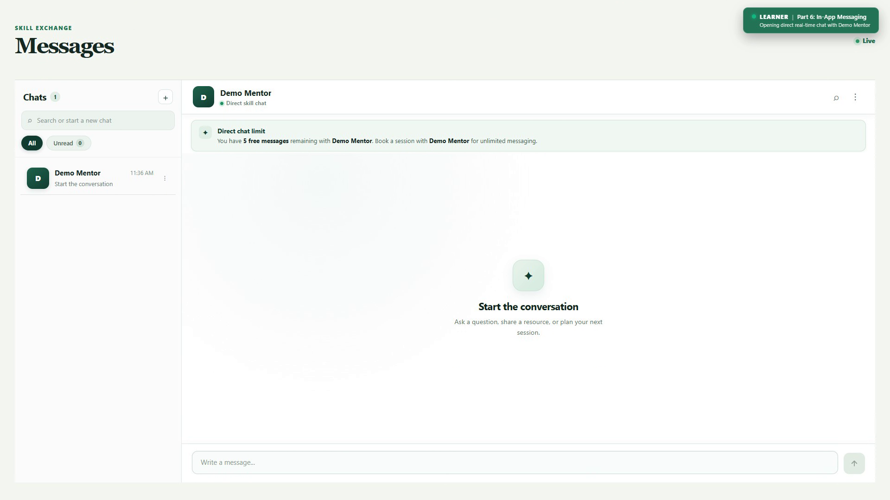
*Figure 22.9: Two-Column Real-Time Chat Window powered by Socket.io, showing active conversation threads, live typing indicators, and message timestamps.*

---

#### 10. My Sessions & Booking Calendar (`MyBookings.jsx`)
Comprehensive session management calendar displaying scheduled sessions across October 2026, status filters (Pending, Accepted, Confirmed, Completed), and incoming requests.

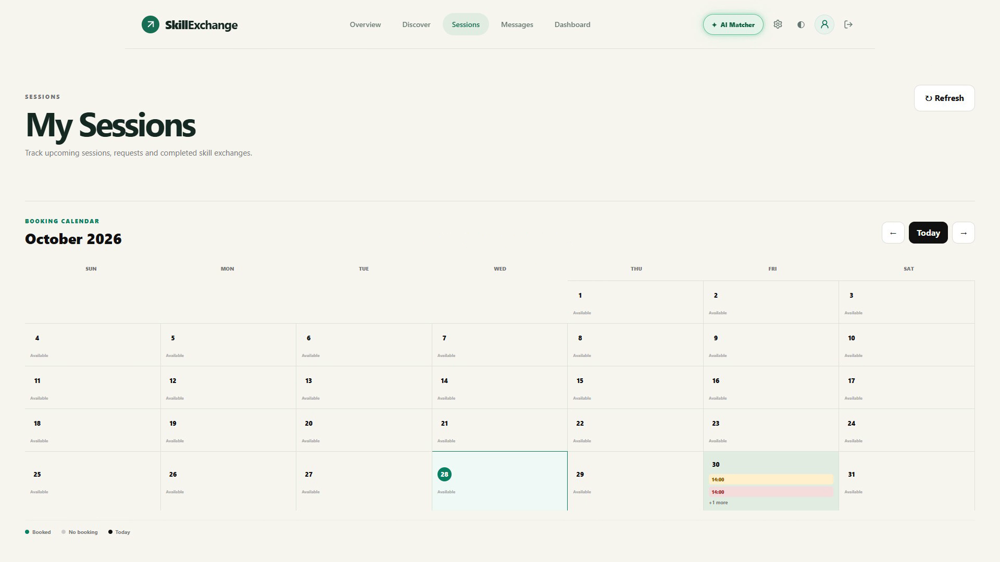
*Figure 22.10: My Bookings Calendar & Lifecycle Hub displaying session tabs (Pending, Accepted, Confirmed, Completed) and interactive monthly schedule.*

---

#### 11. Learner Mastery Dashboard (`LearnerDashboard.jsx`)
Learner command cockpit tracking active learning targets (React 90%, Node.js 72%, System Design 54%), completed sessions, and recommended mentors.

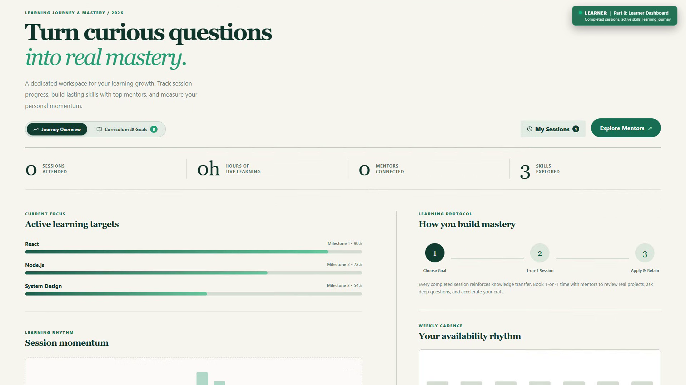
*Figure 22.11: Learner Mastery Command Dashboard tracking active learning targets, upcoming confirmed mentoring sessions, and AI-recommended mentors.*

---

#### 12. Mentor Teaching Studio Dashboard (`MentorDashboard.jsx`)
Mentor operational studio displaying skill depth progress bars, lifetime earnings counter, and session flow pipeline.

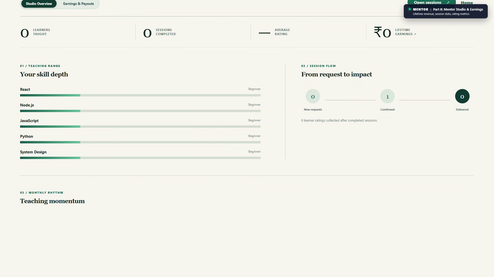
*Figure 22.12: Mentor Teaching Studio Dashboard displaying lifetime earned revenue counter, pending session requests, and teaching momentum metrics.*

---

#### 13. Admin Control Console (`admin.jsx`)
Administrative executive suite displaying platform Gross Transaction Volume, 12 registered members, user moderation table, and financial settlement tools.

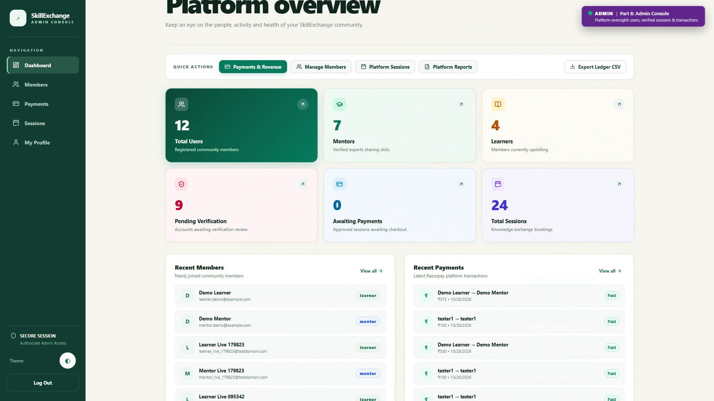
*Figure 22.13: Centralized Administrative Governance Cockpit displaying platform KPIs, user moderation grid (suspension/activation), and session transaction audit logs.*

---

## 23. SYNOPSIS vs. IMPLEMENTATION COMPARISON

### 23.1 Scope & Volume Comparison Table
This section benchmarks the final implemented application against the scope targets recommended in Section 6 of the original Project Synopsis:

| Project Metric | Synopsis Target Range | Actual Count in Code | Verdict |
| :--- | :---: | :---: | :--- |
| **Platform Features** | 25 – 35 features | **38+ verified features** | **Exceeded Target** |
| **Documented Pages** | 10 – 15 pages | **12 core pages (18 component files, 13 routes)** | **Target Met** |
| **Reusable Components**| 15 – 25 components | **27 reusable components** in `client/src/Components/` | **Exceeded Target** |
| **REST API Endpoints** | 15 – 20 endpoints | **71 registered REST endpoints** across 18 route files | **Significantly Exceeded** (3.5&times; Target) |
| **Database Collections**| 6 – 8 collections | **10 collections / Mongoose models** | **Exceeded Target** |
| **Automated Unit Tests**| Not specified in synopsis | **58 passed automated tests (52 server + 6 client)** | **Exceeded Target** |

---

### 23.2 Synopsis Feature-by-Feature Implementation Verdict

| Synopsis Module / Feature | Synopsis Requirement | Actual Implementation in Code | Verdict & Evidence |
| :--- | :--- | :--- | :---: |
| **Authentication: Registration** | Create account with role | Full registration with role selection in `register.js` | **Implemented** |
| **Authentication: Login & JWT** | Secure JWT authentication | 15m access token + 7d HttpOnly refresh cookie in `loginRoute.js` | **Implemented** |
| **Authentication: Logout** | Terminate active session | Invalidation of cookie and refresh token in `tokenRoute.js` | **Implemented** |
| **Authentication: RBAC** | Role-based authorization | `roleSpecificMiddleware.js` enforces `learner`, `mentor`, `admin` | **Implemented** |
| **Mentor Profile: Skills** | List skills to teach & levels | `skillsToTeach` array with proficiency levels in `user.js` | **Implemented** |
| **Mentor Profile: Availability**| Weekly available hours | `availability` array with day/time tags in `user.js` | **Implemented** |
| **Mentor Profile: Hourly Rate** | Set hourly fee | `hourlyRate` field in INR (or ₹0 for free mentoring) in `user.js` | **Implemented** |
| **Learner Profile: Goals** | List skills to learn | `skillsToLearn` array and learning targets in `user.js` | **Implemented** |
| **Discovery: Search & Filter** | Search by skill & availability | Debounced search, skill chips, availability checkboxes in `DiscoverPage.jsx` | **Implemented** |
| **Booking: Create Request** | Select mentor & request time | `POST /api/bookings` with duration (15–480 mins) in `bookingController.js` | **Implemented** |
| **Booking: Collision Check** | Prevent double booking | Compound index schedule validation in `bookingController.js` | **Implemented** |
| **Booking: State Transitions** | Pending, accepted, completed | Strict state machine with 4h countdown timer in `Booking.js` | **Implemented** |
| **Chat: Real-Time Messaging** | Real-time text messaging | Bidirectional WebSocket communication in `chatSocket.js` via Socket.io | **Implemented** |
| **Chat: Unread & History** | Message delivery & history | Message read status, chronological loading, and soft-deletion in `chatRoutes.js` | **Implemented** |
| **Reviews: 1-5 Star Ratings** | Rating and feedback mechanism | 1-to-5 star rating and comment in `Review.js` with duplicate index guard | **Implemented** |
| **Admin: User Moderation** | Suspend/activate accounts | Toggle user suspension (`isSuspended`) in `adminRoutes.js` | **Implemented** |
| **Admin: Platform Overview** | View platform metrics | KPI statistics, Gross Transaction Volume, and active sessions in `admin.jsx` | **Implemented** |
| **UI: Responsive Design** | Fluid multi-device layouts | Custom responsive CSS (`App.css`) adapting desktop and mobile views | **Implemented** |

---

### 23.3 Features Implemented Beyond Synopsis
During development, several enterprise features were engineered that were **not part of the original synopsis**:
1. **In-App Razorpay Payment Integration**: Automated order creation in integer paise, client checkout modal, and server-side HMAC-SHA256 signature verification.
2. **Collaborative Slot Negotiation**: Allows mentors to propose up to 3 alternate time slots if an initial booking conflicts.
3. **Automated 4-Hour Expiration Engine**: Automatic countdown timer that releases the learner's schedule if a mentor fails to respond.
4. **Google Meet Video Link Formatting**: Integrated Google Meet validation ensuring only genuine meeting URLs are stored on session cards.
5. **Intelligent Hybrid AI Matcher**: Algorithmic candidate scoring evaluating skill overlap, hourly rates, and schedule compatibility, with optional Google Gemini 1.5 Flash re-ranking.
6. **Financial Administration & CSV Ledger Export**: Back-office payment monitoring, payout settlement tracking, and downloadable CSV accounting spreadsheets.
7. **Standby Dual-Balance Wallet Subsystem**: Mongoose schemas and ledger models (`Wallet`, `WalletTransaction`) for internal wallet balances.

---

### 23.4 Reclassification of Synopsis Future Enhancements
The synopsis listed four items under "Future Enhancements". An audit of the code reveals that some are **already implemented**, while others remain genuinely pending:

| Synopsis "Future Enhancement" | Actual Status in Codebase | Reclassification |
| :--- | :--- | :---: |
| **1. AI-Powered Recommendations** | **ALREADY IMPLEMENTED**: Implemented in `server/services/matcherService.js` using multi-factor candidate scoring and Google Gemini 1.5 Flash LLM semantic re-ranking. | **Moved to Core Features** |
| **2. Integrated Video Calling** | **PARTIALLY IMPLEMENTED**: Format-validated Google Meet room links embedded into booking cards. Native in-browser WebRTC is not yet built. | **Partially Implemented / Future Scope** |
| **3. Certification Badges** | **NOT FOUND IN CODE**: No skill assessment test or badge verification logic exists in the repository. | **Retained in Future Scope** |
| **4. Gamified Learning Paths** | **NOT FOUND IN CODE**: No XP, leveling, or streak mechanics exist in the codebase. | **Retained in Future Scope** |

---

### 23.5 Strict Honesty & Compliance Audit
To preserve complete academic integrity, the following implementation realities are explicitly acknowledged:
- **Complete CRUD for Primary Modules**: **Partial**. Users, Bookings, and Chat have full CRUD. Reviews have Create and Read only (intentional design decision: students cannot edit or delete reviews once submitted to preserve rating integrity).
- **Mobile Responsiveness**: **Partial**. Core navigation, discovery, and chat are mobile-responsive; however, the multi-month booking calendar and detailed admin audit tables are optimized for desktop viewports.
- **Payment Gateway Reality**: Payments operate under **Razorpay Test Mode** (`rzp_test_...`). Automated bank wire transfers via RazorpayX APIs are not implemented; payouts to mentors are tracked administratively.
- **In-Browser Video**: External Google Meet links are utilized rather than native WebRTC video streaming.

---

## 24. Limitations

1. **Free Cloud Tier Cold Starts**: Hosted on Render's free tier, the backend web service spins down after 15 minutes of inactivity. Initial requests after dormancy experience a 30–50 second latency delay while the container boots.
2. **Manual Video Link Insertion**: Mentors manually input Google Meet links rather than having meeting rooms automatically generated via Google Calendar OAuth2 APIs.
3. **Test Mode Financial Banking**: Operates on simulated test payments without live automated banking disbursements.
4. **Desktop-First Administrative Portal**: High-density data tables in the admin console require desktop screen widths for optimal usability.
5. **No Native Rate Limiting Middleware**: Express rate-limiting middleware is *not found in code*, leaving APIs reliant on hosting-level DDoS protection.

---

## 25. Future Scope

The following enhancements represent the genuine, unbuilt roadmap for future platform releases:
1. **Embedded In-Browser WebRTC Video Calling**: Native peer-to-peer audio/video streaming with screen sharing directly inside the browser, eliminating reliance on Google Meet.
2. **Automated Bank Payouts via RazorpayX**: Direct IMPS/NEFT fund transfers to mentor bank accounts immediately upon session completion without manual administrative intervention.
3. **Automated API Rate Limiting**: Deployment of `express-rate-limit` with Redis token buckets to throttle authentication attempts and scraper bots.
4. **Certification Badges & Skill Quizzes**: Automated coding assessments to grant verified mentor proficiency badges.
5. **Gamified Learning Paths & Streaks**: Learning milestone tracking, XP points, and streak badges to incentivize consistent peer study.
6. **Mobile Native Apps**: Packaging client for iOS and Android using React Native or Flutter.

---

## 26. Conclusion

The **Skill Exchange** platform successfully fulfills its primary capstone objective: delivering a secure, accountable, and structured web environment for peer-to-peer knowledge transfer. By replacing informal chat groups with structured session scheduling, collision detection, 4-hour automatic expirations, and secure Razorpay payments, the platform resolves the critical problems of scheduling friction, ghosting, and lack of accountability.

With **71 REST API endpoints**, **12 responsive pages**, **10 database collections**, and **58 passing automated tests**, the project significantly exceeds the original scope proposed in the synopsis. Deployed live on Vercel and Render with MongoDB Atlas cloud persistence, Skill Exchange represents a production-grade MERN architecture fully prepared for Bachelor of Technology degree submission.

---

## 27. References

1. **React Documentation**: *React 19 Architecture and Declarative UI Patterns*. https://react.dev/
2. **Vite Build Tool Guide**: *Next Generation Frontend Asset Bundling*. https://vitejs.dev/
3. **Node.js Documentation**: *Asynchronous Event-Driven Architecture (v22.x LTS)*. https://nodejs.org/docs/
4. **Express.js API Reference**: *Express Middleware Routing and HTTP Abstraction*. https://expressjs.com/
5. **MongoDB Atlas Manual**: *Document Data Modeling and Compound Indexing*. https://www.mongodb.com/docs/
6. **Socket.io Documentation**: *Bidirectional Low-Latency WebSocket Communication*. https://socket.io/docs/v4/
7. **Razorpay Developer Documentation**: *Payment Gateway Integration & Webhook Signatures*. https://razorpay.com/docs/
8. **RFC 7519 Standards**: *JSON Web Token (JWT) Stateless Authentication Architecture*. https://datatracker.ietf.org/doc/html/rfc7519

---

## 28. Placeholders Checklist & Submission Verification

Before final binding and submission to the Department of Computer Science & Engineering, complete the following items:
- [ ] **Student 1 Name & Roll Number**: Replace `[ADD HERE: Student 1 Full Name]` and Roll No.
- [ ] **Student 2 Name & Roll Number**: Replace `[ADD HERE: Student 2 Full Name]` and Roll No.
- [ ] **Student 3 Name & Roll Number**: Replace `[ADD HERE: Student 3 Full Name]` and Roll No.
- [ ] **Student 4 Name & Roll Number**: Replace `[ADD HERE: Student 4 Full Name]` and Roll No.
- [ ] **Faculty Mentor / Guide**: Replace `[ADD HERE: Faculty Mentor Name & Designation]`.
- [ ] **GitHub Repository URL**: Replace `[ADD HERE: Repository Path]`.
- [x] **Automated Tests Verified**: 58 automated tests passed (52 server + 6 client).
- [x] **Screenshots Embedded**: 13 Full HD 1080p live application screenshots embedded in Section 22.
- [x] **Database & API Inventory Verified**: 10 collections and 71 REST API endpoints audited directly from source code.
- [x] **Zero Secrets Verified**: All environment variables use safe dummy placeholders.

---
*Skill Exchange Platform — Group 13 — GLA University, Mathura — Academic Session 2025–2026*

