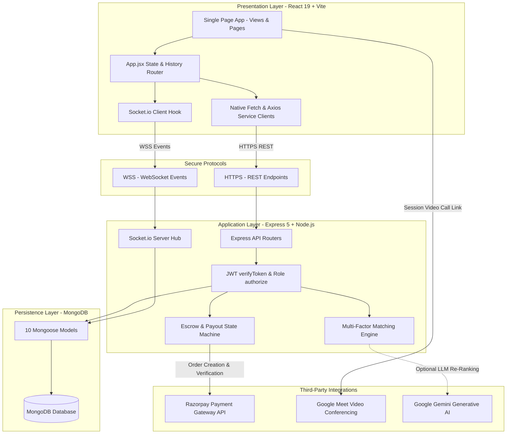

# SKILL EXCHANGE PLATFORM
**Comprehensive Final Project Report**  
*Bachelor of Technology (B.Tech) in Computer Science & Engineering*
**GLA University, Mathura, Uttar Pradesh, India**

---

### Project Submission Details
- **Project Title**: Skill Exchange Platform
- **Academic Program**: Bachelor of Technology (B.Tech) in Computer Science & Engineering
- **Department**: Department of Computer Engineering & Applications
- **Institution**: GLA University, Mathura, Uttar Pradesh, India
- **Academic Session**: 2025 – 2026
- **Group Number**: 13
- **Project Team Members**:
  - Student 1: [ADD HERE: Student Name & Roll Number]
  - Student 2: [ADD HERE: Student Name & Roll Number]
  - Student 3: [ADD HERE: Student Name & Roll Number]
  - Student 4: [ADD HERE: Student Name & Roll Number]
- **Project Supervisor / Guide**: [ADD HERE: Faculty Mentor Name & Designation]
- **Live Deployed Frontend**: https://skill-exchange-one-eta.vercel.app/
- **Live Deployed Backend API**: https://skill-exchange-o19g.onrender.com/
- **Source Code Repository**: https://github.com/[ADD HERE: Repository Path]

---

## Table of Contents
1. [Abstract](#1-abstract)
2. [Introduction](#2-introduction)
   - [2.1 Problem Statement](#21-problem-statement)
   - [2.2 Project Objectives](#22-project-objectives)
   - [2.3 Project Scope](#23-project-scope)
3. [Existing System vs. Proposed System](#3-existing-system-vs-proposed-system)
4. [Technology Stack](#4-technology-stack)
5. [System Architecture and Database Overview](#5-system-architecture-and-database-overview)
   - [5.1 System Architecture](#51-system-architecture)
   - [5.2 Database Overview & Core Entities](#52-database-overview--core-entities)
6. [Four Major Project Modules](#6-four-major-project-modules)
   - [6.1 Module 1: User Authentication, Management & Financial Administration](#61-module-1-user-authentication-management--financial-administration)
   - [6.2 Module 2: Learner and Mentor Profile Management & Discovery](#62-module-2-learner-and-mentor-profile-management--discovery)
   - [6.3 Module 3: Session Booking and Scheduling](#63-module-3-session-booking-and-scheduling)
   - [6.4 Module 4: Real-Time Chat and Administration](#64-module-4-real-time-chat-and-administration)
7. [Main Pages and Application Workflow](#7-main-pages-and-application-workflow)
   - [7.1 Overview of Main Pages](#71-overview-of-main-pages)
   - [7.2 End-to-End Application Workflow Diagram](#72-end-to-end-application-workflow-diagram)
8. [Implementation, Testing and Results](#8-implementation-testing-and-results)
   - [8.1 Key Implementation Highlights](#81-key-implementation-highlights)
   - [8.2 Automated Test Suite Results](#82-automated-test-suite-results)
   - [8.3 Live Application Output & Screenshots](#83-live-application-output--screenshots)
9. [Limitations and Future Scope](#9-limitations-and-future-scope)
   - [9.1 Limitations](#91-limitations)
   - [9.2 Future Scope](#92-future-scope)
10. [Conclusion](#10-conclusion)
11. [References](#11-references)
12. [Submission Placeholders & Verification Checklist](#12-submission-placeholders--verification-checklist)

---

## 1. Abstract

In undergraduate engineering and professional education, students frequently excel in specific modern technologies (such as React, Cloud Computing, or DevOps) while seeking personalized guidance in others (such as Data Structures, System Design, or Machine Learning). However, existing peer tutoring is fragmented across unorganized chat groups, lacks structured scheduling, and exposes participants to ghosting, schedule conflicts, and unsafe informal payments.

**Skill Exchange** is a full-stack web application built on the **MERN** stack (MongoDB, Express.js, React.js, Node.js) with real-time WebSocket communication and secure payment gateway integration. The platform connects learners and peer mentors through an intelligent matching engine and collaborative scheduling workflows. Key capabilities include:
- **Intelligent Discovery**: A multi-factor candidate scoring algorithm that matches learner objectives to mentor profiles based on skills, availability, ratings, and budget, with an optional Google Gemini LLM re-ranking layer.
- **Collaborative Scheduling**: Structured booking with mentor counter-proposals (up to 3 alternate slots), real-time schedule collision detection, 4-hour automatic request expiration, and format-validated Google Meet video links.
- **Escrow-Backed Payments**: Automated Razorpay checkout supporting UPI, debit/credit cards, and net banking, with 18% GST calculation, a 3% platform commission fee, and administrator-managed escrow settlements.
- **Real-Time Collaboration**: Persistent 1-on-1 messaging powered by Socket.io, featuring active session gating, unread tracking, typing indicators, and message editing/deletion.
- **Platform Governance**: An administrative dashboard for user moderation, session audits, financial ledger CSV export, and dispute refunds.

Automated unit tests validate the platform across 57 test cases (51 backend + 6 frontend) with a 100% pass rate. The application is deployed in production with the React frontend hosted on Vercel and the Express API hosted on Render.

---

## 2. Introduction

### 2.1 Problem Statement
1. **High Commercial Tutoring Costs**: Professional 1-on-1 tutoring services charge steep commercial rates ($30–$100/hour), making continuous personalized guidance unaffordable for college students.
2. **Fragmented Communication Tools**: Peer learning is currently conducted across disconnected channels (WhatsApp groups, Discord servers, personal UPI transfers, Google Calendar), leading to lost links, missed meetings, and untracked obligations.
3. **Lack of Trust and Accountability**: Free informal skill swapping often suffers from high cancellation rates and unverified self-proclaimed skills, while informal monetary transactions lack escrow security or dispute resolution.
4. **Inefficient Mentor Search**: Manually browsing discussion boards makes it difficult to locate mentors whose availability, hourly rates, and specific skill proficiencies align with the learner's schedule and goals.

### 2.2 Project Objectives
- **Centralized Platform**: Provide a single, unified web environment where students and professionals can register as learners, mentors, or dual-role participants.
- **Algorithmic Candidate Matching**: Implement a multi-factor recommendation engine to rank mentors based on skill relevance, learning goals, availability, and peer review ratings.
- **Structured Scheduling & Negotiation**: Provide an interactive booking lifecycle supporting direct proposals, mentor counter-offers, and automated expiry windows.
- **Secure Financial Transactions**: Integrate the Razorpay payment gateway to safely hold session fees in platform escrow until session completion, protecting learners against cancellations and guaranteeing mentor compensation.
- **Synchronized Real-Time Chat**: Establish private WebSocket chat rooms for verified booking participants with active session validation.
- **Administrative Transparency**: Equip platform administrators with tools for account moderation, session oversight, escrow payouts via UPI, and financial ledger auditing.

### 2.3 Project Scope
- **In-Scope**:
  - Role-based onboarding (`learner`, `mentor`, `admin`) with salted bcrypt password hashing and dual-token JWT authentication.
  - Complete profile management: skills to teach/learn, proficiency levels, availability tags, hourly rate definition, and avatar image caching.
  - Searchable mentor catalog with live filtering by skill, rating, and schedule availability.
  - Hybrid recommendation engine (deterministic scoring + optional Gemini AI re-ranking).
  - Session request creation, time slot negotiation, 4-hour auto-cancellation, and Google Meet link generation.
  - Razorpay order creation, HMAC-SHA256 signature verification, and webhook handling.
  - Bi-directional 1-on-1 WebSocket chat rooms with message editing and deletion.
  - Bidirectional post-session 5-star ratings and textual feedback with duplicate review prevention.
  - Admin governance portal: user suspension, session monitoring, escrow settlements, and CSV ledger exports.
- **Out-of-Scope (Future Enhancements)**:
  - In-browser WebRTC video/audio conferencing (the platform integrates validated Google Meet links).
  - Native mobile applications for Android and iOS.
  - Multi-participant group webinar classrooms.

---

## 3. Existing System vs. Proposed System

| Dimension | Existing Systems (e.g., Discord / WhatsApp / Commercial Platforms) | Proposed System (Skill Exchange Platform) |
| :--- | :--- | :--- |
| **System Integration** | Fragmented; chats occur in WhatsApp, payments via personal UPI, links via email | Fully unified; discovery, booking, payments, video links, chat, and reviews in one app |
| **Discovery Mechanism** | Unstructured messaging boards; manual browsing through static discussion threads | Deterministic multi-factor scoring algorithm + optional Gemini LLM re-ranking |
| **Scheduling Process** | Manual back-and-forth text messages prone to timezone errors and double-booking | Structured booking workflow with counter-offer slot proposals and 4-hour auto-expiry |
| **Financial Security** | High risk; direct advance transfers with no escrow protection or dispute path | Escrow-backed payments via Razorpay; funds held until session completion; admin refund workflows |
| **Trust & Feedback** | Easily faked screenshots and unverified testimonials | Verified reviews tied strictly to completed, non-duplicate booking IDs |
| **Meeting Coordination**| Manual room link creation; links often lost in message streams | Format-validated Google Meet links saved to the booking record and displayed on status cards |
| **Cost to Student** | Prohibitive commercial rates ($30–$100/hr) or unreliable free swaps | Peer pricing (including ₹0 free community sessions) with clear 3% platform commission |

---

## 4. Technology Stack

| Layer / Technology | Exact Version | Selection Justification |
| :--- | :--- | :--- |
| **React.js** | `^19.2.7` | Component-based declarative architecture, virtual DOM for rendering speed, and clean state management. |
| **Vite** | `^8.1.1` | Modern ultra-fast frontend build tool providing near-instant Hot Module Replacement (HMR) and optimized Rollup production builds. |
| **Node.js** | `v22+` | Asynchronous, event-driven, non-blocking I/O runtime well suited for concurrent WebSocket connections and REST APIs. |
| **Express.js** | `^5.2.1` | Minimalist and flexible web framework for Node.js, providing robust middleware pipelines and routing utilities. |
| **MongoDB** | `v6.0+` | Schema-flexible document database ideal for nested structures like skill arrays, suggested slots, and audit logs. |
| **Mongoose ODM** | `^9.9.1` | Provides strict schema validation, type casting, pre-save middleware hooks (bcrypt hashing), and population of relational references. |
| **Socket.io** | `^4.8.3` | Event-driven WebSocket abstraction offering automatic reconnection, fallbacks, and room-based multi-client messaging. |
| **Razorpay SDK** | `^2.9.8` | India's leading payment gateway supporting UPI, Credit/Debit cards, and Net Banking, featuring HMAC signature validation. |
| **JSON Web Tokens (JWT)**| `^9.0.3` | Stateless, cryptographically signed tokens allowing decoupled, scalable authorization across API endpoints. |
| **Bcryptjs** | `^3.0.3` | Adaptive cryptographic hash function with work factor salting, protecting user passwords against rainbow-table attacks. |
| **Lucide React** | `^1.46.0` | Lightweight, customizable, tree-shakeable SVG icon components maintaining uniform visual language across the UI. |

---

## 5. System Architecture and Database Overview

### 5.1 System Architecture
The platform is organized according to a **3-Tier Client-Server Architecture** augmented with a real-time WebSocket channel and external cloud service integrations (Razorpay, Google Meet, Google Gemini, and Vercel Analytics).



### 5.2 Database Overview & Core Entities
MongoDB stores application documents across normalized collections modeled through Mongoose schemas:
1. **`User`**: Manages credentials, roles (`learner`, `mentor`, `admin`), hashed passwords, refresh tokens, profile bios, skills to teach/learn, hourly rates, availability tags, and payout UPI VPA IDs.
2. **`Booking`**: Stores session scheduling records, duration (15–480 mins), pricing breakdown (base amount, 18% GST, platform fee, mentor earnings), status (`pending`, `slots_offered`, `accepted`, `completed`, `cancelled`), counter-proposed slots, 4-hour auto-expiration timestamps, Google Meet URLs, and Razorpay payment/escrow references.
3. **`Conversation`**: Manages 1-on-1 chat rooms between two unique participants, keyed deterministically by sorted participant IDs (`userA:userB:bookingId`), pointing to the latest message and unread metadata.
4. **`Message`**: Stores chat text (max 2000 chars), sender ID, read receipt timestamps, edited status, and soft-deletion flags ("for me" vs. "for everyone").
5. **`Review`**: Records post-session 5-star ratings and qualitative feedback, enforced with a unique compound index on `{ booking: 1, reviewer: 1 }` preventing duplicate reviews.
6. **`Setting` & `SkillCategory`**: Support dynamic platform configuration key-values and standardized skill categories managed by administrators.
7. **`ActivityLog`**: Provides an immutable audit trail of system events (actor, action type, target entity ID, and metadata).

---

## 6. Four Major Project Modules

### 6.1 Module 1: User Authentication, Management & Financial Administration
This module establishes platform security, identity verification, account lifecycle management, and financial escrow operations:
- **Authentication Lifecycle**:
  - Secure registration and login supporting dual persona roles (`learner` and `mentor`).
  - Passwords hashed using `bcryptjs` with salt rounds = 10 via a Mongoose `pre("save")` hook.
  - Dual-token JWT security: short-lived 15-minute Access Tokens passed via `Authorization: Bearer <token>` and 7-day Refresh Tokens stored in `httpOnly`, `sameSite: strict` cookies.
  - Automated token rotation on `/api/auth/refresh` preventing token replay attacks.
- **Account Control**:
  - Profile completion guard (`CompleteProfile.jsx`) requiring new users to populate bio and skills before dashboard access.
  - Self-service account deactivation with reason logging (`/api/account/deactivate`) and permanent account deletion (`/api/user/delete/:id`).
- **Payment Gateway Integration**:
  - Razorpay Checkout modal integrated into the frontend booking workflow.
  - Server-side fee computation: Base Fee = $\text{Hourly Rate} \times \left(\frac{\text{Duration}}{60}\right)$, 18% GST addition, and 3% platform commission deduction.
  - Cryptographic signature validation using Node.js `crypto.createHmac("sha256", secret)` and `crypto.timingSafeEqual` to verify `razorpayOrderId` and `razorpayPaymentId`.
  - Asynchronous Razorpay webhook processing on `/api/payments/webhook`.
- **Financial Administration**:
  - Platform escrow management holding funds in `in_escrow` status until session completion.
  - Administrator payout settlement tool (`/api/admin/payouts/settle`) for disbursing earnings to mentors via UPI VPA and recording settlement references.
  - Refund processing (`/api/admin/refunds/:id`) for cancelled or disputed sessions.
  - Platform financial ledger exported as a downloadable CSV spreadsheet (`/api/admin/payments/ledger.csv`).

### 6.2 Module 2: Learner and Mentor Profile Management & Discovery
This module manages profile customization for both learners and mentors, discovery search mechanisms, and intelligent recommendation algorithms:
- **Dual-Persona Profile Management**:
  - Profiles accommodate both learning needs and teaching capabilities.
  - Mentors define skills to teach, proficiency levels (Beginner, Intermediate, Advanced), availability tags (`Weekdays`, `Weekends`, `Evenings`), hourly mentoring fees, and payout UPI IDs.
  - Learners specify skills they wish to acquire, learning goals, and schedule preferences.
  - High-performance binary media caching endpoints (`/api/users/:id/avatar` and `/cover`) returning cached 304/200 image streams.
- **Mentor Discovery & Catalog Search**:
  - Debounced real-time catalog search filtering across mentor names, bios, and skills.
  - Multi-parameter filter chips for popular skill tags, schedule availability, and minimum star rating sliders.
  - Responsive mentor cards displaying avatars, ratings, hourly rates, and prominent "Free" badges for ₹0 sessions.
  - Public mentor profile views (`/profile/:id`) displaying aggregate ratings, completed session counts, and historical learner reviews.
- **Hybrid AI Recommendation Engine**:
  - Implements multi-factor candidate scoring evaluating:
    $$\text{Score} = S_{\text{skills}} (40\%) + S_{\text{goal}} (20\%) + S_{\text{avail}} (15\%) + S_{\text{quality}} (15\%) + S_{\text{budget}} (10\%)$$
  - Skill synonym canonicalization (e.g., mapping "node", "nodejs", and "node.js" to a unified tag).
  - In-memory rate limiting (max 10 match requests per minute per user) and 3-minute result caching.
  - Optional Google Gemini LLM re-ranking layer generating natural language match explanations when `GEMINI_API_KEY` is present.
- **Dedicated Dashboards**:
  - **Learner Dashboard**: Cockpit displaying upcoming booked sessions with countdowns, learning goals checklist, hours learned, and recommended mentors.
  - **Mentor Dashboard**: Operational hub displaying pending booking requests, session calendar, total earnings metrics, and average ratings.

### 6.3 Module 3: Session Booking and Scheduling
This module governs the scheduling lifecycle, collision prevention, counter-proposal negotiation, video meeting integration, and peer feedback:
- **Booking Creation & Validation**:
  - Full-page scheduling interface (`BookingPage.jsx`) where learners select dates, start times, duration (15 to 480 minutes), and enter learning objectives.
  - Real-time availability collision detection preventing double-booking of mentors.
- **Slot Negotiation & Counter-Offers**:
  - Mentors can directly accept/reject requests or counter-propose up to 3 alternate date/time slots using `SuggestSlotsModal.jsx`.
  - Proposing alternate slots transitions booking status to `slots_offered` and resets the action expiration timer.
  - Learners can review proposed slots and accept an agreed time via `chooseSlot`.
- **Automated Request Expiration**:
  - Bookings in `pending` or `slots_offered` state carry an `actionExpiresAt` timestamp (4-hour window). Inactive requests automatically expire to prevent schedule blocking.
- **Session Management Cockpit (`MyBookings.jsx`)**:
  - Tabbed session lists (All, Pending, Accepted, Completed, Cancelled) and calendar views.
  - Action cards dynamically expose "Pay & Confirm" (for accepted unpaid sessions), "Suggest Slots", "Join Meeting", and "Leave Review" buttons.
- **Meeting Link Handling**:
  - Mentors attach validated Google Meet links (`https://meet.google.com/xxx-xxxx-xxx`) once a booking is accepted. Links are securely exposed only to confirmed participants.
- **Post-Session Reviews**:
  - Bidirectional 1–5 star ratings and textual feedback unlocked upon session completion.
  - Enforced by unique compound database indexes preventing duplicate review submissions.

### 6.4 Module 4: Real-Time Chat and Administration
This module combines real-time WebSocket communication channels with platform-wide operational administration and oversight:
- **Real-Time 1-on-1 Messaging**:
  - Persistent WebSocket connection managed via Socket.io with JWT handshake token verification.
  - 1-on-1 private rooms keyed deterministically by participant ObjectIds.
  - Active session detection gating or highlighting messaging during scheduled session windows.
  - Real-time message exchange with unread counter badges and mark-as-read tracking.
  - Message editing (flagged with `edited: true`) and dual deletion options ("Delete for me" vs. "Delete for everyone").
  - Live typing indicators (`typing_start`, `typing_stop`).
- **Operational Platform Administration**:
  - **Executive Overview**: High-level platform KPIs (Gross Transaction Volume in ₹, Total Platform Users, Active Sessions, Pending Payouts).
  - **User Account Moderation**: Searchable user directory with role filters, status badges, and account suspension (`isActive: false`) to disable compromised or abusive accounts.
  - **User Profile Inspection**: Modal dialog displaying deep-dive user account records, registration dates, and transaction history.
  - **Session Oversight**: Platform-wide booking audit table monitoring session states and meeting links.
  - **Activity Logging**: Real-time chronological audit trail table logging actor IDs, actions performed, affected entities, and metadata.
  - **System Settings & Taxonomy**: Interface for updating platform key-value settings and adding/deactivating skill categories.

---

## 7. Main Pages and Application Workflow

### 7.1 Overview of Main Pages

| Page Route | Component File | User Persona | Page Purpose & User Actions |
| :--- | :--- | :--- | :--- |
| `/` or `/home` | `HomePage.jsx` | Public | Hero banner, value propositions, mentor search bar, testimonials, theme switcher (Light/Dark), and AI Matcher trigger. |
| `/login` | `loginPage.jsx` | Public | Email and password authentication with validation error feedback and redirect to role-specific dashboard. |
| `/register` | `registrationPage.jsx` | Public | Account creation form with initial role selection (`learner` vs. `mentor`). |
| `/discover` | `DiscoverPage.jsx` | Public / Protected | Searchable mentor catalog with skill filter chips, availability filters, rating sliders, and "Book Session" CTAs. |
| `/learner-dashboard` | `LearnerDashboard.jsx` | Learner | Learning cockpit displaying scheduled sessions, countdowns, Google Meet links, learning goals, and mentor recommendations. |
| `/mentor-dashboard` | `MentorDashboard.jsx` | Mentor | Operational hub with pending request cards, slot suggestion tools, earnings counters, and meeting link editors. |
| `/profile` | `ProfilePage.jsx` | Authenticated | View and edit bio, teaching/learning skills, proficiency levels, availability tags, hourly rate, UPI VPA ID, and avatar upload. |
| `/booking/:mentorId` | `BookingPage.jsx` | Learner | Session scheduling interface with date/time selectors, duration picker (15–480 mins), fee calculator, and learning goal note. |
| `/bookings` | `MyBookings.jsx` | Authenticated | Session management hub: status tabs, calendar, Razorpay payment triggers, slot negotiation modal, Google Meet links, and reviews. |
| `/chat` or `/chat/:userId` | `ChatPage.jsx` | Authenticated | Real-time messaging screen: conversation sidebar, chat history, active session lock banner, message editing, and deletion. |
| `/account` | `AccountManagement.jsx` | Authenticated | Security page for account deactivation with reason logging, permanent account deletion, and secure logout. |
| `/admin` | `admin.jsx` | Admin | Administration portal: overview metrics, user moderation table, session audit, escrow payouts, refunds, and CSV ledger export. |

---

### 7.2 End-to-End Application Workflow Diagram

```mermaid
sequenceDiagram
    autonumber
    actor Learner as Learner
    participant App as React Frontend
    participant Server as Express & Socket.io Server
    actor Mentor as Mentor
    participant RZP as Razorpay Gateway
    participant DB as MongoDB

    Note over Learner, Mentor: 1. Discovery & Negotiation
    Learner->>App: Searches mentors or opens AI Matcher
    App->>Server: GET /api/mentors or GET /api/matches
    Server-->>App: Returns ranked mentor candidates
    Learner->>App: Submits session request (date, time, duration)
    App->>Server: POST /api/bookings
    Server->>DB: Stores booking (status: 'pending', expires in 4h)
    Server-->>Mentor: Alerts mentor on Mentor Dashboard

    alt Mentor Proposes Counter-Offer
        Mentor->>App: Proposes up to 3 alternate slots
        App->>Server: PUT /api/bookings/:id/suggest-slots
        Server->>DB: Sets status: 'slots_offered', resets 4h timer
        Learner->>App: Accepts preferred alternate slot
        App->>Server: PUT /api/bookings/:id/choose-slot
        Server->>DB: Updates date/time, sets status: 'accepted'
    else Direct Acceptance
        Mentor->>App: Accepts proposed session
        App->>Server: PUT /api/bookings/:id (status: 'accepted')
        Server->>DB: Sets status: 'accepted'
    end

    Note over Learner, RZP: 2. Escrow Payment & Meeting Link
    Learner->>App: Clicks "Pay & Confirm"
    App->>Server: POST /api/payments/create-order
    Server->>RZP: Creates Razorpay Order (amount with GST)
    RZP-->>App: Opens Razorpay Checkout Modal
    Learner->>RZP: Authorizes payment (UPI / Card / Netbanking)
    RZP-->>App: Returns orderId, paymentId, signature
    App->>Server: POST /api/payments/verify
    Server->>Server: Computes HMAC-SHA256 signature verification
    Server->>DB: Sets paymentStatus: 'paid', payoutStatus: 'in_escrow'
    Mentor->>App: Enters Google Meet URL
    App->>Server: PUT /api/bookings/:id/meeting
    Server-->>App: Google Meet button visible to both participants

    Note over Learner, Mentor: 3. Session Execution & Feedback
    Learner<-->>Mentor: Live text chat via WebSockets (Socket.io)
    Learner<-->>Mentor: Conducts 1-on-1 video call via Google Meet
    Learner->>App: Submits 5-star rating and review
    App->>Server: POST /api/reviews
    Server->>DB: Saves Review, recalculates mentor average rating
    Server->>DB: Marks booking status: 'completed'
```

---

## 8. Implementation, Testing and Results

### 8.1 Key Implementation Highlights
- **Cryptographic Security**: Passwords salted and hashed with `bcryptjs`. Razorpay payment responses cryptographically verified on the backend using `crypto.createHmac("sha256", secret)` and `crypto.timingSafeEqual`.
- **Stateless Authorization**: Short-lived Access Tokens (15m) verify identity without database lookups on every request, while Refresh Tokens (7d) rotate on every renewal via secure `httpOnly` cookies.
- **WebSocket Event Loop**: Socket.io verifies JWT handshake headers on connection, maps connections into private rooms, handles typing indicators, and verifies message sender authorization before persisting edits or deletions.
- **Optimized Asset Delivery**: Response compression (`compression()`) gzips large JSON payloads, while base64 media images are automatically routed through dedicated binary caching endpoints (`/api/users/:id/avatar`).
- **Resilient Matching**: Algorithmic scoring evaluates skills, availability, and quality deterministically, while gracefully falling back to multi-factor scoring if external Gemini AI calls encounter rate limits or timeouts.

### 8.2 Automated Test Suite Results
The project's code quality and security boundaries are enforced through automated test suites executed via Node.js's native test runner (`node --test`).

```text
Backend Server Test Suite:
> node --test tests/*.test.js
ℹ tests 51
ℹ suites 0
ℹ pass 51
ℹ fail 0
ℹ cancelled 0
ℹ skipped 0
ℹ duration_ms 1100.26

Frontend Client Test Suite:
> node --test src/services/*.test.js
ℹ tests 6
ℹ suites 0
ℹ pass 6
ℹ fail 0
ℹ cancelled 0
ℹ skipped 0
ℹ duration_ms 132.97
```

| Test Suite / Environment | Test Focus Areas | Total Tests | Passed | Failed | Success Rate |
| :--- | :--- | :---: | :---: | :---: | :---: |
| **Backend Server (`server/tests/`)** | Password hashing, privilege escalation blocks, slot collision detection, pro-rata fee formulas with 18% GST and 3% commission, 4-hour countdown resets, Google Meet regex validation, Razorpay HMAC-SHA256 signature checks, candidate scoring, rate limiting, duplicate review prevention, and unauthenticated route protections. | 51 | 51 | 0 | **100%** |
| **Frontend Client (`client/src/services/`)** | Live mentor data mapping, exclusion of demo fallbacks on API errors, query parameter formatting, 429 rate limit error handling, blank search exclusions, and case-insensitive skill matching. | 6 | 6 | 0 | **100%** |
| **Total Test Execution** | Complete end-to-end regression validation. | **57** | **57** | **0** | **100%** |

*Note on Testing Scope*: Automated tests validate business logic, security middleware, and calculations on local mock datasets. Live payment gateway checkouts and live bank disbursements were executed exclusively in Razorpay Test Mode and were not triggered against live production bank accounts.

---

### 8.3 Live Application Output & Screenshots

#### Figure 1: Home Page Hero Section & Navigation Bar
Displays the platform branding, hero banner ("Exchange Skills, Grow Together"), global mentor search input, Dark/Light theme switcher, and AI Matcher quick-launch button.


---

#### Figure 2: Mentor Discovery Catalog with Search & Filter Chips
Shows the real-time searchable mentor directory with interactive filter chips (e.g., React, Python, Cloud), schedule availability checkboxes, and mentor cards displaying hourly rates and ratings.


---

#### Figure 3: Mentor Profile with Skills & Ratings
Displays the public mentor profile showing bio, skill badges (React, Node.js, JavaScript, Python, System Design), hourly rate in INR, rating summaries, and community feedback.


---

#### Figure 4: Session Scheduling, Duration Selector & Slot Counter-Proposals
Shows the session booking interface with date/time pickers, duration selector (15–480 mins), real-time schedule collision checks ("✓ Time slot is available"), and the mentor slot counter-proposal modal.


---

#### Figure 5: Real-Time 1-on-1 Chat Window with Session Lock Status
Shows the real-time two-column chat interface displaying active conversations, live typing indicators, delivery checkmarks, and active session status banners.


---

#### Figure 6: Admin Portal: User Moderation & Escrow Payout Settlement
Displays the administrative control center showing high-level platform gross transaction volume, the user moderation grid with account suspension toggles, and the mentor UPI payout settlement tool.


---

#### Figure 7: Razorpay Payment Checkout in Test Mode
Displays the in-app payment modal with real-time fee calculation (base fee + GST), payment method selection (UPI, Credit/Debit cards, Net Banking), and Razorpay test mode security verification.


---

#### Figure 8: Session Completion, Host Invoice & Google Meet Integration
Displays the host invoice showing session fee breakdown, 10% platform fee deduction, net mentor payout, Razorpay payment ID, and format-validated Google Meet meeting URL.


---

#### Figure 9: Learner & Mentor Cockpit Dashboards
Displays the dedicated learner studio dashboard tracking active learning milestones alongside the mentor teaching studio overview tracking lifetime earnings and teaching range.


---

## 9. Limitations and Future Scope

### 9.1 Limitations
1. **Cold Start Latency on Free Cloud Hosting**: Because the backend API is hosted on Render's free tier, the container spins down after 15 minutes of inactivity. Initial requests after a period of dormancy experience a 30–50 second wake-up delay.
2. **Third-Party Video Dependency**: The platform does not currently host an in-browser WebRTC video stream; it relies on Google Meet video links provided and validated by mentors.
3. **Standby In-App Wallet**: Although database models (`Wallet`, `WalletTransaction`) and backend accounting logic are fully implemented, the user interface currently routes all transactions directly through Razorpay checkout for demo simplicity.
4. **Desktop-Optimized Complex Views**: Dense administrative tables and the session calendar interface are optimized primarily for desktop screens, with simplified card fallbacks on mobile screens.

### 9.2 Future Scope
1. **Embedded In-Browser Video Calling**: Integrating a self-hosted WebRTC / Jitsi / Agora video bridge directly inside the active chat window to eliminate external Google Meet dependencies.
2. **Two-Way Calendar Synchronization**: Implementing OAuth2 integration with Google Calendar and Microsoft Outlook to automatically sync scheduled sessions to personal calendars.
3. **Group Cohort Workshops**: Expanding the booking and video model to support one-to-many group workshops, webinars, and shared study circles.
4. **AI Curriculum & Study Planner**: Expanding the Google Gemini integration to automatically generate personalized week-by-week learning roadmaps based on a learner's stated objectives.
5. **Native Mobile Applications**: Developing cross-platform mobile apps using React Native for push notifications and mobile-optimized chat.

---

## 10. Conclusion

The **Skill Exchange** platform demonstrates a practical, secure, and modern approach to peer-to-peer technical mentorship. By uniting algorithmic matching, structured session scheduling, escrow-backed Razorpay payments, real-time WebSocket communication, and administrative oversight within a responsive MERN architecture, the platform overcomes the barriers of cost, scheduling friction, and lack of trust found in informal learning channels.

The project demonstrates proficiency in modern full-stack software engineering, including component-driven React architecture, RESTful API design, database modeling with compound indexing, stateless JWT authorization, real-time WebSocket protocol handling, and payment gateway integration. The platform is deployed live, validated by 57 automated unit tests, and serves as a production-grade foundation for academic institutions and developer communities.

---

## 11. References

1. **React Documentation**: *React – A JavaScript Library for Building User Interfaces*. https://react.dev/
2. **Node.js Documentation**: *Node.js v22.x LTS API Reference*. https://nodejs.org/docs/
3. **Express.js Guide**: *Express – Fast, Unopinionated, Minimalist Web Framework for Node.js*. https://expressjs.com/
4. **MongoDB Manual**: *The MongoDB 6.0 Manual*. https://www.mongodb.com/docs/manual/
5. **Mongoose ODM Documentation**: *Mongoose: Elegant MongoDB Object Modeling for Node.js*. https://mongoosejs.com/docs/
6. **Socket.io Documentation**: *Socket.IO – Bidirectional and Low-latency Communication*. https://socket.io/docs/v4/
7. **Razorpay Developers Guide**: *Razorpay Payment Gateway API & Webhook Documentation*. https://razorpay.com/docs/
8. **JSON Web Tokens Standard (RFC 7519)**: *JSON Web Token (JWT) Architecture and Implementation*. https://datatracker.ietf.org/doc/html/rfc7519

---

## 12. Submission Placeholders & Verification Checklist

Before final academic submission, please supply the following remaining details in this document:
- [ ] **Student 1 Name & Roll Number**: [ADD HERE: Student Name & Roll Number]
- [ ] **Student 2 Name & Roll Number**: [ADD HERE: Student Name & Roll Number]
- [ ] **Student 3 Name & Roll Number**: [ADD HERE: Student Name & Roll Number]
- [ ] **Student 4 Name & Roll Number**: [ADD HERE: Student Name & Roll Number]
- [ ] **Faculty Mentor / Guide**: [ADD HERE: Faculty Mentor Name & Designation]
- [ ] **GitHub Repository URL**: [ADD HERE: Repository Path]
- [x] **Figure 1 Screenshot**: Embedded live UI capture (`docs/screenshots/01_home_hero.png`).
- [x] **Figure 2 Screenshot**: Embedded live UI capture (`docs/screenshots/03_discover_catalog.png`).
- [x] **Figure 3 Screenshot**: Embedded live UI capture (`docs/screenshots/04_mentor_profile.png`).
- [x] **Figure 4 Screenshot**: Embedded live UI captures (`docs/screenshots/05_session_booking.png` & `docs/screenshots/06_slot_counter_proposal.png`).
- [x] **Figure 5 Screenshot**: Embedded live UI capture (`docs/screenshots/09_realtime_chat.png`).
- [x] **Figure 6 Screenshot**: Embedded live UI capture (`docs/screenshots/13_admin_console.png`).
- [x] **Additional Figures 7–9**: Embedded payment checkout, host invoice payout, and dashboards (`docs/screenshots/07_payment_checkout.png`, `08_session_details_payout.png`, `11_learner_dashboard.png`, `12_mentor_dashboard.png`).

---
*Skill Exchange Platform — Group 13 — GLA University, Mathura — Academic Session 2025–2026*
