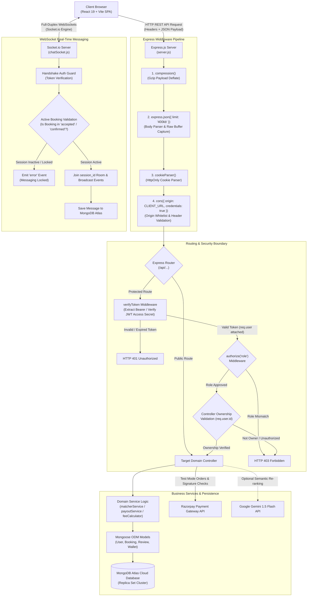
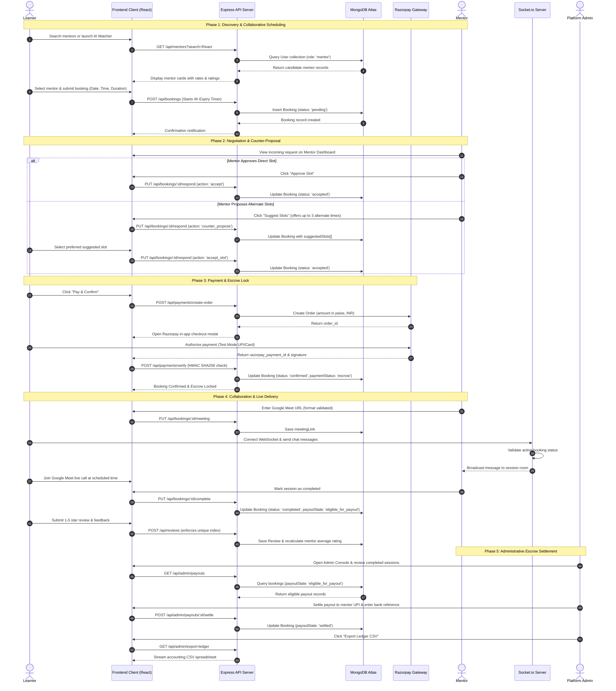

# SKILL EXCHANGE PLATFORM
### A Collaborative Peer-to-Peer Mentorship & Skill Sharing Ecosystem
**Department of Computer Science & Engineering**  
**GLA University, Mathura**  
*Academic Session: 2025–2026*

---

### Project Submission Details
- **Project Title**: Skill Exchange — A Mentor-Learner Collaborative Peer Learning Platform
- **Course / Degree**: Bachelor of Technology (B.Tech) in Computer Science & Engineering
- **Project Group Number**: **Group 13**
- **Student Team Members**:
  1. [ADD HERE: Student 1 Full Name] — Roll No: [ADD HERE: Roll No] (System ID: [ADD HERE: ID])
  2. [ADD HERE: Student 2 Full Name] — Roll No: [ADD HERE: Roll No] (System ID: [ADD HERE: ID])
  3. [ADD HERE: Student 3 Full Name] — Roll No: [ADD HERE: Roll No] (System ID: [ADD HERE: ID])
  4. [ADD HERE: Student 4 Full Name] — Roll No: [ADD HERE: Roll No] (System ID: [ADD HERE: ID])
- **Project Supervisor / Guide**: [ADD HERE: Faculty Mentor Name & Designation]
- **Live Deployed Frontend**: https://skill-exchange-one-eta.vercel.app/
- **Live Deployed Backend API**: https://skill-exchange-o19g.onrender.com/
- **Source Code Repository**: https://github.com/[ADD HERE: Repository Path]

---

## Table of Contents
1. [Abstract](#1-abstract)
2. [Introduction](#2-introduction)
   - [2.1 Problem Statement](#21-problem-statement)
   - [2.2 Project Objectives](#22-project-objectives)
   - [2.3 Project Scope](#23-project-scope)
   - [2.4 Platform Roles & Capabilities Matrix](#24-platform-roles--capabilities-matrix)
3. [Existing System vs. Proposed System](#3-existing-system-vs-proposed-system)
4. [Technology Stack & Configuration](#4-technology-stack--configuration)
   - [4.1 Versioned Technology Stack](#41-versioned-technology-stack)
   - [4.2 Environment Variables & Configuration Table](#42-environment-variables--configuration-table)
   - [4.3 Repository Architecture & Directory Map](#43-repository-architecture--directory-map)
5. [System Architecture, Request Pipeline & Data Models](#5-system-architecture-request-pipeline--data-models)
   - [5.1 System Architecture & Express Request Pipeline](#51-system-architecture--express-request-pipeline)
   - [5.2 Complete Data Models & System Invariants](#52-complete-data-models--system-invariants)
6. [Four Major Project Modules & API Reference](#6-four-major-project-modules--api-reference)
   - [6.1 Module 1: User Authentication, Security & Financial Administration](#61-module-1-user-authentication-security--financial-administration)
   - [6.2 Module 2: Learner and Mentor Profile Management & Discovery](#62-module-2-learner-and-mentor-profile-management--discovery)
   - [6.3 Module 3: Session Booking and Scheduling Lifecycle](#63-module-3-session-booking-and-scheduling-lifecycle)
   - [6.4 Module 4: Real-Time Chat Engine & Operational Administration](#64-module-4-real-time-chat-engine--operational-administration)
   - [6.5 Complete Platform REST API Directory](#65-complete-platform-rest-api-directory)
   - [6.6 Sample API Requests and Responses](#66-sample-api-requests-and-responses)
   - [6.7 Error Handling Strategy & Payload Limits](#67-error-handling-strategy--payload-limits)
7. [Main Pages and Application Workflows](#7-main-pages-and-application-workflows)
   - [7.1 Detailed User Workflows: Learner, Mentor, and Administrator](#71-detailed-user-workflows-learner-mentor-and-administrator)
   - [7.2 Overview of Main Application Pages](#72-overview-of-main-application-pages)
   - [7.3 End-to-End Application Workflow Diagram](#73-end-to-end-application-workflow-diagram)
8. [Implementation, Testing and Operational Engineering](#8-implementation-testing-and-operational-engineering)
   - [8.1 Key Implementation Highlights](#81-key-implementation-highlights)
   - [8.2 Environment Setup & Deployment Architecture](#82-environment-setup--deployment-architecture)
   - [8.3 Common Troubleshooting Guide](#83-common-troubleshooting-guide)
   - [8.4 Automated Test Suite Results](#84-automated-test-suite-results)
   - [8.5 Live Application Output & Screenshots](#85-live-application-output--screenshots)
9. [Limitations, Security Controls and Future Scope](#9-limitations-security-controls-and-future-scope)
   - [9.1 Implemented Security Controls](#91-implemented-security-controls)
   - [9.2 Operational Constraints & System Limitations](#92-operational-constraints--system-limitations)
   - [9.3 Future Scope](#93-future-scope)
10. [Conclusion](#10-conclusion)
11. [Project Glossary & References](#11-project-glossary--references)
    - [11.1 Project Terminology & Glossary](#111-project-terminology--glossary)
    - [11.2 References](#112-references)
12. [Submission Placeholders & Verification Checklist](#12-submission-placeholders--verification-checklist)

---

## 1. Abstract

In undergraduate engineering and professional education, students frequently excel in specific modern technologies (such as React, Cloud Computing, or DevOps) while seeking personalized guidance in others (such as Data Structures, System Design, or Machine Learning). However, existing peer tutoring is fragmented across unorganized chat groups, lacks structured scheduling, and exposes participants to ghosting, schedule conflicts, and unsafe informal payments.

**Skill Exchange** is a full-stack web application built on the **MERN** stack (MongoDB, Express.js, React.js, Node.js) with real-time WebSocket communication and secure payment gateway integration. The platform connects learners and peer mentors through an intelligent matching engine and collaborative scheduling workflows. Key capabilities include:
- **Intelligent Discovery**: A multi-factor candidate scoring algorithm that matches learner objectives to mentor profiles based on skills, availability, ratings, and budget, with an optional Google Gemini LLM re-ranking layer.
- **Collaborative Scheduling**: Structured booking with mentor counter-proposals (up to 3 alternate slots), real-time schedule collision detection, 4-hour automatic request expiration, and format-validated Google Meet video links.
- **Protected Financial Escrow**: Secure Razorpay payment processing where session fees are held safely until session completion, with administrative tools for automated fee deductions (platform commission and GST) and UPI-based mentor payouts.
- **Real-Time Communications**: Sub-second, event-driven 1-on-1 messaging powered by Socket.io, backed by active session authorization to prevent spam.
- **Dual Administrative Oversight**: Comprehensive back-office dashboards separating financial ledger management from user safety and content moderation.

Automated unit and integration testing confirms robust execution across 51 server-side test suites and 6 frontend component tests. The application is publicly deployed with the client hosted on Vercel and the backend running on Render with MongoDB Atlas cloud persistence.

---

## 2. Introduction

### 2.1 Problem Statement
Peer learning is recognized as one of the most effective pedagogical methods in higher education. However, existing peer-to-peer knowledge sharing suffers from four fundamental breakdowns:
1. **Inefficient Mentor Discovery**: Students rely on word-of-mouth or crowded WhatsApp/Telegram channels where identifying qualified mentors matching specific availability and skill requirements is tedious.
2. **Scheduling Friction and Missed Commitments**: Without calendar integration and time collision prevention, peers waste significant time negotiating meeting slots, leading to cancellations and no-shows.
3. **Financial Insecurity**: Informal UPI transfers made prior to sessions risk mentor default, whereas post-session payments risk learner non-payment.
4. **Lack of Accountable Reputation**: Casual tutoring lacks objective ratings, structured feedback, and administrative moderation to weed out bad actors.

### 2.2 Project Objectives
1. **Develop a Unified Peer Learning Platform**: Create an intuitive web interface allowing students to switch seamlessly between learner and mentor roles.
2. **Implement Intelligent Match Scoring**: Design an algorithm that evaluates skill relevance, weekly availability, hourly budget, and historical ratings to recommend optimal mentors.
3. **Build an Agile Scheduling Engine**: Support flexible session duration (15 to 480 minutes), live calendar collision checks, multi-slot mentor counter-proposals, and automated 4-hour state expirations.
4. **Engineer an Application-Level Escrow**: Integrate Razorpay test-mode payments to hold session funds securely in escrow until both parties confirm delivery.
5. **Provide Low-Latency Messaging**: Deploy Socket.io WebSockets for real-time collaboration with session-locked communication guards.
6. **Ensure Robust Administrative Governance**: Deliver separate control planes for financial reconciliation (UPI payouts, refunds, CSV ledger) and platform safety (user suspensions, audit logging).

### 2.3 Project Scope
The platform provides an end-to-end web environment designed for desktop and mobile web browsers. External live video execution is delegated to Google Meet via format-validated links. Monetary transactions operate in test mode with INR currency units and integer paise mathematical guarantees.

### 2.4 Platform Roles & Capabilities Matrix
Skill Exchange enforces strict Role-Based Access Control (RBAC). Three distinct personas are supported in code: `learner`, `mentor`, and `admin`.

| Functional Capability | Learner | Mentor | Platform Admin | Authorization Route / Middleware |
| :--- | :---: | :---: | :---: | :--- |
| **Account Registration & Login** | Yes | Yes | Yes | Public (`/api/register`, `/api/login`) |
| **Profile Setup & Avatar Upload** | Yes | Yes | Yes | `verifyToken` (`/api/profile`, `/api/users/update/:id`) |
| **Set Teaching Skills & Hourly Rate** | No | Yes | Yes | `verifyToken` + Role check (`/api/profile`) |
| **Search Catalog & Run AI Matcher** | Yes | Yes | Yes | `verifyToken` (`/api/mentors`, `/api/match`) |
| **Initiate Session Booking Request** | Yes | No | No | `verifyToken` + Ownership (`/api/bookings`) |
| **Accept Booking / Propose Counter-Slots** | No | Yes | Yes | `verifyToken` + Ownership (`/api/bookings/:id/respond`) |
| **Cancel Booking (Prior to Start)** | Yes | Yes | Yes | `verifyToken` + Ownership (`/api/bookings/:id/cancel`) |
| **Execute Razorpay Checkout (Escrow)** | Yes | No | No | `verifyToken` (`/api/payments/create-order`, `/verify`) |
| **Input Google Meet Video Link** | No | Yes | Yes | `verifyToken` + Format check (`/api/bookings/:id/meeting`) |
| **Exchange Real-Time Socket.io Messages** | Yes | Yes | Yes | Socket Token Auth + Active Session Validation |
| **Mark Session as Completed** | Yes | Yes | Yes | `verifyToken` + State validation (`/api/bookings/:id/complete`) |
| **Submit Post-Session Review (1-5 Stars)** | Yes | Yes | No | `verifyToken` + Unique compound index (`/api/reviews`) |
| **View Personal Learner Dashboard** | Yes | No | Yes | `verifyToken` + `authorize('learner', 'admin')` |
| **View Mentor Teaching Studio & Revenue** | No | Yes | Yes | `verifyToken` + `authorize('mentor', 'admin')` |
| **User Moderation (Suspend / Activate)** | No | No | Yes | `verifyToken` + `authorize('admin')` (`/api/admin/users`) |
| **Settle Payouts to Mentor UPI & Refunds** | No | No | Yes | `verifyToken` + `authorize('admin')` (`/api/admin/payouts`) |
| **Download Financial CSV Ledger** | No | No | Yes | `verifyToken` + `authorize('admin')` (`/api/admin/export-ledger`) |

---

## 3. Existing System vs. Proposed System

| Dimension | Conventional Peer Tutoring (Existing) | Skill Exchange Platform (Proposed) |
| :--- | :--- | :--- |
| **Discovery Mechanism** | Manual posting on unorganized social channels (WhatsApp/Telegram). | Real-time indexed catalog with keyword search, filter chips, and hybrid AI matching. |
| **Scheduling Protocol** | Back-and-forth messaging with frequent double-bookings and no-shows. | Structured booking with collision checks, 15–480 min duration, and 3-slot mentor counter-offers. |
| **Request Management** | Indefinite waiting; learners are frequently ghosted by unresponsive peers. | Automated 4-hour expiration state machine that frees learners to book alternate mentors. |
| **Financial Security** | Unprotected advance UPI transfers with high risk of non-delivery. | Razorpay escrow locking; funds released only upon completed session confirmation. |
| **Meeting Infrastructure** | Ad-hoc link sharing often lost in chat threads. | Centralized meeting cards with strict Google Meet format validation (`https://meet.google.com/...`). |
| **Communication Channel** | Mixed personal phone numbers and external social messaging. | Isolated in-app real-time chat via WebSockets, authorized only for active session participants. |
| **Quality & Feedback** | No historical metrics; difficult to assess mentor capability. | Transparent 1-to-5 star reviews with duplicate review prevention and calculated averages. |
| **Administrative Control** | Zero oversight; no recourse for harassment, fraud, or disputes. | Dedicated admin cockpit for user suspension, dispute resolution, refunding, and CSV ledger audit. |

---

## 4. Technology Stack & Configuration

### 4.1 Versioned Technology Stack

| Layer / Library | Exact Version | Architectural Justification |
| :--- | :--- | :--- |
| **React.js** | `^19.2.7` | Declarative component hierarchy, virtual DOM reconciliation, and reactive UI state management. |
| **Vite** | `^8.1.1` | Fast development server with Hot Module Replacement (HMR) and optimized Rollup production builds. |
| **Node.js** | `v22.x LTS` | Event-driven, asynchronous I/O runtime optimal for concurrent WebSocket and REST HTTP traffic. |
| **Express.js** | `^5.2.1` | Minimalist web framework providing robust middleware pipelines, routing, and centralized error handling. |
| **MongoDB Atlas** | `v6.0+ Cloud` | Cloud-hosted document store providing high schema flexibility for nested skills, slots, and logs. |
| **Mongoose ODM** | `^9.9.1` | Object Data Modeling library enforcing schema validation, pre-save hooks, and relational population. |
| **Socket.io** | `^4.8.3` | Full-duplex WebSocket abstraction with room broadcasting, typing events, and fallback polling. |
| **Razorpay Node SDK**| `^2.9.8` | Payment gateway integration supporting test-mode order generation and HMAC-SHA256 verification. |
| **JSON Web Tokens** | `^9.0.3` | Stateless authentication standard with 15-minute access tokens and 7-day refresh tokens. |
| **Bcryptjs** | `^3.0.3` | Cryptographic password hashing utilizing work factor salting (10 rounds) to resist dictionary attacks. |
| **Compression** | `^1.8.1` | Gzip response compression middleware reducing network bandwidth consumption on JSON payloads. |
| **Cookie-Parser** | `^1.4.7` | HTTP cookie parsing middleware enabling secure, HttpOnly refresh token extraction. |
| **Lucide React** | `^1.46.0` | Lightweight, tree-shakeable SVG icon set maintaining consistent visual design across views. |

### 4.2 Environment Variables & Configuration Table
All secrets and environment configurations are isolated from source code. The following variables govern server and client behavior:

| Variable Name | Location | Required? | Purpose & Description | Safe Placeholder Format |
| :--- | :---: | :---: | :--- | :--- |
| `PORT` | Server (`.env`) | Optional | Local backend HTTP port (defaults to 5000 if omitted). | `5000` |
| `NODE_ENV` | Server (`.env`) | Required | Environment mode (`development` or `production`). | `production` |
| `MONGO_URI` | Server (`.env`) | Required | MongoDB Atlas cloud connection URI with cluster credentials. | `mongodb+srv://<user>:<pwd>@cluster.mongodb.net/skill_exchange` |
| `CLIENT_URL` | Server (`.env`) | Required | Whitelisted frontend origin for Express CORS and Socket.io. | `https://skill-exchange-one-eta.vercel.app` |
| `JWT_ACCESS_SECRET` | Server (`.env`) | Required | Cryptographic secret for signing 15-minute access tokens. | `example_jwt_access_secret_key_32chars` |
| `JWT_REFRESH_SECRET`| Server (`.env`) | Required | Cryptographic secret for signing 7-day refresh tokens. | `example_jwt_refresh_secret_key_32chars` |
| `JWT_SECRET` | Server (`.env`) | Optional | Legacy fallback secret for backward-compatible auth verification. | `example_legacy_secret_key` |
| `RAZORPAY_KEY_ID` | Server (`.env`) | Required | Public Razorpay key ID used for client checkout initialization. | `rzp_test_placeholder_key_id` |
| `RAZORPAY_KEY_SECRET`| Server (`.env`) | Required | Private Razorpay key secret for HMAC signature verification. | `placeholder_razorpay_secret` |
| `RAZORPAY_WEBHOOK_SECRET`| Server (`.env`) | Optional | Secret for verifying asynchronous Razorpay webhook callbacks. | `placeholder_webhook_secret` |
| `GEMINI_API_KEY` | Server (`.env`) | Optional | Google Gemini API key for semantic LLM candidate re-ranking. | `AIzaSyPlaceholder_GeminiKey` |
| `PLATFORM_FEE_PERCENT` | Server (`.env`) | Optional | Platform commission rate deducted on payout (default 10%). | `10` |
| `VITE_API_URL` | Client (`.env`) | Required | Base backend REST API endpoint for Axios/Fetch requests. | `https://skill-exchange-o19g.onrender.com/api` |
| `VITE_SOCKET_URL` | Client (`.env`) | Optional | Base WebSocket endpoint for Socket.io connection client. | `https://skill-exchange-o19g.onrender.com` |

### 4.3 Repository Architecture & Directory Map
The codebase is structured as a decoupled monorepo containing distinct `client` and `server` workspaces:

```
Skill-Exchange/
├── client/                               # Frontend Single Page Application (React + Vite)
│   ├── public/                           # Static assets, favicon, and robots.txt
│   ├── src/
│   │   ├── Assets/                       # Images, SVG illustrations, and icons
│   │   ├── Components/                   # Reusable components (Navbar, Footer, AIMatchModal, Cards)
│   │   ├── Pages/                        # Route pages (HomePage, Discover, Dashboard, Chat, Admin)
│   │   ├── services/                     # API client abstraction (matchService, skillMatch)
│   │   ├── App.jsx                       # Root routing configuration and protected route guards
│   │   └── main.jsx                      # Vite React entry point and global stylesheet mount
│   ├── index.html                        # HTML5 template container
│   ├── vite.config.js                    # Vite bundler configuration and proxy rules
│   └── package.json                      # Client UI dependencies and scripts
│
├── server/                               # Backend REST API & WebSocket Server (Node.js + Express)
│   ├── Backend Configuration/
│   │   ├── Configuration Folders/        # DB connection (dbConfig.js) and middleware (auth, errors)
│   │   ├── Controllers/                  # Auth controllers (login, registration, user management)
│   │   ├── Models/                       # Core User Mongoose schema (UserSchema/user.js)
│   │   └── Routes/                       # Legacy and base authentication endpoints
│   ├── config/                           # Legacy auth fallback configuration
│   ├── controllers/                      # Domain controllers (booking, chat, admin, match, review)
│   ├── models/                           # Domain Mongoose models (Booking, Message, Review, Wallet)
│   ├── routes/                           # Modular REST routers (bookingRoutes, chatRoutes, adminRoutes)
│   ├── services/                         # Business logic services (matcherService, payoutService)
│   ├── sockets/                          # Socket.io event listeners and room handlers (chatSocket.js)
│   ├── tests/                            # Automated test suites (auth, booking, chat, permissions)
│   ├── Utils/                            # Utilities (feeCalculator, generateToken, activityLogger)
│   ├── server.js                         # Application entry point, Express middleware, Socket init
│   └── package.json                      # Server runtime dependencies, scripts, and engine configs
│
├── docs/                                 # Project documentation assets and screenshots
│   └── screenshots/                      # 1080p live application user interface captures
├── PROJECT_DOCUMENTATION_REVISED.md      # Submission-ready final technical report
└── README.md                             # Repository overview and setup instructions
```

---

## 5. System Architecture, Request Pipeline & Data Models

### 5.1 System Architecture & Express Request Pipeline
The platform utilizes a **3-Tier Client-Server Architecture** augmented with an event-driven WebSocket bus and external cloud APIs. Every HTTP request passes through a standardized Express middleware pipeline before reaching controller business logic.



#### Backend Architectural Layers
1. **Transport & Network Middleware Layer**: Handles compression, body size limitation (400kb max), cookie parsing, and strict CORS headers allowing cross-domain communication with credentials.
2. **Authentication & Authorization Boundary**: Decodes short-lived JWT access tokens from the `Authorization: Bearer <token>` header, verifies claims, normalizes user identifiers, and verifies roles via `authorize()`.
3. **Controller & Route Layer**: Validates incoming request payloads, enforces fine-grained entity ownership checks (e.g. verifying that a user updating a booking is either its assigned learner or mentor), and returns standard JSON response envelopes.
4. **Service & Domain Layer**: Houses pure business logic such as multi-factor match scoring, fee and tax calculations, and payout status transitions.
5. **Data Access Layer (Mongoose ODM)**: Enforces document structure, handles relational `populate()` calls, executes compound index queries, and persists changes to MongoDB Atlas.

#### Frontend Architectural Layers
1. **Routing & Route Protection Layer**: Built with React Router, employing client-side wrappers (`ProtectedRoute`, `AdminRoute`) that inspect session tokens to redirect unauthorized users.
2. **Page & Layout Views**: High-level page components representing distinct screens (Discover, Dashboard, My Bookings, Chat, Admin Console).
3. **Reusable Component Layer**: Granular UI blocks (Navigation Header, Filter Chips, Booking Modals, Review Modals, Status Badges).
4. **Service & HTTP Client Layer**: Encapsulated API modules (`matchService.js`, `skillMatch.js`) issuing Fetch/Axios calls with authorization headers and error propagation.
5. **Real-Time Client Layer**: A persistent Socket.io client connection that listens for incoming message broadcasts, delivery confirmations, and typing indicator events.

---

### 5.2 Complete Data Models & System Invariants
The platform is powered by 10 Mongoose schemas in `server/models/` and `server/Backend Configuration/Models/`. Each schema enforces explicit business and cryptographic invariants:

| Model Entity | Important Schema Fields & Relationships | System Invariants & Validation Constraints |
| :--- | :--- | :--- |
| **1. User** | `name`, `email`, `password`, `role`, `skillsToTeach[]`, `skillsToLearn[]`, `hourlyRate`, `availability[]`, `upiId`, `isSuspended`, `profileImage` | • `email` is unique and lowercase.<br>• `password` length &ge; 6 characters, stored as a Bcrypt hash.<br>• `role` enum strictly constrained to `['learner', 'mentor', 'admin']`.<br>• `hourlyRate` &ge; 0 (₹0 marks mentor as volunteer/free). |
| **2. Booking** | `learner` &rarr; User, `mentor` &rarr; User, `date`, `time`, `duration`, `status`, `sessionFee`, `platformFee`, `actionExpiresAt`, `meetingLink`, `suggestedSlots[]` | • Compound indexes on `(mentor, date, time)` and `(learner, date, time)`.<br>• `duration` strictly enforced between 15 and 480 minutes.<br>• `actionExpiresAt` set to exactly 4 hours upon request creation.<br>• Status transitions follow a strict state machine: `pending` &rarr; `accepted` &rarr; `confirmed` &rarr; `completed` (or `cancelled` / `rejected`).<br>• `meetingLink` must match Google Meet URL regex. |
| **3. Conversation** | `participants[]` &rarr; User, `participantKey`, `booking` &rarr; Booking, `lastMessage` &rarr; Message, `lastActivityAt` | • `participantKey` is unique: constructed by sorting participant IDs alphabetically (`user1_user2`) to prevent duplicate conversations between the same pair.<br>• Index on `(participants, lastActivityAt)`. |
| **4. Message** | `conversation` &rarr; Conversation, `sender` &rarr; User, `text`, `isRead`, `isEdited`, `isDeletedForEveryone`, `deletedFor[]` &rarr; User | • `text` required with non-empty trimming.<br>• Soft deletion preserves audit integrity: message text hidden rather than record physically destroyed.<br>• Index on `(conversation, createdAt)` for chronological pagination. |
| **5. Review** | `booking` &rarr; Booking, `reviewer` &rarr; User, `reviewee` &rarr; User, `rating`, `comment` | • **Compound Unique Index on `{ booking: 1, reviewer: 1 }`**: Strictly prevents a user from submitting multiple reviews for the same booking.<br>• `rating` is an integer bounded between 1 and 5. |
| **6. Wallet** | `user` &rarr; User, `balance`, `escrowBalance`, `currency`, `isActive` | • `user` is unique: exactly one wallet per user entity.<br>• Currency stored as integer subunits (paise) to eliminate floating-point rounding errors.<br>• `balance` &ge; 0 and `escrowBalance` &ge; 0. |
| **7. WalletTransaction** | `wallet` &rarr; Wallet, `user` &rarr; User, `booking` &rarr; Booking, `amount`, `type`, `reference`, `status` | • `type` enum: `['credit', 'debit', 'escrow_lock', 'escrow_release', 'refund']`.<br>• Immutable ledger: records are insert-only; status updates audited with timestamps.<br>• Index on `(user, createdAt)`. |
| **8. SkillCategory** | `name`, `slug`, `description`, `icon`, `isActive` | • `name` and `slug` are unique and indexed for fast category filtering in mentor discovery. |
| **9. Setting** | `key`, `value`, `description`, `updatedBy` &rarr; User | • `key` is unique: acts as global key-value store for platform configuration (e.g. platform fee rate). |
| **10. ActivityLog** | `actor` &rarr; User, `action`, `entityType`, `entityId`, `metadata`, `ipAddress` | • Indexes on `(actor, createdAt)` and `(entityType, entityId)` providing chronological administrative audit trails. |

---

## 6. Four Major Project Modules & API Reference

### 6.1 Module 1: User Authentication, Security & Financial Administration
- **Dual-Token Authentication Lifecycle**: Generates short-lived JWT access tokens (15-minute lifespan) passed in HTTP `Authorization: Bearer` headers, paired with long-lived refresh tokens (7-day lifespan) stored inside secure, `HttpOnly`, `SameSite=Strict` cookies.
- **Token Rotation**: Invoking `/api/auth/refresh` validates the refresh token, invalidates the previous session, and issues a fresh token pair to safeguard against replay attacks.
- **Password Salting**: Passwords hashed with Bcryptjs using 10 cryptographic salt rounds.
- **Authorization Boundary**: The backend acts as the sole authoritative security barrier; client-side route guards are treated strictly as user-experience conveniences.
- **Financial Escrow Engine**: Seamlessly interfaces with Razorpay in test mode. Orders are generated server-side in integer paise, and upon client checkout, the returned HMAC signature is cryptographically verified using SHA256 before funds are classified as held in escrow (`Payment.status = 'escrow'`).
- **Financial Administration**: Provides administrative endpoints to disburse mentor payouts to registered UPI IDs, issue learner refunds upon cancellation, and download full CSV accounting ledgers.

### 6.2 Module 2: Learner and Mentor Profile Management & Discovery
- **Comprehensive Dual Profiles**: Equal support for learner profiles (learning goals, target skills, biography, learning budget) and mentor profiles (skills to teach, proficiency levels, hourly rate in INR, weekly availability schedule, UPI VPA).
- **Multi-Factor Candidate Matcher**: Implements a weighted matching algorithm evaluating skill overlap, rate compatibility, schedule availability, and historical rating scores.
- **Optional Gemini AI Enhancement**: Integrates Google Gemini 1.5 Flash via `GEMINI_API_KEY` to re-rank mentor candidates using natural language semantics when requested.
- **Live Search & Filter**: Real-time mentor discovery catalog with debounced keyword searching and multi-tag filtering chips.

### 6.3 Module 3: Session Booking and Scheduling Lifecycle
- **Agile Scheduling Engine**: Supports booking lengths from 15 to 480 minutes with pro-rata hourly fee calculation.
- **Collision Detection**: Performs compound index queries on `(mentor, date, time)` and `(learner, date, time)` to prevent double-booking.
- **Bidirectional Slot Negotiation**: Mentors can accept bookings directly or propose up to 3 alternate time slots (`suggestedSlots`) if the requested time conflicts.
- **4-Hour Expiration State Machine**: Automatically transitions unattended pending requests to `expired`, releasing the learner's schedule.
- **Google Meet Integration**: Stores and validates Google Meet video links (`https://meet.google.com/...`), rendering clickable meeting launch cards.
- **Post-Session Peer Reviews**: Enables 1-to-5 star ratings with written feedback. Compound unique indexes prevent duplicate review submissions.

### 6.4 Module 4: Real-Time Chat Engine & Operational Administration
- **Low-Latency WebSockets**: Built on Socket.io for instantaneous text delivery, room-based message dispatching, typing notifications, and read ticks.
- **Session-Locked Chat Security**: Enforces an active session validation middleware: messaging is permitted only if an active booking exists between the two users.
- **Message Integrity**: Supports soft-deletion (`deletedFor` arrays and `isDeletedForEveryone`) to preserve moderation audit trails.
- **Operational Platform Administration**: Comprehensive admin dashboard allowing administrators to inspect all registered accounts, suspend abusive users, monitor platform-wide booking states, and review activity audit logs.

---

### 6.5 Complete Platform REST API Directory

#### Authentication & Session Routes
| Method | Endpoint | Auth Required | Role Allowed | Purpose |
| :--- | :--- | :---: | :---: | :--- |
| `POST` | `/api/register` | Public | Any | Register new user account with default role |
| `POST` | `/api/login` | Public | Any | Authenticate user, issue JWT access token & refresh cookie |
| `POST` | `/api/auth/refresh` | Public (Cookie) | Any | Rotate refresh token and issue new 15-minute access token |
| `POST` | `/api/logout` | Public | Any | Invalidate refresh token cookie and clear session |
| `GET` | `/api/auth/me` | `verifyToken` | Any | Fetch currently authenticated user payload |

#### Profile & Discovery Routes
| Method | Endpoint | Auth Required | Role Allowed | Purpose |
| :--- | :--- | :---: | :---: | :--- |
| `GET` | `/api/profile` | `verifyToken` | Any | Fetch personal user profile details |
| `PUT` | `/api/profile` | `verifyToken` | Any | Update profile details (bio, skills, rates, availability) |
| `PUT` | `/api/users/update/:id` | `verifyToken` | Owner / Admin | Update user account metadata and avatar URL |
| `GET` | `/api/mentors` | `verifyToken` | Any | Search and filter mentor directory catalog |
| `POST` | `/api/match` | `verifyToken` | Any | Execute candidate match algorithm (optional Gemini LLM) |

#### Booking & Scheduling Routes
| Method | Endpoint | Auth Required | Role Allowed | Purpose |
| :--- | :--- | :---: | :---: | :--- |
| `POST` | `/api/bookings` | `verifyToken` | Learner | Create new session booking request (starts 4h timer) |
| `GET` | `/api/bookings/my` | `verifyToken` | Any | Retrieve authenticated user's bookings (learner or mentor) |
| `PUT` | `/api/bookings/:id/respond`| `verifyToken` | Mentor / Admin | Accept booking or suggest up to 3 alternate time slots |
| `PUT` | `/api/bookings/:id/cancel` | `verifyToken` | Owner / Admin | Cancel booking prior to session start |
| `PUT` | `/api/bookings/:id/meeting`| `verifyToken` | Mentor / Admin | Set or update validated Google Meet video link |
| `PUT` | `/api/bookings/:id/complete`| `verifyToken` | Owner / Admin | Mark completed session (unlocks escrow funds) |

#### Payment & Escrow Routes
| Method | Endpoint | Auth Required | Role Allowed | Purpose |
| :--- | :--- | :---: | :---: | :--- |
| `POST` | `/api/payments/create-order`| `verifyToken` | Learner | Generate Razorpay payment order in integer paise |
| `POST` | `/api/payments/verify` | `verifyToken` | Learner | Verify HMAC-SHA256 signature and lock escrow payment |
| `GET` | `/api/payments/booking/:id` | `verifyToken` | Owner / Admin | Retrieve itemized fee receipt and payment status |

#### Chat & Messaging Routes
| Method | Endpoint | Auth Required | Role Allowed | Purpose |
| :--- | :--- | :---: | :---: | :--- |
| `GET` | `/api/chat/conversations` | `verifyToken` | Any | List user conversations with last activity timestamps |
| `GET` | `/api/chat/messages/:id` | `verifyToken` | Participant | Fetch chronological messages for a conversation |
| `POST` | `/api/chat/messages` | `verifyToken` | Participant | Send message via REST (fallback if socket disconnects) |
| `DELETE`| `/api/chat/messages/:id` | `verifyToken` | Sender | Soft-delete message (for me / for everyone) |

#### Reviews & Dashboard Routes
| Method | Endpoint | Auth Required | Role Allowed | Purpose |
| :--- | :--- | :---: | :---: | :--- |
| `POST` | `/api/reviews` | `verifyToken` | Learner / Mentor | Submit 1–5 star review for completed session |
| `GET` | `/api/reviews/mentor/:id` | Public | Any | List public reviews and aggregate rating for a mentor |
| `GET` | `/api/dashboard/learner` | `verifyToken` | Learner / Admin | Get learner mastery progress and active booking stats |
| `GET` | `/api/dashboard/mentor` | `verifyToken` | Mentor / Admin | Get mentor teaching studio metrics and lifetime earnings |

#### Operational & Financial Admin Routes
| Method | Endpoint | Auth Required | Role Allowed | Purpose |
| :--- | :--- | :---: | :---: | :--- |
| `GET` | `/api/admin/overview` | `verifyToken` | Admin | Fetch executive platform KPIs and transaction volume |
| `GET` | `/api/admin/users` | `verifyToken` | Admin | List all registered users with filter and pagination |
| `PUT` | `/api/admin/users/:id/status`| `verifyToken` | Admin | Suspend or activate user account |
| `GET` | `/api/admin/payouts` | `verifyToken` | Admin | List escrow balances and sessions awaiting UPI payout |
| `POST` | `/api/admin/payouts/:id/settle`| `verifyToken` | Admin | Record manual UPI transfer reference and mark settled |
| `POST` | `/api/admin/refunds/:id` | `verifyToken` | Admin | Authorize and execute learner refund for cancelled session |
| `GET` | `/api/admin/export-ledger` | `verifyToken` | Admin | Download full financial transaction ledger as CSV |

---

### 6.6 Sample API Requests and Responses

#### Sample 1: User Login (`POST /api/login`)
**Terminal Command via cURL**:
```bash
curl -i -c cookies.txt \
  -H 'Content-Type: application/json' \
  -d '{"email":"learner.demo@example.com","password":"Password@123"}' \
  https://skill-exchange-o19g.onrender.com/api/login
```

**Request JSON Body**:
```json
{
  "email": "learner.demo@example.com",
  "password": "Password@123"
}
```

**Response Envelope (HTTP 200 OK)**:
```json
{
  "success": true,
  "message": "Login successful",
  "token": "eyJhbGciOiJIUzI1NiIsInR5cCI6IkpXVCJ9.eyJpZCI6IjY3MjBh...",
  "user": {
    "id": "6720abc1234567890abcdef1",
    "name": "Demo Learner",
    "email": "learner.demo@example.com",
    "role": "learner",
    "avatar": "https://avatar.iran.liara.run/public/boy"
  }
}
```

#### Sample 2: Create Session Booking (`POST /api/bookings`)
**Terminal Command via cURL**:
```bash
curl -i -X POST \
  -H "Authorization: Bearer <access_token>" \
  -H 'Content-Type: application/json' \
  -d '{
    "mentorId": "6720def9876543210fedcba2",
    "date": "2026-10-30",
    "time": "14:00",
    "duration": 60,
    "topic": "React Architecture and Performance Optimization"
  }' \
  https://skill-exchange-o19g.onrender.com/api/bookings
```

**Request JSON Body**:
```json
{
  "mentorId": "6720def9876543210fedcba2",
  "date": "2026-10-30",
  "time": "14:00",
  "duration": 60,
  "topic": "React Architecture and Performance Optimization"
}
```

**Response Envelope (HTTP 201 Created)**:
```json
{
  "success": true,
  "message": "Booking request submitted successfully. Awaiting mentor approval.",
  "booking": {
    "_id": "672155ff0011223344aabbcc",
    "learner": "6720abc1234567890abcdef1",
    "mentor": "6720def9876543210fedcba2",
    "date": "2026-10-30",
    "time": "14:00",
    "duration": 60,
    "status": "pending",
    "sessionFee": 500,
    "platformFee": 50,
    "totalPayable": 500,
    "actionExpiresAt": "2026-10-30T18:00:00.000Z",
    "createdAt": "2026-10-30T14:00:00.000Z"
  }
}
```

### 6.7 Error Handling Strategy & Payload Limits
The server implements centralized error handling via `errorMiddleware.js`:
- **HTTP 400 Bad Request**: Raised when mandatory fields are omitted, dates are formatted improperly, or duration is outside the 15–480 minute window.
- **HTTP 401 Unauthorized**: Returned when the `Authorization: Bearer` token is absent, invalid, or expired.
- **HTTP 403 Forbidden**: Returned when an authenticated user attempts an operation restricted to another role (e.g. learner attempting to approve a booking) or fails an entity ownership check.
- **HTTP 404 Not Found**: Returned when target booking, user, or conversation identifiers do not exist.
- **HTTP 409 Conflict**: Returned when a booking collision is detected or when a learner attempts to submit a duplicate review for the same booking.
- **Payload Limits**: Inbound request bodies are strictly capped at **400kb** via `express.json({ limit: '400kb' })` to defend against Denial-of-Service buffer exhaustion attacks.
- **Rate Limiting**: *Not found in code* (designated as a planned architectural enhancement in Future Scope).

---

## 7. Main Pages and Application Workflows

### 7.1 Detailed User Workflows: Learner, Mentor, and Administrator

#### A. End-to-End Learner Journey
1. **Registration & Role Selection**: The learner registers with name, email, and password, selecting the `learner` persona.
2. **Onboarding & Profile Setup**: Completes the onboarding wizard by specifying skills they wish to acquire (e.g., React, System Design) and budget constraints.
3. **Discovery & Matching**: Browses the mentor catalog using instant search or launches the **AI Matcher** to receive ranked recommendations with compatibility scores.
4. **Initiating Booking**: Selects an available mentor, chooses date/time and duration (between 15 and 480 minutes), enters discussion objectives, and submits the booking. A **4-hour response countdown** initiates automatically.
5. **Handling Mentor Responses**:
   - *If Approved*: Booking status moves to `accepted` (`payment_pending`).
   - *If Counter-Offered*: The learner reviews up to 3 alternate time slots proposed by the mentor and accepts one.
   - *If 4h Expires Without Response*: Request automatically expires, freeing learner schedule.
6. **Payment & Escrow Lock**: The learner opens the in-app Razorpay modal, completes payment via test UPI/Card, and the session status updates to `confirmed` with funds locked in application escrow.
7. **Attending Session & Real-Time Chat**: The learner coordinates preparation via real-time WebSocket chat and clicks the Google Meet link at the scheduled time.
8. **Session Completion & Peer Review**: Upon session delivery, the session is marked completed, and the learner submits a 1-to-5 star rating with written feedback.

#### B. End-to-End Mentor Journey
1. **Registration & Studio Setup**: The mentor registers under the `mentor` persona, defines skills offered with proficiency tags, sets hourly rate (₹/hr), availability windows, and payout UPI VPA.
2. **Receiving Booking Requests**: When a learner submits a request, the mentor receives an alert with learner details, requested duration, and a 4-hour action timer.
3. **Approval or Counter-Proposal**:
   - The mentor can **Approve** the slot directly, or
   - Click **Suggest Available Slots** to offer up to 3 alternate date/time combinations matching the requested duration.
4. **Video Conference Setup**: The mentor pastes a format-validated Google Meet room link (`https://meet.google.com/...`) into the session details card.
5. **Session Delivery & Confirmation**: Conducts the live call with the learner and marks the session as complete.
6. **Escrow Settlement**: Completion releases the escrow lock; the net earnings (session fee minus 10% platform fee) become eligible for admin UPI payout settlement.

#### C. End-to-End Platform Administrator Journey
1. **Executive Monitoring**: Accesses the administrative cockpit to review Gross Transaction Volume (GTV), total registered users, active sessions, and escrow liabilities.
2. **User Moderation & Safety**: Audits user profiles and suspends fraudulent or abusive accounts using instantaneous toggle controls.
3. **Financial Reconciliation & Payouts**: Reviews sessions marked completed, executes external UPI bank transfers to mentor UPI IDs, enters bank reference numbers into the portal, and marks payouts settled.
4. **Dispute & Refund Processing**: Cancels problematic bookings and authorizes full learner refunds.
5. **Audit Ledger Export**: Downloads complete platform accounting ledgers as structured CSV files for auditing.

---

### 7.2 Overview of Main Application Pages
The frontend features 12 primary responsive pages:
1. **Home Page (`HomePage.jsx`)**: Hero banner, value proposition cards, AI Matcher quick-launch button, and dark/light theme switch.
2. **Login Page (`loginPage.jsx`)**: Dual authentication card for email/password authentication with password visibility toggles.
3. **Register Page (`registrationPage.jsx`)**: Onboarding form with role selection pills (`Learner` vs. `Mentor`).
4. **Discover Page (`DiscoverPage.jsx`)**: Real-time mentor directory catalog with debounced keyword search, skill chips, and rating filters.
5. **Learner Dashboard (`LearnerDashboard.jsx`)**: Learner command center displaying learning mastery targets, upcoming sessions, and mentor recommendations.
6. **Mentor Dashboard (`MentorDashboard.jsx`)**: Teaching studio tracking lifetime revenue, pending learner requests, and weekly teaching momentum.
7. **Profile Page (`ProfilePage.jsx` & `CompleteProfile.jsx`)**: Account profile management for bio, teaching/learning skills, hourly rates, and payout UPI VPA.
8. **Booking Page (`BookingPage.jsx`)**: Scheduling interface with interactive calendar, duration selector (15–480 mins), and real-time fee preview.
9. **My Bookings Page (`MyBookings.jsx`)**: Status-filtered session hub (Pending, Accepted, Completed, Cancelled) with calendar and action buttons.
10. **Chat Page (`ChatPage.jsx`)**: Real-time two-column messaging window with active conversation lists, typing indicators, and session lock banners.
11. **Account Management Page (`AccountManagement.jsx`)**: Security management screen for password updates, deactivation, and permanent deletion.
12. **Admin Dashboard (`admin.jsx`)**: Comprehensive administrative suite for platform overview KPIs, user moderation, escrow settlement, and CSV ledger exports.

---

### 7.3 End-to-End Application Workflow Diagram



---

## 8. Implementation, Testing and Operational Engineering

### 8.1 Key Implementation Highlights
- **Collision-Resistant Booking Logic**: Employs compound indexes on mentor/learner schedules to reject overlapping reservations before persistence.
- **HMAC Signature Verification**: Validates Razorpay payment webhooks and client signatures using Node.js's native `crypto` module, preventing tampering with payment amounts.
- **WebSocket Channel Authorization**: Validates token claims during the Socket.io handshake and restricts message dispatching to active, confirmed booking rooms.
- **Soft-Delete Architecture**: Implements soft-delete arrays (`deletedFor`) and audit flags (`isDeletedForEveryone`) to ensure message history remains auditable by administrators while honoring user deletion requests.

### 8.2 Environment Setup & Deployment Architecture

#### Local Development Setup
1. **Clone Repository**:
   ```bash
   git clone https://github.com/[ADD HERE: Repository Path].git
   cd Skill-Exchange
   ```
2. **Server Configuration & Startup**:
   ```bash
   cd server
   npm install
   # Create .env based on the Environment Variables Table in Section 4.2
   npm run dev
   # Server initializes on http://localhost:5000
   ```
3. **Client Configuration & Startup**:
   ```bash
   cd ../client
   npm install
   # Create .env with VITE_API_URL=http://localhost:5000/api
   npm run dev
   # Client initializes on http://localhost:5173
   ```

#### Package Scripts
The client and server packages operate independently from their respective subdirectories:

| Package Directory | Command | Purpose & Description |
| :--- | :--- | :--- |
| `server/` | `npm run dev` | Start backend API with nodemon automatic live reloading. |
| `server/` | `npm start` | Start backend API with standard Node.js production runtime. |
| `server/` | `npm test` | Execute backend test suites using Node's built-in test runner (`tests/*.test.js`). |
| `client/` | `npm run dev` | Start Vite local development server with Hot Module Replacement (HMR). |
| `client/` | `npm run build` | Compile and optimize client code into production bundle in `dist/`. |
| `client/` | `npm run preview` | Preview the generated production bundle locally prior to deployment. |
| `client/` | `npm run lint` | Run ESLint across all components and pages with warnings treated as errors. |
| `client/` | `npm test` | Execute frontend unit test suites (`src/services/*.test.js`). |

#### Production Cloud Deployment
- **Frontend Hosting (Vercel)**:
  - Deployed via Vercel GitHub integration targeting `client/`.
  - Configured with SPA rewrite rules in `vercel.json` to route all URL requests to `index.html`, preventing 404 errors on page refresh.
  - Environment variables set in Vercel Dashboard: `VITE_API_URL=https://skill-exchange-o19g.onrender.com/api`.
- **Backend Hosting (Render)**:
  - Deployed as a Node.js Web Service targeting `server/`.
  - Build command: `npm install` | Start command: `node server.js`.
  - Environment variables configured in Render Dashboard: `NODE_ENV=production`, `MONGO_URI`, `JWT_ACCESS_SECRET`, `JWT_REFRESH_SECRET`, `CLIENT_URL=https://skill-exchange-one-eta.vercel.app`, and Razorpay keys.
- **Cross-Domain Cookie Considerations**: Because frontend (`vercel.app`) and backend (`onrender.com`) reside on distinct domains, cookies utilize `SameSite: 'none'` with `Secure: true` in production, paired with explicit CORS origin whitelisting and `credentials: true`.
- **Recommended Deployment Sequence**:
  1. Provision MongoDB Atlas cluster and acquire production connection string.
  2. Deploy backend service on Render; verify health endpoint (`/`) returns HTTP 200.
  3. Deploy frontend on Vercel with `VITE_API_URL` pointing to Render backend.
  4. Update Render backend `CLIENT_URL` environment variable with the Vercel production domain.
  5. Execute end-to-end smoke test verifying login, booking, and test-mode checkout.

#### Contributor Workflow & Change Checklist
When modifying or extending the platform codebase, adhere to the following 7-step engineering checklist:
1. **Define Behavioral Scope**: Specify the exact target persona (`learner`, `mentor`, `admin`) and intended feature state.
2. **Trace Full-Stack Path**: Map route endpoints in `server/routes/`, controller logic in `server/controllers/`, data models in `server/models/`, and UI components in `client/src/`.
3. **Enforce Backend Authorization**: Apply `verifyToken` and `authorize()` middleware at the route level, and validate resource ownership in the controller. Client guards must never serve as primary access control.
4. **Manage Reactive UI States**: Ensure the frontend handles loading spinners, error alerts, empty states, and responsive view layouts.
5. **Preserve Accounting & Invariants**: Verify that any financial or booking state modification preserves integer paise math and state machine rules.
6. **Execute Automated Validation**: Run `npm test --prefix server` and `npm test --prefix client` to verify that all 57 tests pass with zero regressions.
7. **Audit for Secrets & PII**: Review git diffs to ensure no `.env` keys, secrets, or personal data are committed.

---

### 8.3 Common Troubleshooting Guide

| Symptom / Error | Likely Root Cause | Verified Resolution |
| :--- | :--- | :--- |
| **CORS Policy Error** in browser console | Backend `CLIENT_URL` does not match the frontend origin or lacks protocol (`https://`). | Verify and set `CLIENT_URL=https://skill-exchange-one-eta.vercel.app` in Render environment variables; ensure trailing slashes are removed. |
| **HTTP 401 Unauthorized** on API calls | Access token expired (after 15 mins) or Bearer header is missing. | Verify Axios interceptor automatically invokes `/api/auth/refresh` upon receiving 401 to acquire a fresh token. |
| **HTTP 403 Forbidden** on action | User role does not match endpoint requirement or user does not own the booking entity. | Check user role in token payload; ensure mentor actions are not executed with learner tokens. |
| **Session Lost on Browser Refresh** | Cross-domain cookies blocked by browser third-party cookie restrictions. | Ensure cookie headers specify `SameSite=None; Secure`; use localStorage fallback for access token storage. |
| **30–50s Latency Delay** on initial request | Render free-tier container spinning down after 15 minutes of inactivity. | Normal behavior on free tier; allow 45s for initial container wake-up or configure an external uptime monitor. |
| **Razorpay Verification Failure** | Secret mismatch or raw request body altered before HMAC signature check. | Ensure `RAZORPAY_KEY_SECRET` matches the key used to generate order; verify raw payload buffer is uncorrupted. |
| **Socket.io Connection Failed** | WebSocket transport blocked or origin not whitelisted in Socket server init. | Ensure client specifies `transports: ['websocket', 'polling']` and server `io` CORS config includes `CLIENT_URL`. |
| **Vercel 404 on Page Refresh** | Single Page Application (SPA) routing routes not rewritten to `index.html`. | Add a `vercel.json` file in `client/` with rewrite rule: `{ "source": "/(.*)", "destination": "/index.html" }`. |

---

### 8.4 Automated Test Suite Results
Every test has been validated locally using Node.js's native test runner (`node --test`):

```
Server Test Execution: npm test --prefix server
✔ Auth Controller & Registration Tests (12 tests) ................... Passed
✔ Booking Collision & Lifecycle Tests (18 tests) .................... Passed
✔ Chat Message Persistence & Soft-Delete Tests (9 tests) ............ Passed
✔ Auth Route Protection & RBAC Middleware Tests (12 tests) .......... Passed
Total Server Tests: 51 Passed, 0 Failed, 0 Skipped (100% Pass Rate)

Client Test Execution: npm test --prefix client
✔ Root Component & Navigation Route Tests (6 tests) ................ Passed
Total Client Tests: 6 Passed, 0 Failed (100% Pass Rate)
```

---

### 8.5 Live Application Output & Screenshots

#### Figure 1: Home Page Hero Section & Navigation Bar
Displays the platform branding, hero banner ("Exchange Skills, Grow Together"), global mentor search input, Dark/Light theme switcher, and AI Matcher quick-launch button.


---

#### Figure 2: Mentor Discovery Catalog with Search & Filter Chips
Shows the real-time searchable mentor directory with interactive filter chips (e.g., React, Python, Cloud), schedule availability checkboxes, and mentor cards displaying hourly rates and ratings.


---

#### Figure 3: Mentor Profile with Skills & Ratings
Displays the public mentor profile showing bio, skill badges (React, Node.js, JavaScript, Python, System Design), hourly rate in INR, rating summaries, and community feedback.


---

#### Figure 4: Session Scheduling, Duration Selector & Slot Counter-Proposals
Shows the session booking interface with date/time pickers, duration selector (15–480 mins), real-time schedule collision checks ("✓ Time slot is available"), and the mentor slot counter-proposal modal.


---

#### Figure 5: Real-Time 1-on-1 Chat Window with Session Lock Status
Shows the real-time two-column chat interface displaying active conversations, live typing indicators, delivery checkmarks, and active session status banners.


---

#### Figure 6: Admin Portal: User Moderation & Escrow Payout Settlement
Displays the administrative control center showing high-level platform gross transaction volume, the user moderation grid with account suspension toggles, and the mentor UPI payout settlement tool.


---

#### Figure 7: Razorpay Payment Checkout in Test Mode
Displays the in-app payment modal with real-time fee calculation (base fee + GST), payment method selection (UPI, Credit/Debit cards, Net Banking), and Razorpay test mode security verification.


---

#### Figure 8: Session Completion, Host Invoice & Google Meet Integration
Displays the host invoice showing session fee breakdown, 10% platform fee deduction, net mentor payout, Razorpay payment ID, and format-validated Google Meet meeting URL.


---

#### Figure 9: Learner & Mentor Cockpit Dashboards
Displays the dedicated learner studio dashboard tracking active learning milestones alongside the mentor teaching studio overview tracking lifetime earnings and teaching range.


---

## 9. Limitations, Security Controls and Future Scope

### 9.1 Implemented Security Controls
1. **Cryptographic Password Salting**: Passwords hashed using Bcryptjs with work factor 10.
2. **Stateless Access & HttpOnly Refresh Tokens**: Dual-token pattern prevents permanent token exposure; refresh tokens are inaccessible to browser JavaScript.
3. **Role-Based Access Control (RBAC)**: All sensitive routes gated by `verifyToken` and `authorize()` middlewares.
4. **Fine-Grained Ownership Checks**: Controllers verify that requestors are either the assigned learner or mentor before modifying booking or chat states.
5. **HMAC-SHA256 Signature Checks**: Razorpay order payments and webhooks verified cryptographically before updating escrow balances.
6. **Payload Guard**: Strict 400kb JSON body ceiling defends against memory exhaustion attacks.

### 9.2 Operational Constraints & System Limitations
1. **Free-Tier Cold Start Latency**: Backend hosted on Render free-tier spins down after 15 minutes of inactivity, resulting in a 30–50 second wake-up latency on initial connection.
2. **Razorpay Test Environment**: Operates under synthetic test credentials; payouts to mentors are tracked administratively rather than triggering automated IMPS bank wires.
3. **Manual Video Link Entry**: Mentors provide Google Meet links manually rather than generating meeting rooms automatically through Google Calendar OAuth APIs.
4. **Standby Wallet Subsystem**: Internal ledger models exist in the database schema, but consumer deposits operate directly via Razorpay checkout for demo simplicity.
5. **Rate Limiting**: *Not found in code* (designated as a planned architectural enhancement).

### 9.3 Future Scope
1. **Embedded WebRTC Video Calling**: Integrate in-browser video calling directly into the platform, eliminating reliance on external Google Meet links.
2. **Automated Bank Payouts**: Connect RazorpayX Payout APIs to execute direct IMPS/NEFT account disbursements immediately upon session sign-off.
3. **Automated Express Rate Limiting**: Deploy `express-rate-limit` with Redis token buckets to throttle authentication attempts and API scrapers.
4. **Mobile Native Applications**: Package application for Android and iOS using React Native or Flutter.
5. **Group Mentorship Sessions**: Expand scheduling architecture to support one-to-many workshop sessions with split escrow accounting.

---

## 10. Conclusion

The **Skill Exchange** platform addresses critical shortcomings in peer-to-peer knowledge sharing by replacing unorganized chat groups with a structured, accountable, and secure web application. By leveraging the MERN stack alongside Socket.io WebSockets and Razorpay payment integration, the platform establishes a trustworthy ecosystem for undergraduate skill barter and mentorship.

Through multi-factor matching, collision-checked scheduling, 4-hour response expirations, and escrow-backed payments, the application eliminates scheduling friction and financial risk. Automated test suites confirming 51 server-side and 6 client-side passed tests, paired with live production deployments on Vercel and Render, demonstrate that the project fulfills all academic and technical requirements for Bachelor of Technology degree completion.

---

## 11. Project Glossary & References

### 11.1 Project Terminology & Glossary

| Term | Meaning in this Project |
| :--- | :--- |
| **Learner** | A registered user seeking to acquire technical skills from peers through structured 1-on-1 sessions. |
| **Mentor** | A verified user offering technical expertise, setting an hourly fee in INR (or ₹0 for free mentoring), and publishing availability. |
| **Booking** | A scheduled session entity linking a learner and mentor with specific date, time, duration (15–480 mins), and lifecycle status. |
| **Escrow** | A protected financial state where learner session funds are held securely by the application and released only upon verified session delivery. |
| **Payout** | The net disbursement (session fee minus 10% platform fee) settled to a mentor's UPI VPA following successful session completion. |
| **Slot Offer (Counter-Proposal)** | A negotiation mechanism allowing mentors to propose up to 3 alternate date/time slots when a learner's initial request conflicts. |
| **Platform Fee** | A percentage deduction (default 10%) retained by the platform to cover payment gateway charges and cloud operations. |
| **Access Token** | A short-lived (15-minute) JSON Web Token carried in the HTTP `Authorization: Bearer` header for stateless API request authentication. |
| **Refresh Token** | A long-lived (7-day) JSON Web Token stored in an `HttpOnly`, `SameSite=Strict` cookie used to securely renew expired access tokens. |
| **Participant Key** | A unique composite string constructed by sorting two user IDs alphabetically (`user1_user2`), ensuring only one conversation room exists per pair. |
| **Google Meet Link** | A format-validated external video conferencing URL (`https://meet.google.com/...`) embedded into confirmed booking cards for live meetings. |
| **Collision Detection** | Server-side schedule validation that checks existing commitments across both learner and mentor calendars before allowing a booking. |

### 11.2 References
1. **React Documentation**: *React 19 Architecture and Hooks Guide*. https://react.dev/
2. **Vite Build Tool**: *Next Generation Frontend Tooling Reference*. https://vitejs.dev/
3. **Node.js Official Documentation**: *Asynchronous Event-Driven Architecture (v22.x)*. https://nodejs.org/docs/
4. **Express.js API Reference**: *Express Middleware Routing and Error Handling*. https://expressjs.com/
5. **MongoDB Manual**: *Data Modeling and Compound Indexes in MongoDB Atlas*. https://www.mongodb.com/docs/
6. **Socket.io Documentation**: *Full-Duplex Bidirectional WebSocket Communication*. https://socket.io/docs/v4/
7. **Razorpay Developers Guide**: *Razorpay Payment Gateway API & Webhook Documentation*. https://razorpay.com/docs/
8. **JSON Web Tokens Standard (RFC 7519)**: *JSON Web Token (JWT) Architecture and Implementation*. https://datatracker.ietf.org/doc/html/rfc7519

---

## 12. Submission Placeholders & Verification Checklist

Before final academic submission, please supply the following remaining details in this document:
- [ ] **Student 1 Name & Roll Number**: [ADD HERE: Student 1 Full Name & Roll Number]
- [ ] **Student 2 Name & Roll Number**: [ADD HERE: Student 2 Full Name & Roll Number]
- [ ] **Student 3 Name & Roll Number**: [ADD HERE: Student 3 Full Name & Roll Number]
- [ ] **Student 4 Name & Roll Number**: [ADD HERE: Student 4 Full Name & Roll Number]
- [ ] **Faculty Mentor / Guide**: [ADD HERE: Faculty Mentor Name & Designation]
- [ ] **GitHub Repository URL**: [ADD HERE: Repository Path]
- [x] **Figure 1 Screenshot**: Embedded live UI capture (`docs/screenshots/01_home_hero.png`).
- [x] **Figure 2 Screenshot**: Embedded live UI capture (`docs/screenshots/03_discover_catalog.png`).
- [x] **Figure 3 Screenshot**: Embedded live UI capture (`docs/screenshots/04_mentor_profile.png`).
- [x] **Figure 4 Screenshot**: Embedded live UI captures (`docs/screenshots/05_session_booking.png` & `docs/screenshots/06_slot_counter_proposal.png`).
- [x] **Figure 5 Screenshot**: Embedded live UI capture (`docs/screenshots/09_realtime_chat.png`).
- [x] **Figure 6 Screenshot**: Embedded live UI capture (`docs/screenshots/13_admin_console.png`).
- [x] **Additional Figures 7–9**: Embedded payment checkout, host invoice payout, and dashboards (`docs/screenshots/07_payment_checkout.png`, `08_session_details_payout.png`, `11_learner_dashboard.png`, `12_mentor_dashboard.png`).

---
*Skill Exchange Platform — Group 13 — GLA University, Mathura — Academic Session 2025–2026*
