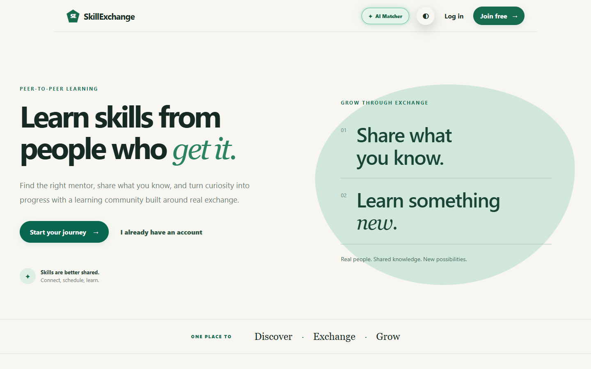
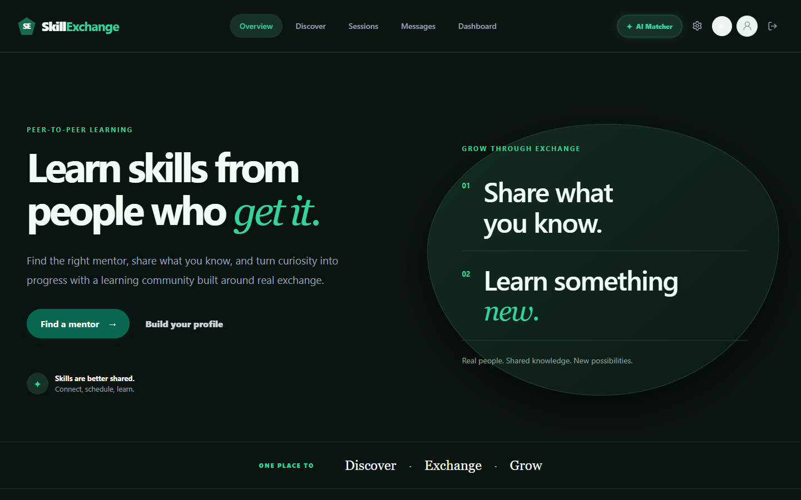
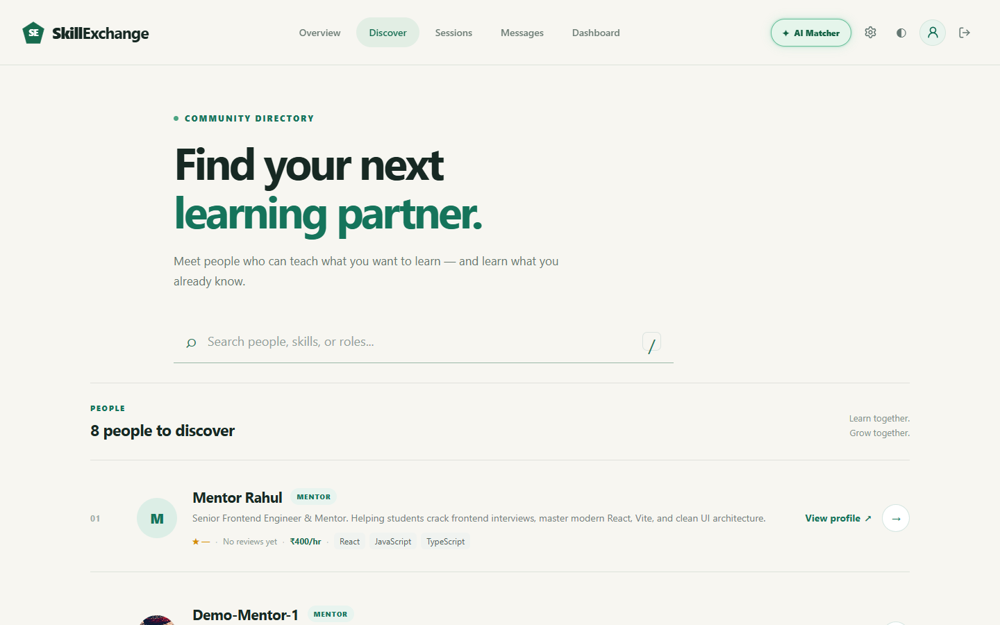
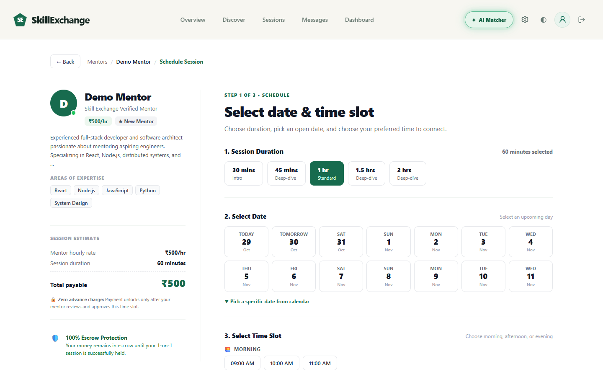
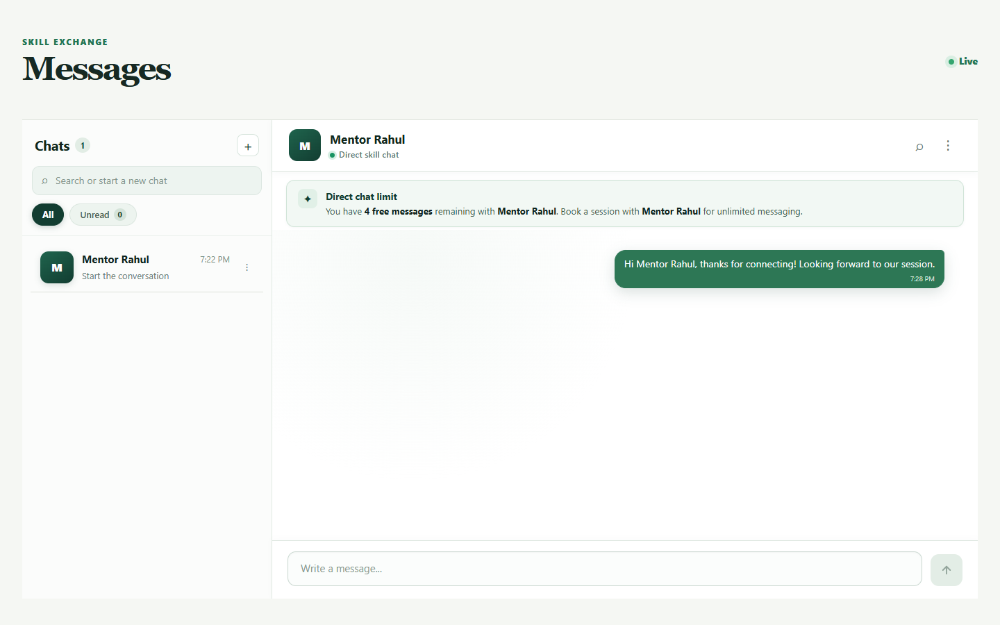
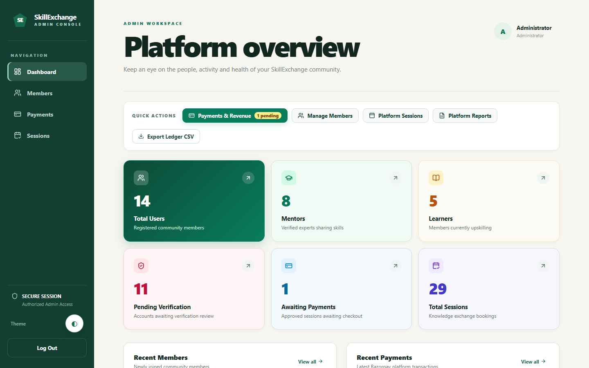
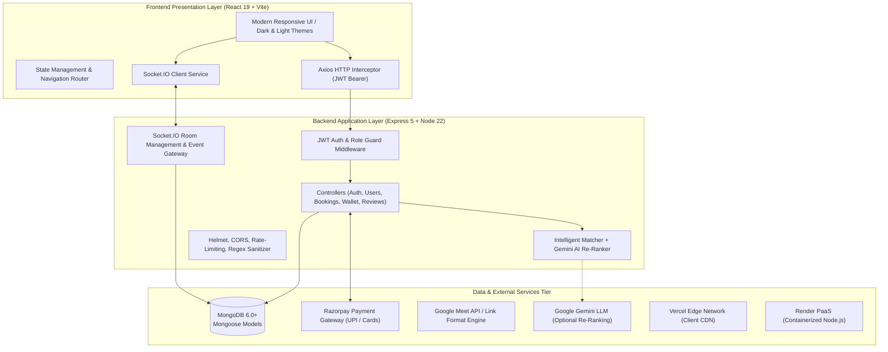

# Skill Exchange 🎓🤝

<div align="center">

[](https://react.dev/)
[](https://vitejs.dev/)
[](https://nodejs.org/)
[](https://expressjs.com/)
[](https://www.mongodb.com/)
[](https://socket.io/)
[](https://razorpay.com/)
[](#-testing--quality-assurance)
[](https://skill-exchange-one-eta.vercel.app/)
[](https://skill-exchange-o19g.onrender.com/)

**A peer-to-peer knowledge sharing and mentorship platform bridging the gap between learners and mentors through algorithmic discovery, interactive scheduling, real-time collaboration, and transparent financial workflows.**

[🚀 Explore Live Application](https://skill-exchange-one-eta.vercel.app/) • [⚡ Live API Health](https://skill-exchange-o19g.onrender.com/health) • [📖 Full Academic Documentation](PROJECT_DOCUMENTATION_REVISED.md) • [📊 Slide Deck](Skill_Exchange_Presentation.pptx)

</div>

---

## 🌟 Executive Summary

**Skill Exchange** is a full-stack, real-time collaborative web application designed to democratize 1-on-1 personalized mentorship. Rather than compartmentalizing users into rigid silos, Skill Exchange champions a **dual-identity architecture** where any user can learn a new skill while simultaneously teaching another from a single account.

The platform eliminates the friction of traditional tutoring (high commercial fees, fragmented communication channels, schedule conflicts, and unverified reviews) by integrating:
- **Intelligent Algorithmic Matching** enhanced with Google Gemini AI re-ranking.
- **Collaborative Session Lifecycle** with multi-slot negotiation and auto-expiry safeguards.
- **Fair & Transparent Financial Model** featuring 0% platform commission, Razorpay checkout, and an in-app dual-balance wallet.
- **Active-Session WebSocket Chat** combining limited exploratory discovery messages with auto-unlocked unlimited messaging during confirmed sessions.
- **Unified Light/Dark Visual System** with responsive mobile-first typography and iconography.

---

## 📸 Visual Showcase

<div align="center">

| Light Theme Overview | Dark Theme Mode |
| :---: | :---: |
|  |  |
| *Modern editorial landing page with clear CTA & metrics* | *Eye-friendly dark theme overhaul across all pages* |

| Mentor Discovery & Intelligent Search | Interactive Booking & Slot Counter-Offers |
| :---: | :---: |
|  |  |
| *Live filtering by skill, rating, and availability* | *Non-boxy interactive scheduling with alternate slots* |

| Real-Time Active-Session Chat | Administrative Moderation & Metrics |
| :---: | :---: |
|  |  |
| *Socket.IO chat rooms with typing indicators & unread counts* | *Platform analytics, user moderation, and audit logs* |

</div>

---

## 🚀 Key Features

### 👤 1. Unified User Identity & Profiles
- **Dual-Role Model**: Users can act as both **learners** and **mentors** under one account, sharing a unified wallet, profile, and message inbox.
- **Rich Profiles**: Define skills to teach, skills to learn, proficiency levels, hourly rate (including ₹0 for free community sessions), bio, and weekly availability tags.
- **Incremental Profile Saving**: Supports partial profile updates with client-side and server-side validation.
- **Circular Photo Lightbox**: Clean avatar viewing modal on public profile cards with high-resolution caching.

### 🔍 2. Algorithmic Discovery & Gemini AI Matching
- **Multi-Factor Scoring Engine**: Ranks mentor candidates using deterministic scoring across:
  - Skill normalization and synonym expansion (e.g., `React.js` ↔ `React`).
  - Learning objective text-token overlap with stop-word filtering.
  - Mutual availability schedule alignment (weekdays, weekends, evenings).
  - Historical review ratings and completed exchange volume.
- **Optional Gemini LLM Re-Ranking**: Dynamically evaluates candidate relevance against user learning goals using Google Gemini models, with graceful zero-dependency fallback.
- **Zero Hallucination Filter**: Never injects synthetic or demo mentors upon search misses or empty queries.

### 📅 3. Interactive Scheduling & Session Lifecycle
- **Slot Collision Detection**: Real-time validation prevents double-booking mentor availability.
- **Counter-Proposal Workflow**: Mentors can accept, decline with up to 3 alternate proposed time slots, or cancel requests.
- **4-Hour Request Expiration**: Unanswered booking requests automatically expire, releasing locked time slots.
- **Validated Video Meetings**: Generates and format-validates Google Meet room links, displayed directly on session status cards.

### 💳 4. 100% Transparent Financial Architecture
- **Zero Added Fees**: 0% platform fee, 0% convenience fee, and 0% application-level taxes. 100% of the session fee goes directly to the mentor.
- **Razorpay Payment Gateway**: Seamless checkout supporting UPI (Google Pay, PhonePe, Paytm), Credit/Debit Cards, and NetBanking with cryptographic HMAC-SHA256 signature verification.
- **In-App Skill Exchange Wallet**:
  - **Dual-Balance Accounting**: Segregates **Earned Balance** (withdrawable revenue from completed sessions) from **Top-Up Balance** (spendable balance loaded for sessions).
  - **Top-Up First Deduction**: Prioritizes spent balance before utilizing earned funds.
  - **Instant Transparent Receipts**: Itemized receipts for both booker and mentor upon session confirmation.

### 💬 5. Real-Time Collaboration & Session Gating
- **WebSocket Chat via Socket.IO**: Bidirectional low-latency messaging with persistent MongoDB storage.
- **Session-Gated Quota**: 
  - Allows a free conversational discovery quota for prospective connections.
  - Automatically unlocks **unlimited messaging** when a confirmed booking session is active.
- **Rich Message Interactions**: Real-time typing indicators, unread badge counters, edit history, and soft deletion.

### 🛡️ 6. Platform Administration & Governance
- **Comprehensive Admin Dashboard**: System health overview, total revenue throughput, session state distributions, and user growth curves.
- **User Moderation**: Suspend, activate, or update member profiles with strict privilege escalation prevention (admins cannot create fellow admins via public endpoints).
- **Audit Logging**: Immutable tracking of critical platform actions (logins, bookings, cancellations, suspensions).

---

## 🏗️ System Architecture

Skill Exchange follows a clean **3-Tier Client-Server Architecture** decoupled via RESTful APIs and asynchronous WebSocket event channels:



---

## 🛠️ Technology Stack

| Layer | Technology | Version | Purpose |
| :--- | :--- | :--- | :--- |
| **Frontend Framework** | React.js | `^19.2.7` | Virtual DOM, declarative component state, fast client-side rendering |
| **Build Tool** | Vite | `^8.1.5` | Instant Hot Module Replacement (HMR) and optimized Rollup production builds |
| **Styling & Icons** | Vanilla CSS + Lucide React | `^1.46.0` | Custom CSS variables, dark/light theme tokens, and accessible SVG iconography |
| **Runtime Environment** | Node.js | `v22.x` | Event-driven, non-blocking I/O runtime for scalable concurrent connections |
| **Web Framework** | Express.js | `^5.2.1` | REST API routing, request middleware pipelines, error handling |
| **Database** | MongoDB | `v6.0+` | Scalable NoSQL document database for flexible JSON structures |
| **Object Data Modeling** | Mongoose | `^9.9.1` | Schema typing, lifecycle hooks, and relational query population |
| **Real-Time Communication** | Socket.IO | `^4.8.3` | Low-latency duplex WebSocket connection with fallback transport |
| **Payment Gateway** | Razorpay SDK | `^2.9.8` | Secure payment capture, order generation, and HMAC-SHA256 signature verification |
| **Security & Auth** | JWT + Bcryptjs | `^9.0.3` / `^3.0.3` | Dual-token authentication (Access/Refresh) and salted password hashing |
| **Hosting & CDN** | Vercel & Render | Production | Vercel edge deployment for frontend; Render container for backend |

---

## 📂 Repository Structure

```
Skill-Exchange/
├── client/                              # React 19 Frontend Application
│   ├── public/                          # Static assets and favicons
│   ├── src/
│   │   ├── Components/                  # Modular reusable UI widgets
│   │   │   ├── NavigationBar.jsx        # Top bar with dynamic theme toggle & badges
│   │   │   ├── DarkModeToggle.jsx       # Theme state switcher
│   │   │   ├── BookingModal.jsx         # Non-boxy booking & slot counter-offer UI
│   │   │   ├── ChatWindow.jsx           # Real-time WebSocket messaging interface
│   │   │   ├── ReceiptModal.jsx         # Transparent session payout & cost receipts
│   │   │   └── ProtectedRoute.jsx       # Role-based route guard
│   │   ├── Pages/                       # Full page views
│   │   │   ├── HomePage.jsx             # Landing page with stats & hero section
│   │   │   ├── DiscoverPage.jsx         # Mentor catalog with real-time filters
│   │   │   ├── LearnerDashboard.jsx     # Learner booking timeline & session history
│   │   │   ├── MentorDashboard.jsx      # Mentor requests, earnings & schedule
│   │   │   ├── AdminDashboard.jsx       # Platform oversight, users & financial ledger
│   │   │   ├── ProfilePage.jsx          # Public and editable personal profile
│   │   │   ├── WalletPage.jsx           # Wallet top-up, payout records & balances
│   │   │   └── LoginPage.jsx / Signup   # Authentication workflows
│   │   ├── services/                    # API client services & unit tests
│   │   └── App.jsx                      # Root application component & routing
│   └── package.json
│
├── server/                              # Node.js & Express 5 API Application
│   ├── controllers/                     # Feature request handlers & business logic
│   │   ├── authController.js            # JWT login, refresh token rotation, logout
│   │   ├── bookingController.js         # Booking state machine, slots, Google Meet links
│   │   ├── paymentController.js         # Razorpay checkout, HMAC verification, ledger
│   │   ├── profileController.js         # Incremental profile updates, media caching
│   │   ├── reviewController.js          # Bidirectional 5-star rating system
│   │   └── adminController.js           # Platform analytics & account moderation
│   ├── models/                          # Mongoose data schemas
│   │   ├── User.js                      # Unified dual-role profile schema
│   │   ├── Booking.js                   # Booking lifecycle state & negotiation
│   │   ├── Conversation.js / Message.js # Socket.IO chat history schema
│   │   ├── Wallet.js / Transaction.js   # Dual-balance financial ledger
│   │   └── Review.js                    # Verified post-session reviews
│   ├── routes/                          # REST API endpoint definitions
│   ├── sockets/                         # Socket.IO room lifecycle & chat handlers
│   ├── scripts/                         # Database seed scripts (Admin, dummy data)
│   ├── tests/                           # Comprehensive backend test suite (52 tests)
│   └── server.js                        # HTTP + WebSocket server bootstrap
│
├── screenshots/                         # High-resolution application screenshots
├── PROJECT_DOCUMENTATION_REVISED.md     # Detailed academic project report
├── AUDIT_REPORT.md                      # Code audit, security & performance review
├── Skill_Exchange_Presentation.pptx     # 15-Slide project presentation deck
├── .env.example                         # Reference environment variables
└── README.md                            # Main project documentation
```

---

## ⚡ Quick Start & Local Setup

### Prerequisites
- [Node.js](https://nodejs.org/) (v20 or higher recommended, v22 LTS tested)
- [Git](https://git-scm.com/)
- [MongoDB](https://www.mongodb.com/) (Local instance running on `localhost:27017` or MongoDB Atlas URI)

### 1. Clone the Repository
```bash
git clone https://github.com/CosmicCoder06/Skill-Exchange.git
cd Skill-Exchange
```

### 2. Configure Backend Environment
Navigate to `server/` and create a `.env` file:
```bash
cd server
cp ../.env.example .env
```
Fill in the necessary values:
```env
PORT=5000
NODE_ENV=development
MONGO_URI=mongodb://127.0.0.1:27017/skill-exchange
CLIENT_URL=http://localhost:5173

# Security Secrets (Generate using `node -e "console.log(require('crypto').randomBytes(32).toString('hex'))"`)
JWT_ACCESS_SECRET=your_super_secret_access_jwt_key
JWT_REFRESH_SECRET=your_super_secret_refresh_jwt_key

# Default Administrator Seed Account
ADMIN_NAME=Platform Administrator
ADMIN_EMAIL=admin@skillexchange.com
ADMIN_PASSWORD=AdminSecurePassword123!

# Razorpay Configuration (Optional for mock wallet mode, required for live payments)
RAZORPAY_KEY_ID=rzp_test_yourKeyId
RAZORPAY_KEY_SECRET=yourRazorpaySecret

# Optional AI Re-Ranking
GEMINI_API_KEY=your_gemini_api_key
```

### 3. Install Dependencies & Seed Admin
```bash
# In the /server directory:
npm install

# Seed the configured administrator account:
node scripts/seedAdmin.js
```

### 4. Configure Frontend Environment
In a new terminal window, navigate to `client/` and configure `.env`:
```bash
cd ../client
```
Create `client/.env`:
```env
VITE_API_URL=http://localhost:5000/api
VITE_SOCKET_URL=http://localhost:5000
```
Install frontend dependencies:
```bash
npm install
```

### 5. Run the Application
```bash
# Terminal 1: Run Backend API (from /server)
npm run dev

# Terminal 2: Run Frontend Vite Server (from /client)
npm run dev
```

Open your browser at **`http://localhost:5173`**. The backend will be actively serving requests at **`http://localhost:5000`**.

---

## 🧪 Testing & Quality Assurance

Skill Exchange features an automated unit test suite covering authentication guards, matching algorithms, booking state transitions, Razorpay signature verification, wallet ledger math, and frontend search caching.

```bash
# Run Backend Test Suite (52 unit tests)
npm test --prefix server

# Run Frontend Service Test Suite (6 unit tests)
npm test --prefix client

# Run Frontend Production Build & Bundle Verification
npm run build --prefix client
```

### Test Suite Execution Summary
```
Backend Suite (Node Native Test Runner):
  ✔ 52/52 tests passing (0 failing, 0 skipped)
  ✔ Execution Duration: ~1.08s
  ✔ Key coverage: Razorpay HMAC checks, 0% platform fee calculations,
    slot overlap detection, dual-balance wallet math, Gemini fallback.

Frontend Suite:
  ✔ 6/6 tests passing (0 failing, 0 skipped)
  ✔ Key coverage: Search term casing, rate limit 429 backoff, 
    zero-hallucination mentor mappings.

Production Client Build:
  ✔ Transformed 2,030 modules with Vite 8.1 / Rollup
  ✔ Optimized production bundles created in ~3.3s with Gzip compression.
```

---

## 📡 REST API Reference

All protected endpoints require an `Authorization: Bearer <token>` HTTP header.

### Authentication & Sessions
| Method | Endpoint | Access | Description |
| :--- | :--- | :--- | :--- |
| `POST` | `/api/registration/api` | Public | Register a new user account (learner or mentor) |
| `POST` | `/api/loginRoute/api` | Public | Authenticate credentials and receive access + refresh tokens |
| `POST` | `/api/auth/refresh` | Public | Rotate refresh token and issue a fresh access token |
| `POST` | `/api/auth/logout` | Authenticated | Revoke refresh token and invalidate session |

### Profiles & Mentor Discovery
| Method | Endpoint | Access | Description |
| :--- | :--- | :--- | :--- |
| `GET` | `/api/profile/me` | Authenticated | Fetch authenticated user's profile and settings |
| `PUT` | `/api/profile/update` | Authenticated | Incremental partial update of profile information |
| `GET` | `/api/profile/:id` | Authenticated | View public profile of a specific community member |
| `GET` | `/api/mentors` | Authenticated | Search & filter mentors with algorithmic candidate ranking |

### Bookings & Scheduling
| Method | Endpoint | Access | Description |
| :--- | :--- | :--- | :--- |
| `POST` | `/api/bookings` | Authenticated | Submit a session booking request for a time slot |
| `GET` | `/api/bookings` | Authenticated | List all bookings where the user is learner or mentor |
| `GET` | `/api/bookings/requests` | Mentor | View incoming booking requests requiring mentor action |
| `PUT` | `/api/bookings/:id` | Authenticated | Accept, reject, or propose up to 3 alternate slots |
| `DELETE` | `/api/bookings/:id` | Authenticated | Cancel a pending or upcoming booking |

### Payments & Wallet
| Method | Endpoint | Access | Description |
| :--- | :--- | :--- | :--- |
| `GET` | `/api/wallet/balance` | Authenticated | Retrieve available Top-Up and Earned wallet balances |
| `POST` | `/api/wallet/topup` | Authenticated | Instant simulation of wallet credit top-up |
| `POST` | `/api/payments/razorpay/create-order` | Authenticated | Initialize an order via Razorpay API |
| `POST` | `/api/payments/razorpay/verify` | Authenticated | Cryptographic HMAC validation of payment completion |
| `GET` | `/api/wallet/transactions` | Authenticated | Itemized audit ledger of credits, debits, and payouts |

### Real-Time Chat & Reviews
| Method | Endpoint | Access | Description |
| :--- | :--- | :--- | :--- |
| `GET` | `/api/conversations` | Authenticated | List active user conversations with unread indicators |
| `GET` | `/api/conversations/:id/messages` | Authenticated | Fetch paginated chat history for a conversation |
| `PATCH` | `/api/conversations/:id/read` | Authenticated | Mark conversation messages as read |
| `POST` | `/api/reviews` | Authenticated | Submit verified 5-star rating for completed session |
| `GET` | `/api/reviews/user/:userId` | Authenticated | Fetch all public reviews for a member |

### Platform Administration
| Method | Endpoint | Access | Description |
| :--- | :--- | :--- | :--- |
| `GET` | `/api/admin/overview` | Admin Only | Platform statistics, total revenue, session distribution |
| `GET` | `/api/admin/users` | Admin Only | Search, filter, and inspect user accounts |
| `PATCH`| `/api/admin/users/:id` | Admin Only | Moderate user status (active/suspended) |
| `GET` | `/api/activity-logs` | Admin Only | Immutable system-wide audit activity stream |

---

## 🔌 Socket.IO Event Specification

| Event Name | Direction | Payload | Description |
| :--- | :--- | :--- | :--- |
| `join_conversation` | Client ➔ Server | `{ conversationId }` | User joins dedicated conversation room |
| `leave_conversation` | Client ➔ Server | `{ conversationId }` | User leaves conversation room |
| `send_message` | Client ➔ Server | `{ conversationId, content }` | Dispatches new chat message |
| `receive_message` | Server ➔ Client | `{ message }` | Broadcasts message to room participants |
| `typing_start` | Client ➔ Server | `{ conversationId, userId }` | Broadcasts active typing indicator |
| `typing_stop` | Client ➔ Server | `{ conversationId, userId }` | Clears active typing indicator |
| `message_updated` | Server ➔ Client | `{ messageId, content }` | Dispatches real-time edited message |
| `message_deleted` | Server ➔ Client | `{ messageId }` | Dispatches soft-deleted message notice |
| `messages_read` | Server ➔ Client | `{ conversationId, readerId }` | Emits read receipts for sent messages |

---

## 🔒 Security & Performance Features

- **Dual-Token Authentication**: Short-lived Access Tokens (15 min) paired with strictly rotated Refresh Tokens stored securely.
- **Password Salting**: Salted `bcryptjs` hashing with work factor 10 prevents dictionary and rainbow-table compromises.
- **Strict Role Boundaries**: Admin endpoints enforce server-level role verification (`role === 'admin'`). Privilege escalation attacks are explicitly rejected.
- **Cryptographic Signature Verification**: Razorpay order payments are validated using `crypto.timingSafeEqual` over HMAC-SHA256 digests to protect against timing attacks.
- **Sanitized Media Storage**: Automatic conversion and caching of oversized data-URIs into URL-backed static endpoints with gzip compression.
- **SQL / NoSQL Injection Immunity**: Mongoose schema sanitization combined with `escapeRegex` safeguards on user search inputs.

---

## 👥 Authors & Academic Credits

Skill Exchange was developed as a comprehensive engineering project at **GLA University, Mathura**:

- **Institution**: Department of Computer Engineering & Applications, GLA University
- **Academic Program**: Bachelor of Technology (B.Tech) in Computer Science & Engineering
- **Team**: Group 13
- **Live Deployed Frontend**: [https://skill-exchange-one-eta.vercel.app/](https://skill-exchange-one-eta.vercel.app/)
- **Live Deployed API**: [https://skill-exchange-o19g.onrender.com/](https://skill-exchange-o19g.onrender.com/)

---

## 📜 License

This project is licensed under the [MIT License](LICENSE) for educational and collaborative development.
